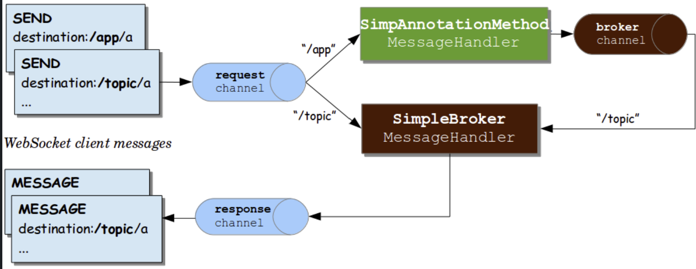
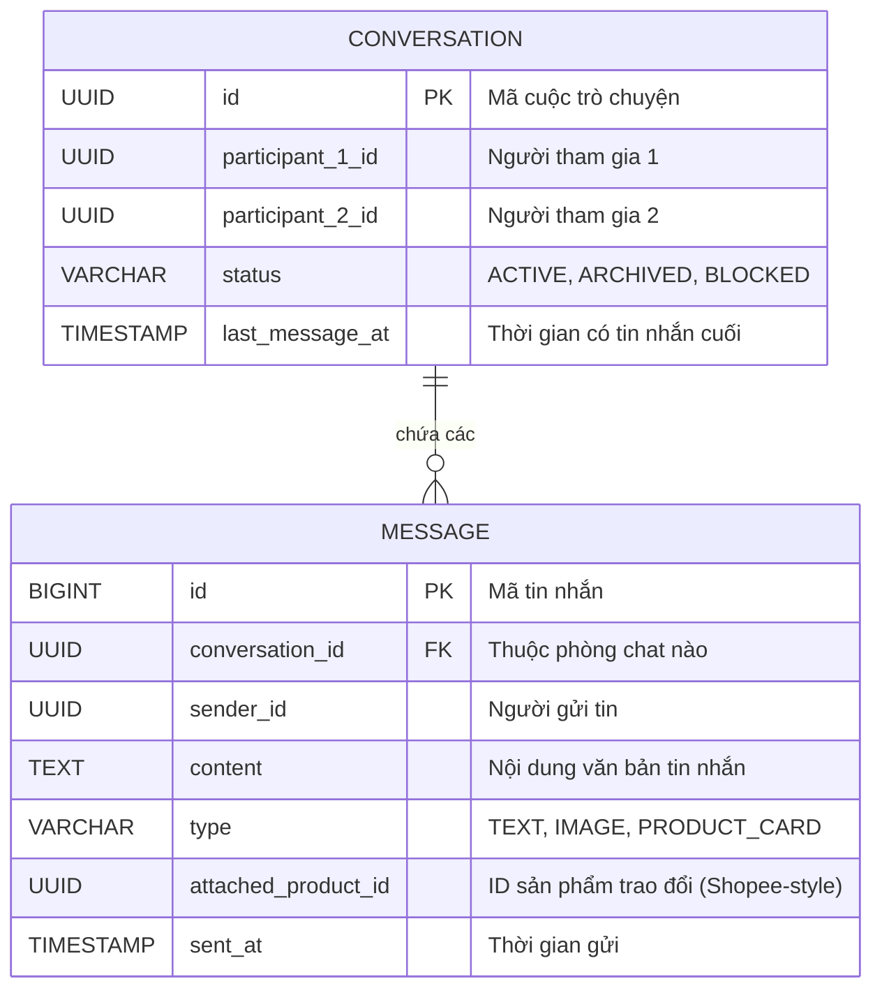
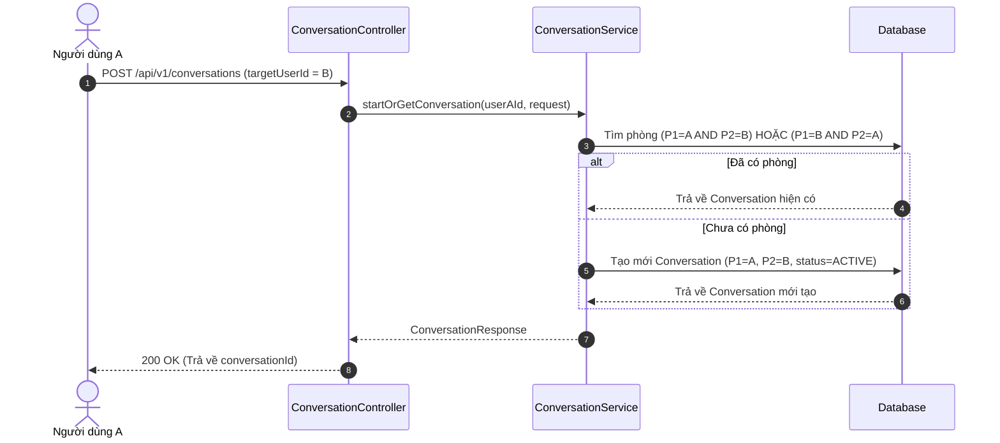
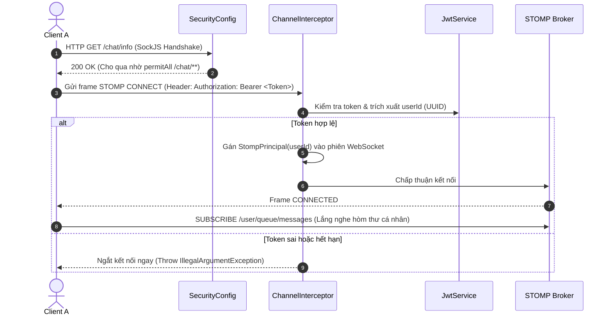
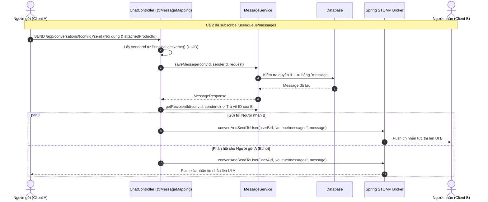

# Kiến trúc Chat Module (Moldy Market)

---

**Dự án:** Moldy Market — Marketplace C2C Đồ cũ  
**Module:** `com.moldy.moldymarket.chat`  
**Chức năng:** Nhắn tin trực tiếp 1-1 thời gian thực, quản lý hộp thư (Inbox), xem lịch sử và đính kèm thẻ sản phẩm đàm phán giá.

---

## 1. Tổng quan

```
Client (Ứng dụng / Trình duyệt)
   ├── [HTTP REST API]      → Giống như đến Bưu điện tra cứu danh bạ & xem thư cũ
   └── [WebSocket STOMP]    → Giống như nhấc máy gọi điện thoại, nói một câu là bên kia nghe ngay
```

* **Tại sao không dùng một loại duy nhất?**
  - Không ai giữ máy điện thoại thông suốt ngày đêm chỉ để lật xem từng lá thư cũ trong quá khứ.
  - Vì vậy: Các việc tĩnh như **tải danh sách hộp thư** hay **tải lịch sử tin nhắn** dùng **REST API** (nhanh, nhẹ, tiết kiệm tài nguyên).
  - Việc trò chuyện tức thì 2 bên cần nhận được ngay trong tích tắc (dưới 1 giây) thì dùng **WebSocket STOMP**.

---

## 2. Luồng Định tuyến Nội bộ của Spring STOMP Broker 



```
[WebSocket Client]
       │
       ▼
[Request Channel (clientInboundChannel)]  ──► Đón đầu, kiểm tra JWT qua ChannelInterceptor
       │
       ├──────────────────────────────────────────┐
       ▼ (Gửi tới: /app/...)                      ▼ (Gửi tới: /topic/...)
[SimpAnnotationMethodMessageHandler]       [SimpleBroker MessageHandler]
(Gọi ChatController để lưu CSDL)          (Bỏ qua CSDL, phát tán ngay)
       │                                          │
       ▼ (gọi convertAndSendToUser)               │
[Broker Channel]                                  │
       │                                          │
       ▼                                          ▼
[SimpleBroker MessageHandler] ────────────► [Response Channel]
(Tìm session của người nhận)               (Đẩy frame MESSAGE xuống Client)
```

### Bóc tách 2 Con đường Định tuyến trong Hệ thống:

#### Con đường 1: Gửi tới `/app/...` — Dự án đang sử dụng
1. **Client gửi tin:** Client bấm gửi tới địa chỉ `/app/conversations/{id}/send`.
2. **Đi vào `Request Channel` (`clientInboundChannel`):** Ống đón đầu mọi tin nhắn. Tại đây `ChannelInterceptor` chặn lại để kiểm tra vé vào cổng (Token JWT).
3. **Rẽ vào `SimpAnnotationMethodMessageHandler` (Khối màu xanh lá):**
   - Tiền tố `/app` báo hiệu cho Spring biết đây là tin nhắn **cần xử lý logic**.
   - Spring tìm đến `@MessageMapping` trong `ChatController` để kiểm tra: *Người gửi có thuộc cuộc trò chuyện này không?* và **Lưu tin nhắn vào PostgreSQL**.
4. **Bàn giao qua `Broker Channel` (Ống màu nâu):**
   - Sau khi lưu CSDL an toàn, Controller gọi `simpMessagingTemplate.convertAndSendToUser(...)` để đưa tin nhắn đã lưu vào ống `broker channel`.
5. **Vào `SimpleBroker MessageHandler` (Khối màu nâu):**
   - "Bưu điện" nội bộ của Spring tìm kiếm trong danh bạ xem Người nhận (và Người gửi) đang mở kết nối ở đâu.
6. **Đẩy qua `Response Channel` & Tới Client:**
   - Đóng gói dữ liệu thành khung STOMP `MESSAGE` và đẩy thẳng xuống màn hình người nhận qua kết nối WebSocket.

#### Con đường 2: Nhánh Phát tán Trực tiếp (Gửi tới `/topic/...`) — Bỏ qua Controller
* Nếu Client gửi thẳng tới `/topic/...`, tin nhắn đi thẳng vào `SimpleBroker` rồi bắn ra cho mọi người mà **không lưu vào CSDL, không kiểm tra quyền**. Ví dụ: đang gõ phím, thả tim tiktok(thả tim liên tục),...
* **Lý do dự án Chat bắt buộc đi theo Con đường 1 (`/app`):** Để đảm bảo tin nhắn không bao giờ bị mất khi người dùng tải lại trang và ngăn chặn người xấu mạo danh ID người khác để gửi tin rác.

---

## 3. Cấu trúc Cơ sở Dữ liệu (Database ERD)



* **Hai nguyên tắc thiết kế cốt lõi:**
  1. **1 phòng duy nhất giữa 2 người (Unified Single Room):** Dù A và B hỏi mua 10 sản phẩm khác nhau, giữa 2 người vẫn chỉ có **1 phòng chat duy nhất** (tìm kiếm 2 chiều: P1=A, P2=B hoặc P1=B, P2=A).
  2. **Đính kèm sản phẩm vào tin nhắn (`attached_product_id`):** ID món hàng được gắn trực tiếp vào tin nhắn thay vì phòng chat, giúp hiển thị thẻ sản phẩm (Product Card) đúng ngữ cảnh lúc đàm phán giá.

---

## 4. Chi tiết Các Luồng Nghiệp vụ & Luồng Code (Workflows)

### Workflow 1: Khởi tạo hoặc Lấy phòng chat (REST)
Chạy khi người dùng bấm nút "Chat với người bán" trên trang chi tiết sản phẩm.



* **Code thực thi chính:**
  - `ConversationController.startConversation`: Nhận `targetUserId`.
  - `ConversationService.startOrGetConversation`: Kiểm tra và trả về phòng chat sẵn có hoặc tạo mới.

---

### Workflow 2: Kết nối & Xác thực WebSocket (STOMP Connect)
Trước khi gửi tin, ứng dụng mở kết nối WebSocket và gửi kèm JWT Token để chứng minh danh tính.



---

### Workflow 3: Gửi và Nhận tin nhắn Real-time (STOMP Send & Receive)
Chu trình từ lúc bấm gửi tin nhắn đến khi người nhận nhìn thấy trên màn hình.



* **Code Controller xử lý:**
  ```java
  @MessageMapping("/conversations/{conversationId}/send")
  public void sendMessage(@DestinationVariable UUID conversationId, 
                          @Payload SendMessageRequest request, 
                          Principal principal) {
      UUID senderId = UUID.fromString(principal.getName());
      MessageResponse saved = messageService.saveMessage(conversationId, senderId, request);
      UUID recipientId = messageService.getRecipientId(conversationId, senderId);

      // Gửi cho người nhận & gửi lại xác nhận cho người gửi
      simpMessagingTemplate.convertAndSendToUser(recipientId.toString(), "/queue/messages", saved);
      simpMessagingTemplate.convertAndSendToUser(senderId.toString(), "/queue/messages", saved);
  }
  ```

---

### Workflow 4: Xem Hộp thư (Inbox) & Lịch sử tin nhắn (REST)
* **Xem danh sách Inbox:** Gọi `GET /api/v1/conversations` → Lấy danh sách các cuộc trò chuyện của tôi, sắp xếp theo thời gian tin nhắn mới nhất giảm dần.
* **Xem lịch sử tin nhắn:** Gọi `GET /api/v1/conversations/{id}/messages?page=0&size=20` → Phân trang lịch sử chat từ mới nhất ngược dần về quá khứ.

---

## 5. Danh sách Endpoint & Định tuyến

### 5.1. REST API
| Phương thức | Đường dẫn | Chức năng | Quyền hạn |
|---|---|---|---|
| `POST` | `/api/v1/conversations` | Bắt đầu hoặc lấy phòng chat với người dùng khác | User đăng nhập |
| `GET` | `/api/v1/conversations` | Lấy danh sách hộp thư đến (Inbox) của tôi | User đăng nhập |
| `GET` | `/api/v1/conversations/{id}/messages` | Tải lịch sử tin nhắn có phân trang | Thành viên phòng chat |

### 5.2. WebSocket STOMP
| Kênh / Địa chỉ | Loại | Ý nghĩa |
|---|---|---|
| `/chat` | Endpoint | Điểm kết nối bắt tay ban đầu (có SockJS) |
| `/app/conversations/{id}/send` | Send Destination | Client gửi tin nhắn lên server xử lý nghiệp vụ |
| `/user/queue/messages` | Subscribe Queue | Client lắng nghe tin nhắn cá nhân được server đẩy về |

---

## 6. Phân tích Chi tiết Các Lưu ý Kỹ thuật Cốt lõi 

### Lưu ý 1: Tại sao phải `permitAll` cho `/chat/**` ở `SecurityConfig`?
* **Cách hiểu đơn giản:** Giống như cho khách đi qua cổng chung của tòa nhà (HTTP Handshake) trước, rồi mới vào từng phòng riêng kiểm tra căn cước công dân (STOMP CONNECT).
* **Vấn đề kỹ thuật:** Lệnh mở kết nối WebSocket ban đầu của trình duyệt (`new SockJS('/chat')`) **không thể tự chèn custom header** `Authorization: Bearer <token>`. Nếu chặn ở Spring Security, request sẽ bị trả về mã `401 Unauthorized` kèm lỗi CORS.
* **Giải pháp Code:**
    ```java
    // SecurityConfig.java
    public SecurityFilterChain filterChain(HttpSecurity http) throws Exception {
    http.authorizeHttpRequests(auth -> auth
    .requestMatchers("/chat/**").permitAll() // Handshake thành công
    .anyRequest().authenticated()
    );
    return http.build();
    }
    ```

---

### Lưu ý 2: Cơ chế xác thực tại `ChannelInterceptor` (Frame `CONNECT`)
* **Cách hiểu đơn giản:** Khi khách đã vào cửa và bắt đầu nói câu chào đầu tiên ("Tôi muốn kết nối"), đây là lúc ta bắt buộc khách phải trình vé VIP (JWT Token).
* **Vấn đề kỹ thuật:** Khi kết nối WebSocket đã mở, Client gửi frame STOMP `CONNECT`. Thư viện STOMP lúc này mới có thể đính kèm header chứa token.
* **Giải pháp Code:** Bắt giữ frame `CONNECT` ngay tại `Request Channel` (`clientInboundChannel`):
  ```java
  @Override
    public void configureClientInboundChannel(ChannelRegistration registration){
        registration.interceptors(new ChannelInterceptor() {
            @Override
            public @Nullable Message<?> preSend(Message<?> message, MessageChannel channel) {
                StompHeaderAccessor accessor = MessageHeaderAccessor.getAccessor(message, StompHeaderAccessor.class);
                if(accessor != null && StompCommand.CONNECT.equals(accessor.getCommand())){
                    String authHeader = accessor.getFirstNativeHeader("Authorization");

                    if(authHeader == null || !authHeader.startsWith("Bearer ")) {
                        throw new IllegalArgumentException("No bearer token found in CONNECT headers!");
                    }

                    String token = authHeader.substring(7);

                    try{
                        if(jwtService.isTokenValid(token)){
                            UUID userId = jwtService.extractUserId(token);

                            accessor.setUser(new StompPrincipal(userId.toString()));
                            log.info("Successfully authenticated WebSocket connection for user: {}", userId);
                        }
                        else{
                            log.error("Token validation failed for token: {}", token);
                            throw new IllegalArgumentException("Token is invalid or expired");
                        }
                    }catch (Exception e){
                        log.error("Critical auth error in WebSocket: ", e);
                        throw new IllegalArgumentException("Authentication failed: " + e.getMessage());
                    }
                }
                return message;
            }
        });
    }
  ```

---

### Lưu ý 3: Tại sao bắt buộc dùng `StompPrincipal(userId)` thay vì Principal mặc định?
* **Cách hiểu đơn giản (Vấn đề "Thư gửi nhầm tên"):**
  - Hệ thống bảo bưu tá: *"Hãy gửi thư này cho người có mã căn cước là `123e4567-...`"*.
  - Nhưng trên hòm thư của người nhận, bưu tá mặc định lại dán nhãn bằng Email (`hoangdev10@gmail.com`).
  - Hậu quả: Bưu tá tìm không thấy hòm thư nào tên là `123e4567-...`, nên **vứt lá thư đi trong im lặng (Silent drop)**!
* **Vấn đề kỹ thuật:** Hàm `convertAndSendToUser(recipientId.toString(), ...)` tìm kiếm session có `Principal.getName()` trùng khớp với tham số truyền vào. Mặc định Spring Security dùng `UserDetails.getUsername()` (trả về email).
* **Giải pháp Code:** Tạo class `StompPrincipal` tùy chỉnh chứa chuỗi UUID để tên session trên Broker trùng khớp 100% với UUID của người dùng:
  ```text
  // 1. Định nghĩa StompPrincipal (StompPrincipal.java)
  public record StompPrincipal(String name) implements Principal {
      @Override public String getName() { return name; }
  }

  // 2. Trong WebSocketConfig: Gán userId làm tên phiên WebSocket
  UUID userId = jwtService.extractUserId(token);
  accessor.setUser(new StompPrincipal(userId.toString()));
  ```
  Nhờ đó, khi Controller gọi `convertAndSendToUser(recipientId.toString())`, Spring tìm thấy đúng chính xác session của người nhận ngay lập tức!

## 7. Mở rộng
Tích hợp Web Push API để tin nhắn có thể được gửi đến người nhận kể cả khi tắt tab hay trình duyệt.

