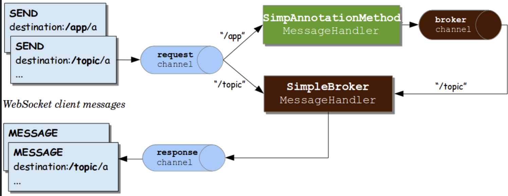
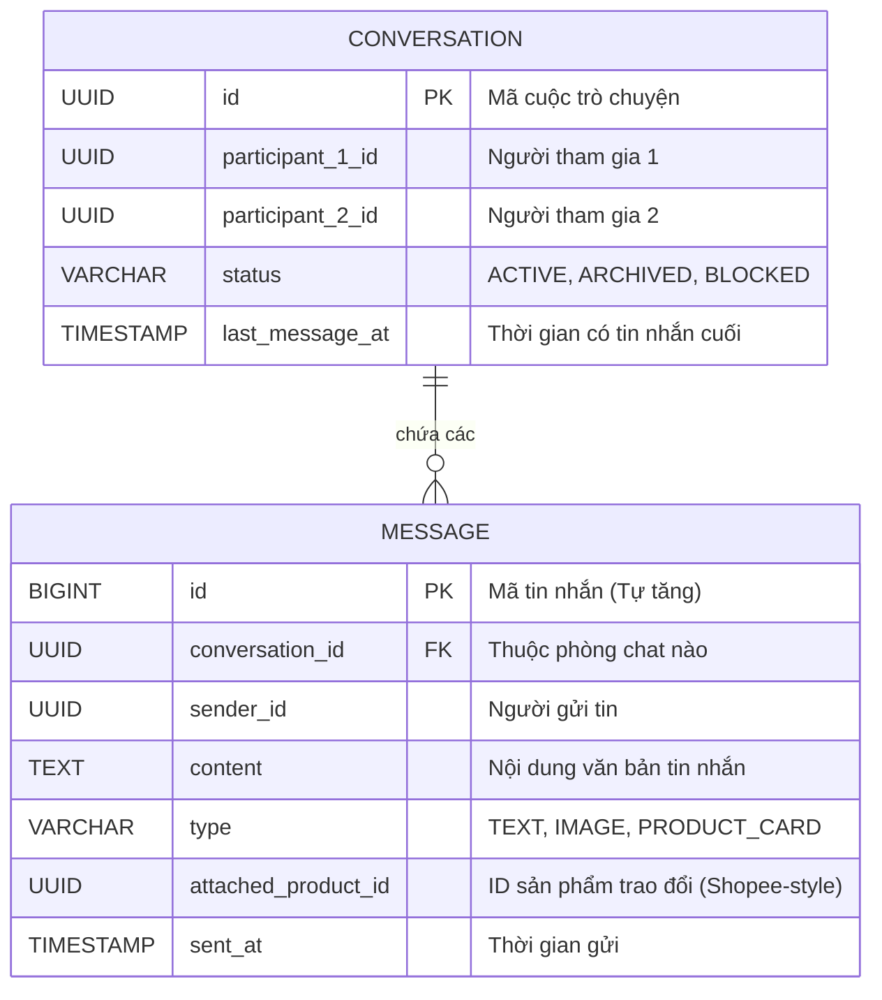
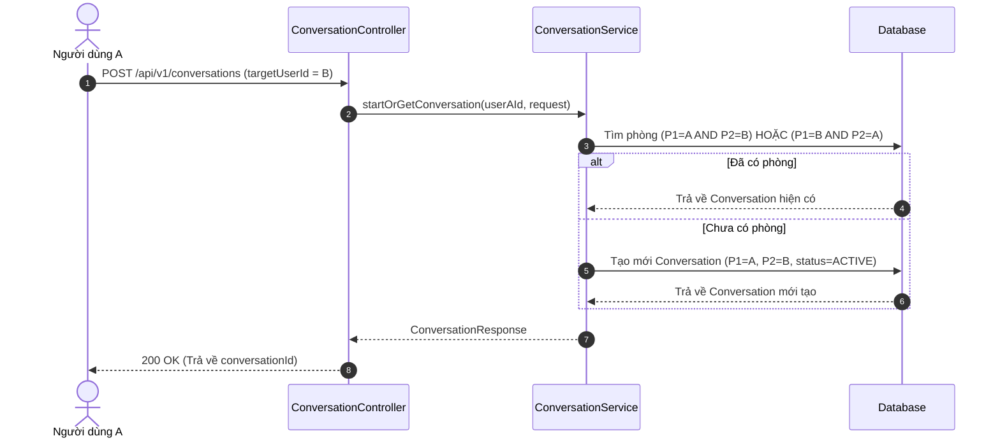
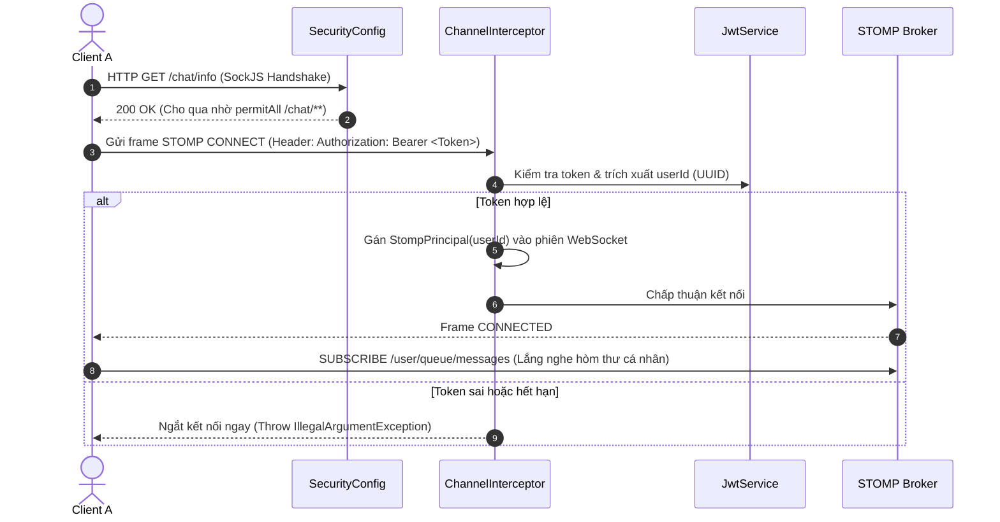
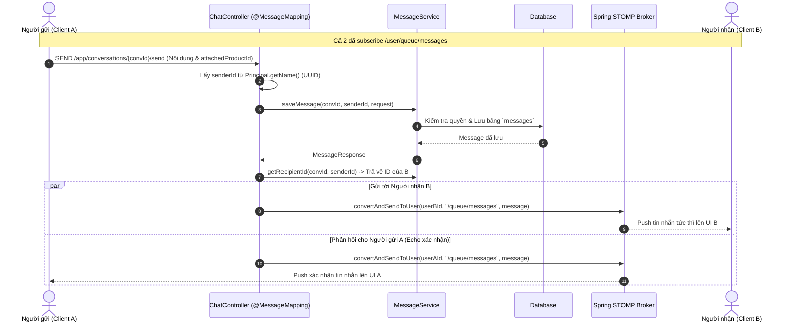

# Kiến trúc Chat Module (Real-time Messaging)
---

## 1. Tổng quan

Module Chat trong Moldy-Market là kênh giao tiếp trực tiếp giữa Người mua (Buyer) và Người bán (Seller), phục vụ các mục đích cốt lõi của sàn C2C: hỏi đáp tình trạng đồ cũ, đàm phán giá cả, hẹn địa điểm giao dịch (meetup), và gửi liên kết xem nhanh sản phẩm.

Hệ thống áp dụng mô hình **Hybrid (Lai giữa HTTP REST và WebSocket STOMP)**:

```
Client (Ứng dụng Web)
   ├── [HTTP REST API]      → Tra cứu tĩnh: Danh bạ hộp thư (Inbox) & Lịch sử tin nhắn cũ
   └── [WebSocket STOMP]    → Giao tiếp tức thì: Bắt tay, đẩy và nhận tin nhắn hai chiều (< 1 giây)
```

* **Lý do không dùng một giao thức duy nhất:**
  - Không duy trì kết nối WebSocket liên tục chỉ để phân trang đọc lại tin nhắn từ vài tháng trước (gây lãng phí băng thông và RAM trên server).
  - Vì vậy: Dữ liệu tĩnh như **tải danh sách cuộc trò chuyện** hoặc **tải lịch sử tin nhắn theo trang** sử dụng **REST API** (nhanh, nhẹ, tận dụng HTTP caching).
  - Ngược lại, việc gửi nhận tin nhắn thời gian thực đòi hỏi độ trễ cực thấp (< 500ms) thì bắt buộc dùng **WebSocket kết hợp STOMP**.

---

## 2. Phân tích Luồng Hoạt động Tổng quát của Module (Internal Routing Flow)



Hệ thống sử dụng cơ chế **STOMP over WebSocket** tích hợp sẵn trong Spring Framework. Toàn bộ thông điệp được định tuyến thông qua các kênh (Channels) và bộ xử lý nội bộ:

```
[WebSocket Client]
       │
       ▼
[Request Channel (clientInboundChannel)]  ──► Đón đầu, kiểm tra JWT qua ChannelInterceptor
       │
       ├──────────────────────────────────────────┐
       ▼ (Gửi tới: /app/...)                      ▼ (Gửi tới: /topic/...)
[SimpAnnotationMethodMessageHandler]       [SimpleBroker MessageHandler]
(Gọi ChatController để lưu CSDL)          (Bỏ qua CSDL, phát tán ngay)
       │                                          │
       ▼ (gọi convertAndSendToUser)               │
[Broker Channel]                                  │
       │                                          │
       ▼                                          ▼
[SimpleBroker MessageHandler] ────────────► [Response Channel]
(Tìm session của người nhận theo Principal)   (Đẩy frame MESSAGE xuống Client)
```

### Phân tích 2 Con đường Định tuyến Nội bộ:

#### Con đường 1: Gửi tới `/app/...` — Luồng nghiệp vụ chính của sàn
1. **Client gửi tin:** Client phát frame `SEND` tới địa chỉ `/app/conversations/{id}/send`.
2. **Đi vào `Request Channel` (`clientInboundChannel`):** Ống đón đầu mọi tin nhắn. Tại đây, `ChannelInterceptor` chặn lại để kiểm tra "vé vào cổng" (JWT Token).
3. **Rẽ vào `SimpAnnotationMethodMessageHandler`:**
   - Tiền tố `/app` báo hiệu cho Spring biết đây là tin nhắn **cần xử lý logic nghiệp vụ**.
   - Spring tìm đến `@MessageMapping` trong `ChatController` để: xác thực danh tính người gửi, kiểm tra quyền tham gia phòng, và **lưu tin nhắn vào PostgreSQL**.
4. **Bàn giao qua `Broker Channel`:**
   - Sau khi ghi CSDL thành công, Controller gọi `simpMessagingTemplate.convertAndSendToUser(...)` để đưa tin nhắn đã lưu vào ống `Broker Channel`.
5. **Vào `SimpleBroker MessageHandler`:**
   - "Bưu điện" nội bộ của Spring tra cứu trong danh bạ phiên kết nối xem Người nhận (và Người gửi) đang mở kết nối ở đâu dựa trên `StompPrincipal(userId)`.
6. **Đẩy qua `Response Channel` & Tới Client:**
   - Đóng gói dữ liệu thành khung STOMP `MESSAGE` và đẩy thẳng xuống màn hình người nhận qua kết nối WebSocket (`/user/queue/messages`).

#### Con đường 2: Nhánh Phát tán Trực tiếp (Gửi tới `/topic/...`) — Bỏ qua Controller
* Nếu Client gửi trực tiếp tới `/topic/...`, tin nhắn đi thẳng vào `SimpleBroker` rồi broadcast cho tất cả người nghe mà **không lưu vào CSDL, không kiểm tra quyền**. (Phù hợp cho: chỉ báo đang soạn tin `typing...`, thả tim real-time).
* **Lý do tin nhắn chat bắt buộc đi qua Con đường 1 (`/app`):** Để đảm bảo tin nhắn không bao giờ bị mất khi người dùng reload trang và ngăn chặn kẻ xấu mạo danh ID người khác để gửi tin rác.

---

## 3. Cấu trúc Cơ sở Dữ liệu (Database ERD & Schema)



### Bảng Chi tiết Schema:

#### 1. Bảng `conversations` (Lưu thông tin phòng chat)
| Tên cột | Kiểu dữ liệu | Ràng buộc | Ý nghĩa |
|---|---|---|---|
| `id` | `UUID` | PK | Mã định danh phòng chat. |
| `participant_1_id` | `UUID` | NOT NULL | ID của người tham gia thứ nhất. |
| `participant_2_id` | `UUID` | NOT NULL | ID của người tham gia thứ hai. |
| `status` | `VARCHAR(30)` | NOT NULL | Enum: `ACTIVE`, `ARCHIVED`, `BLOCKED`. |
| `last_message_at` | `TIMESTAMP` | NULL | Thời điểm gửi tin nhắn gần nhất (dùng để sắp xếp Inbox). |

#### 2. Bảng `messages` (Lưu từng tin nhắn)
| Tên cột | Kiểu dữ liệu | Ràng buộc | Ý nghĩa |
|---|---|---|---|
| `id` | `BIGINT` | PK, AUTO_INCREMENT | Mã tin nhắn. |
| `conversation_id` | `UUID` | FK → `conversations.id` | Phòng chat chứa tin nhắn này. |
| `sender_id` | `UUID` | NOT NULL | Người gửi tin nhắn. |
| `content` | `TEXT` | NULL | Nội dung văn bản (có thể null nếu chỉ gửi ảnh/card). |
| `type` | `VARCHAR(30)` | NOT NULL | Enum: `TEXT`, `IMAGE`, `PRODUCT_CARD`. |
| `attached_product_id` | `UUID` | NULL | ID của sản phẩm đang được nhắc tới (Shopee-style). |
| `sent_at` | `TIMESTAMP` | NOT NULL | Thời điểm lưu tin nhắn. |

---

## 4. Những Nguyên tắc Biên (Boundary Principles & Guardrails)

Trong quá trình vận hành hệ thống chat thực tế, hệ thống bắt buộc áp dụng các nguyên tắc biên sau:

1. **Chặn tự chat với chính mình (Self-Chat Prevention):**
   - Không cho phép người dùng mở cuộc trò chuyện với chính ID của mình (`currentUserId.equals(request.targetUserId())`).
2. **Quy tắc Một Phòng Duy Nhất (Single Unified Room):**
   - Giữa 2 người dùng (A và B) chỉ tồn tại duy nhất **1 phòng chat**. Dù người mua hỏi về 10 món đồ khác nhau, hệ thống vẫn tái sử dụng phòng chat cũ.
   - Truy vấn đối xứng 2 chiều: `(participant1 = A AND participant2 = B) OR (participant1 = B AND participant2 = A)`.
3. **Quyền riêng tư thành viên (Membership Isolation):**
   - Chỉ người trong cuộc (`senderId.equals(p1) || senderId.equals(p2)`) mới có quyền gửi tin hoặc đọc lịch sử tin nhắn của phòng đó. Nếu vi phạm, quăng lỗi `ErrorCode.SENDER_NOT_IN_CONVERSATION`.
4. **Nguyên tắc gắn Sản phẩm vào Tin nhắn (Message-Level Product Card):**
   - `attached_product_id` được gắn vào từng **tin nhắn cụ thể** (`Message`), không gắn cố định vào `Conversation`. Điều này giúp người dùng có thể chuyển đổi hỏi món này sang món khác mượt mà trong cùng một luồng chat.
5. **Mất kết nối mạng đột ngột (Network Drop / Stale Sessions):**
   - Nếu client bị đứt mạng hoặc tắt tab, STOMP Heartbeat (10s/10s) sẽ tự động dọn session trên Broker.
   - Tin nhắn gửi đến khi người nhận offline vẫn được ghi an toàn vào PostgreSQL. Khi người nhận online trở lại, họ chỉ cần gọi REST API để kéo lịch sử.

---

## 5. Chi tiết Các Luồng Nghiệp vụ và Code (Workflows)

### Workflow 1: Khởi tạo hoặc Lấy phòng chat (REST Flow)
Chạy khi người mua bấm nút "Chat với người bán" trên trang sản phẩm.



* **Đoạn code cốt lõi (`ConversationService.java`):**
```java
public ConversationResponse startOrGetConversation(UUID currentUserId, StartConversationRequest request){
    if (currentUserId.equals(request.targetUserId())) {
        throw new AppException(ErrorCode.CANNOT_CHAT_WITH_YOURSELF);
    }
    Conversation conversation = conversationRepository.findExistingConversation(currentUserId, request.targetUserId())
            .orElseGet(() -> {
                Conversation newConversation = new Conversation();
                newConversation.setParticipant1Id(currentUserId);
                newConversation.setParticipant2Id(request.targetUserId());
                return newConversation;
            });
    return conversationMapper.toConversationResponse(conversationRepository.save(conversation));
}
```

---

### Workflow 2: Kết nối & Xác thực WebSocket (STOMP Connect Flow)
Trước khi gửi tin, trình duyệt mở kết nối WebSocket và gửi kèm JWT Token để chứng minh danh tính.



---

### Workflow 3: Gửi và Nhận tin nhắn Real-time (STOMP Send & Receive Flow)
Chu trình từ lúc người gửi ấn Send đến khi người nhận nhìn thấy trên màn hình.



* **Đoạn code Controller xử lý (`ChatController.java`):**
```java
@MessageMapping("/conversations/{conversationId}/send")
public void sendMessage(
        @DestinationVariable UUID conversationId,
        @Payload SendMessageRequest request,
        Principal principal
){
    UUID senderId = UUID.fromString(principal.getName());
    MessageResponse savedMessage = messageService.saveMessage(conversationId, senderId, request);
    UUID recipientId = messageService.getRecipientId(conversationId, senderId);

    // Gửi cho người nhận
    simpMessagingTemplate.convertAndSendToUser(
            recipientId.toString(),
            "/queue/messages",
            savedMessage);

    // Echo lại cho người gửi để xác nhận tin đã lưu DB thành công
    simpMessagingTemplate.convertAndSendToUser(
            senderId.toString(),
            "/queue/messages",
            savedMessage);
}
```

---

### Workflow 4: Xem Hộp thư (Inbox) & Lịch sử tin nhắn (REST Flow)
- **Xem danh sách Inbox:** Client gửi `GET /api/v1/conversations` → Lấy danh sách các cuộc trò chuyện của tôi kèm thông tin người đối thoại, sắp xếp theo tin nhắn mới nhất giảm dần.
- **Xem lịch sử tin nhắn:** Client gửi `GET /api/v1/conversations/{conversationId}/messages?page=0&size=20` → Phân trang lịch sử chat từ mới nhất ngược dần về quá khứ.

---

## 6. Giải thích Các Chức năng có trong Module (kèm Code)

### 6.1. Danh sách Endpoints & STOMP Destinations

#### A. REST API Endpoints
| Phương thức | Đường dẫn | Chức năng | Phân quyền |
|---|---|---|---|
| `POST` | `/api/v1/conversations` | Khởi tạo hoặc lấy phòng chat với người khác | User đăng nhập |
| `GET` | `/api/v1/conversations` | Lấy danh sách hộp thư đến (Inbox) của tôi | User đăng nhập |
| `GET` | `/api/v1/conversations/{id}/messages` | Tải lịch sử tin nhắn có phân trang | Thành viên phòng chat |

#### B. WebSocket STOMP Destinations
| Kênh / Địa chỉ | Loại | Ý nghĩa |
|---|---|---|
| `/chat` | Endpoint | Điểm kết nối bắt tay ban đầu (có hỗ trợ SockJS fallback) |
| `/app/conversations/{id}/send` | Send Destination | Client gửi tin nhắn lên server để thẩm định và lưu trữ |
| `/user/queue/messages` | Subscribe Queue | Client lắng nghe tin nhắn cá nhân được server đẩy về |

---

### 6.2. Chi tiết các hàm Service

#### 1. Hàm `saveMessage` (`MessageService.java`)
Lưu tin nhắn vào CSDL sau khi kiểm tra hợp lệ người gửi:
```java
public MessageResponse saveMessage(UUID conversationId, UUID senderId, SendMessageRequest request) {
    Conversation conversation = conversationRepository.findById(conversationId)
            .orElseThrow(() -> new AppException(ErrorCode.CONVERSATION_NOT_EXISTED));
    User sender = userRepository.findById(senderId)
            .orElseThrow(() -> new AppException(ErrorCode.USER_NOT_FOUND));

    boolean isUserParticipant = sender.getId().equals(conversation.getParticipant1Id()) 
            || sender.getId().equals(conversation.getParticipant2Id());

    if (!isUserParticipant) {
        throw new AppException(ErrorCode.SENDER_NOT_IN_CONVERSATION);
    }

    Message message = messageMapper.toMessage(request);
    message.setConversation(conversation);
    message.setSenderId(sender.getId());

    return messageMapper.toMessageResponse(messageRepository.save(message));
}
```

#### 2. Hàm `getRecipientId` (`MessageService.java`)
Tìm người nhận đối ứng dựa trên người gửi hiện tại:
```java
public UUID getRecipientId(UUID conversationId, UUID senderId) {
    Conversation conversation = conversationRepository.findById(conversationId)
            .orElseThrow(() -> new AppException(ErrorCode.CONVERSATION_NOT_EXISTED));

    if (senderId.equals(conversation.getParticipant1Id())) {
        return conversation.getParticipant2Id();
    } else if (senderId.equals(conversation.getParticipant2Id())) {
        return conversation.getParticipant1Id();
    } else {
        throw new AppException(ErrorCode.SENDER_NOT_IN_CONVERSATION);
    }
}
```

#### 3. Hàm `getChatHistory` (`ConversationService.java`)
Phân trang tin nhắn và bảo vệ dữ liệu chỉ cho thành viên đọc:
```java
public Page<MessageResponse> getChatHistory(UUID currentUserId, UUID conversationId, Pageable pageable){
    Conversation conversation = conversationRepository.findById(conversationId)
            .orElseThrow(() -> new AppException(ErrorCode.CONVERSATION_NOT_EXISTED));

    if (!conversation.getParticipant1Id().equals(currentUserId) 
            && !conversation.getParticipant2Id().equals(currentUserId)) {
        throw new AppException(ErrorCode.SENDER_NOT_IN_CONVERSATION);
    }

    return messageRepository.findByConversationIdOrderBySentAtDesc(conversationId, pageable)
            .map(messageMapper::toMessageResponse);
}
```

---

## 7. Phân tích Chi tiết Các Lưu ý Kĩ thuật Cốt lõi

### Lưu ý 1: Tại sao phải `permitAll` cho `/chat/**` ở `SecurityConfig`?
* **Vấn đề kỹ thuật:** Lệnh mở kết nối WebSocket ban đầu của trình duyệt (`new SockJS('/chat')`) là một HTTP GET Request bắt tay (Handshake). Trình duyệt **không cho phép đính kèm custom HTTP Header** `Authorization: Bearer <token>` trong cú pháp WebSocket tiêu chuẩn. Nếu Spring Security chặn request này tại Filter Chain, request sẽ bị trả về lỗi `401 Unauthorized` hoặc lỗi CORS.
* **Giải pháp Code:**
```java
  // SecurityConfig.java
    @Bean
    public SecurityFilterChain securityFilterChain(HttpSecurity httpSecurity)
            throws Exception {
        httpSecurity.csrf(AbstractHttpConfigurer::disable)
                .sessionManagement(session ->
                        session.sessionCreationPolicy(
                                SessionCreationPolicy.STATELESS
                        )
                )
                .exceptionHandling(exception -> exception
                        .authenticationEntryPoint(authenticationEntryPoint)
                        .accessDeniedHandler(accessDeniedHandler)
                )
                .authorizeHttpRequests(auth -> auth
                        .requestMatchers("/api/v1/auth/**").permitAll()
                        .requestMatchers("/error").permitAll()
                        .requestMatchers("/chat/**").permitAll()
                        .requestMatchers(HttpMethod.GET, "/api/v1/stores/{id}").permitAll()
                        .anyRequest().authenticated()
                )
                .formLogin(AbstractHttpConfigurer::disable)
                .httpBasic(AbstractHttpConfigurer::disable)
                .addFilterBefore(
                        jwtAuthenticationFilter,
                        UsernamePasswordAuthenticationFilter.class
                );
        return httpSecurity.build();
    }
 ```

---

### Lưu ý 2: Cơ chế xác thực JWT tại `ChannelInterceptor` (Frame `CONNECT`)
* **Vấn đề kỹ thuật:** Sau khi bắt tay HTTP thành công, kênh truyền tin STOMP được thiết lập. Client gửi frame STOMP `CONNECT`. Lúc này, client mới có thể truyền token trong native headers.
* **Giải pháp Code:** Bắt giữ frame `CONNECT` ngay tại `Request Channel` (`clientInboundChannel`):
  ```java
  // WebSocketConfig.java
  @Override
  public void configureClientInboundChannel(ChannelRegistration registration){
      registration.interceptors(new ChannelInterceptor() {
          @Override
          public @Nullable Message<?> preSend(Message<?> message, MessageChannel channel) {
              StompHeaderAccessor accessor = MessageHeaderAccessor.getAccessor(message, StompHeaderAccessor.class);
              if (accessor != null && StompCommand.CONNECT.equals(accessor.getCommand())) {
                  String authHeader = accessor.getFirstNativeHeader("Authorization");

                  if (authHeader == null || !authHeader.startsWith("Bearer ")) {
                      throw new IllegalArgumentException("No bearer token found in CONNECT headers!");
                  }

                  String token = authHeader.substring(7);
                  if (jwtService.isTokenValid(token)) {
                      UUID userId = jwtService.extractUserId(token);
                      // Gán StompPrincipal chứa UUID vào context WebSocket
                      accessor.setUser(new StompPrincipal(userId.toString()));
                      log.info("Authenticated WebSocket user: {}", userId);
                  } else {
                      throw new IllegalArgumentException("Token is invalid or expired");
                  }
              }
              return message;
          }
      });
  }
  ```

---

### Lưu ý 3: Tại sao bắt buộc dùng `StompPrincipal(userId)` thay vì Principal mặc định?
* **Hiện tượng "Thư gửi nhầm tên" (Silent Drop):**
  - Khi gửi tin nhắn qua `convertAndSendToUser(recipientId.toString(), ...)`, Spring tìm session có `Principal.getName()` khớp với chuỗi ID truyền vào.
  - Mặc định, Spring Security gán `Principal.getName()` là Email (`UserDetails.getUsername()`).
  - Hậu quả: Controller tìm kiếm hòm thư tên là UUID `a1b2...`, trong khi session lại dán nhãn là Email `user@gmail.com`. Broker không tìm thấy session nào khớp, dẫn đến **vứt bỏ gói tin trong im lặng (Silent drop)**!
* **Giải pháp:** Tạo record `StompPrincipal` tùy biến để `getName()` luôn trả về chính xác chuỗi UUID:
  ```java
  // StompPrincipal.java
  public record StompPrincipal(String name) implements Principal {
      @Override 
      public String getName() { 
          return name; 
      }
  }
  ```

---

### Lưu ý 4: Mẫu thiết kế Echo Message (Đồng bộ giao diện người gửi)
Trong `ChatController`, sau khi lưu tin nhắn thành công, server gửi frame đến cả 2 nơi:
1. `convertAndSendToUser(recipientId.toString(), ...)` → Người nhận nhận được tin nhắn mới.
2. `convertAndSendToUser(senderId.toString(), ...)` → Người gửi nhận lại chính tin nhắn đã được database cấp ID và `sentAt`.
* **Ý nghĩa:** Giúp giao diện client của người gửi chuyển từ trạng thái "Đang gửi..." (Sending) sang "Đã gửi" (Sent) với timestamp chính xác từ server, phòng tránh lỗi lệch đồng hồ giữa client và server.

---

## 8. Tính năng Mở rộng (Nâng cấp Hệ thống khi Đủ Thời gian)

1. **Web Push API (Service Worker):**
   - Khi `recipientId` không có phiên WebSocket nào đang active (đang offline hoặc tắt ứng dụng), server tự động kích hoạt đẩy thông báo trình duyệt (Web Push) hoặc FCM (Firebase Cloud Messaging) để người dùng không bỏ lỡ khách hỏi mua hàng.
2. **Trạng thái Đã xem (Read Receipts / Seen status):**
   - Bổ sung trường `read_at` vào bảng `messages`. Khi người nhận mở phòng chat, gửi frame `ACK` lên `/app/conversations/{id}/read` để cập nhật trạng thái đã xem cho cả 2 bên.
3. **Chỉ báo Đang soạn tin (Typing Indicator):**
   - Tận dụng Con đường 2 (gửi trực tiếp tới `/topic/conversations/{id}/typing`) để bắn sự kiện bàn phím real-time mà không cần ghi DB, tự động hết hạn sau 3 giây.
4. **Nâng cấp sang External Message Broker (RabbitMQ / Redis Pub/Sub):**
   - Khi hệ thống mở rộng lên nhiều server (Horizontal Scaling), `SimpleBroker` (In-memory) sẽ không chia sẻ được session giữa các instance. Chuyển sang dùng `enableStompBrokerRelay()` trỏ tới RabbitMQ cluster để hỗ trợ hàng triệu người dùng đồng thời.
5. **Bộ lọc Từ khóa Nhạy cảm & Chống Giao dịch Gian lận:**
   - Quét nội dung `content` bằng Regex để che số điện thoại, số tài khoản hoặc cảnh báo người dùng khi có dấu hiệu lôi kéo giao dịch ngoài sàn để quỵt tiền.
