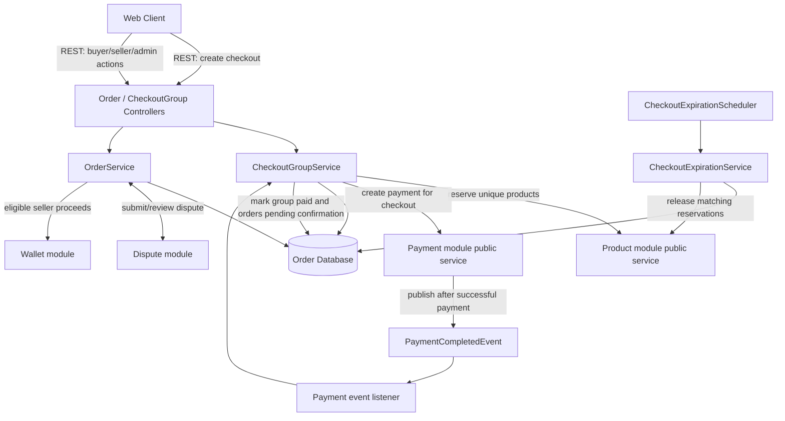
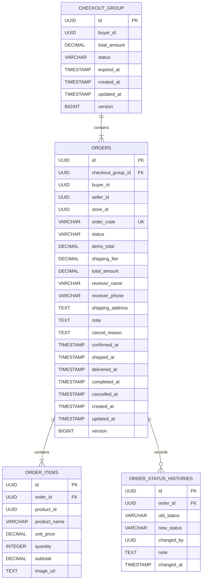
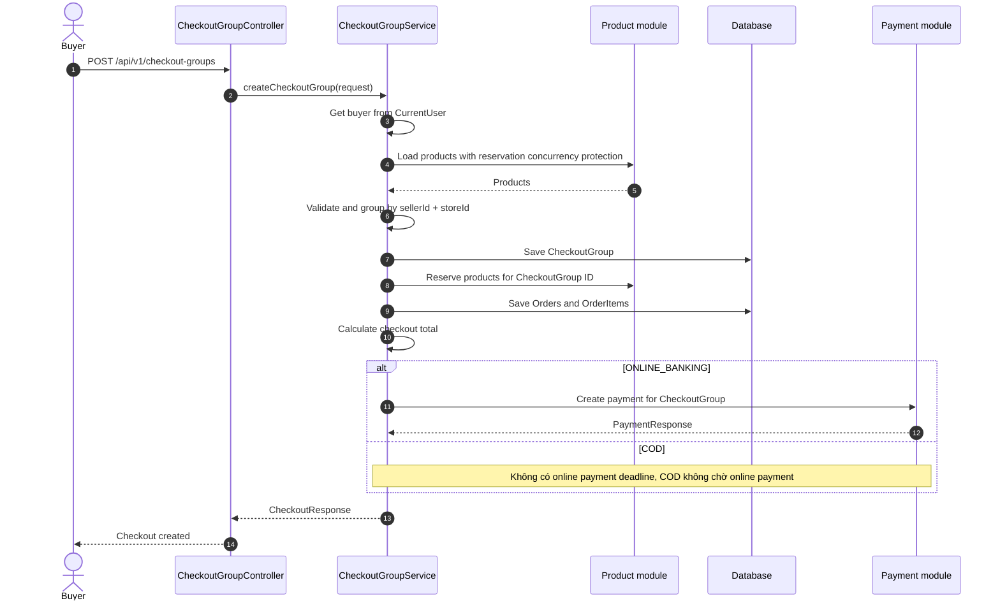
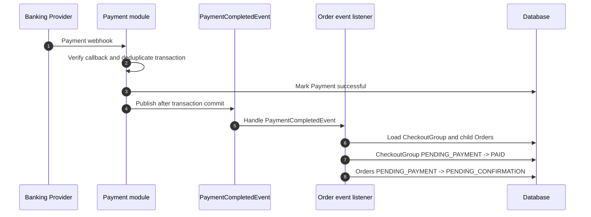
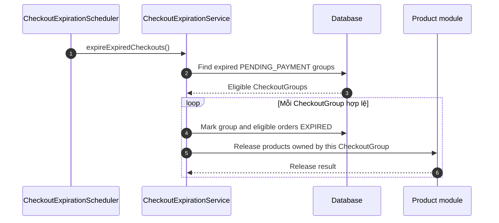
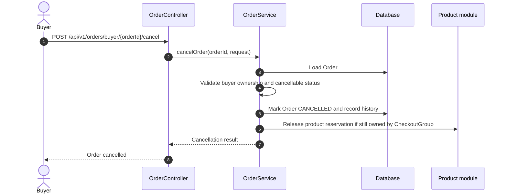
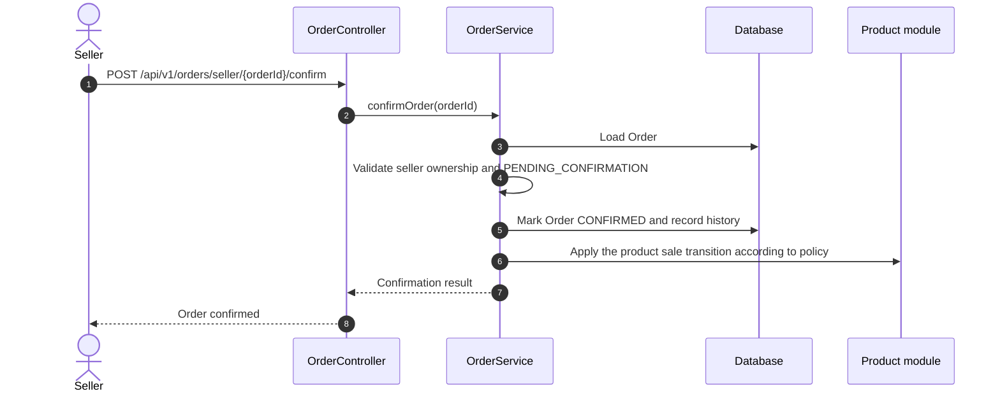
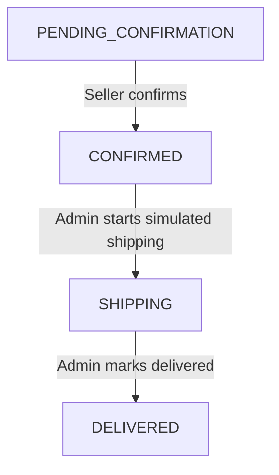
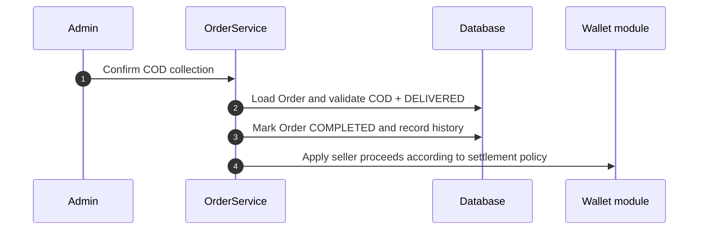
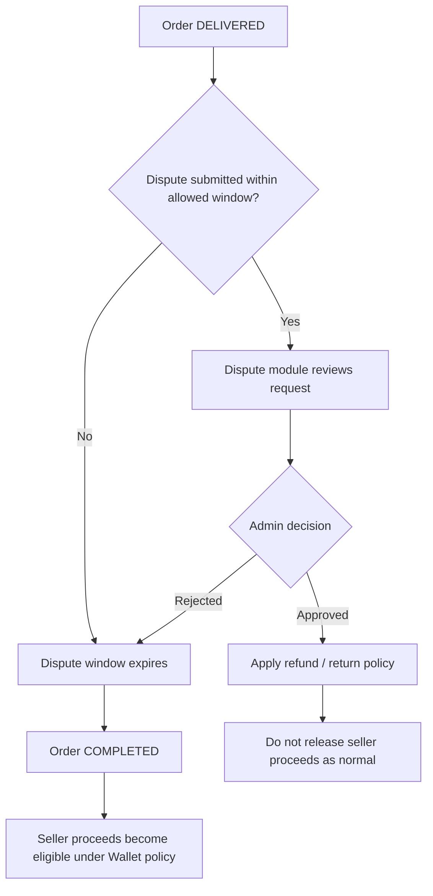

# Kiến trúc Order Module --- Moldy Market

------------------------------------------------------------------------

## 1. Tổng quan

Order Module quản lý vòng đời nghiệp vụ của các giao dịch mua hàng trên
Moldy Market, một sàn thương mại điện tử C2C dành cho đồ cũ. Module này
điều phối việc gom nhóm checkout, tạo đơn hàng, người mua hủy đơn, người
bán xác nhận đơn, mô phỏng quá trình vận chuyển, giao hàng và chuyển đơn
sang trạng thái hoàn tất.

Module này làm việc với Payment, Product, Dispute và Wallet, nhưng mỗi
module vẫn chịu trách nhiệm đối với dữ liệu và business rule của chính
mình.

### 1.1. Thiết kế chính: CheckoutGroup và Order

Một người mua có thể mua sản phẩm từ nhiều người bán hoặc nhiều cửa hàng
trong cùng một lần checkout. Hệ thống nhóm các sản phẩm được chọn theo
`(sellerId, storeId)`:

- Một lần checkout của buyer tạo ra một `CheckoutGroup`.
- Một `CheckoutGroup` có thể chứa nhiều `Order`.
- Mỗi `Order` thuộc về chính xác một nhóm seller/store.
- Một payment được liên kết với `CheckoutGroup`, không phải với từng
  `Order` riêng lẻ.
- Sau giai đoạn checkout/payment, mỗi `Order` tiếp tục xử lý độc lập.

Ví dụ:

```text
Buyer checkout các sản phẩm từ Seller A và Seller B
                         |
                         v
                  CheckoutGroup
                  /            \
                 v              v
             Order A          Order B
             Seller A         Seller B
```

Seller A có thể xác nhận và xử lý Order A trong khi Seller B vẫn chưa
xác nhận Order B.

### 1.2. Trách nhiệm của các thành phần

| Thành phần | Trách nhiệm |
|---|---|
| `CheckoutGroup` | Đại diện cho một lần checkout của buyer và điều phối giai đoạn payment |
| `Order` | Đại diện cho việc xử lý đơn hàng của một seller/store |
| `OrderItem` | Lưu snapshot thông tin sản phẩm được mua |
| `CheckoutExpirationScheduler` | Kích hoạt việc kiểm tra các checkout online đã hết hạn |
| `CheckoutExpirationService` | Xử lý việc expire các checkout hợp lệ và điều phối release product |
| `OrderService` | Xử lý các thao tác order của buyer, seller và admin |
| Payment module | Quản lý payment record, provider callback và payment status |
| Product module | Quản lý product status và các transition liên quan đến reservation |
| Dispute module | Quản lý dispute, evidence và quyết định của admin |
| Wallet module | Quản lý số dư wallet của seller và các hoạt động withdrawal/settlement |

### 1.3. Giả định quan trọng của marketplace

Moldy Market là một marketplace đồ cũ, trong đó mỗi listing đại diện
cho **một sản phẩm duy nhất**. Không có stock quantity cần decrement.

Do đó, vòng đời của Product sử dụng reservation thay vì inventory dựa
trên quantity:

```text
ACTIVE -> RESERVED -> SOLD
             |
             +----> ACTIVE (khi reservation hợp lệ được release)
```

Product module chịu trách nhiệm quản lý các state transition này. Order
module quyết định **khi nào cần yêu cầu reserve hoặc release product**.

------------------------------------------------------------------------

## 2. Luồng xử lý nội bộ tổng quát

Order Module chủ yếu được truy cập thông qua REST API và application
events. Scheduled processing được sử dụng cho việc expire online
checkout và sau này có thể dùng cho việc hoàn tất order sau dispute
window.



### 2.1. Các luồng request chính

**Path A --- Tạo Checkout**

1. Buyer gửi checkout request.
2. Service xác định buyer từ authenticated security context.
3. Service load và lock các product được yêu cầu.
4. Service kiểm tra product availability và seller information.
5. Service tạo và lưu `CheckoutGroup`.
6. Service reserve từng product cho `CheckoutGroup`.
7. Service group products theo seller/store và tạo các Order và
   OrderItem tương ứng.
8. Service tính tổng tiền checkout.
9. Nếu thanh toán bằng online banking, service tạo payment thông qua
   Payment module.
10. Service trả về checkout và order summaries.

**Path B --- Online payment thành công**

1. Payment module nhận và verify callback từ payment provider.
2. Payment module thay đổi payment state và publish
   `PaymentCompletedEvent` sau khi transaction của nó commit.
3. Order module xử lý event.
4. `CheckoutGroup` chuyển từ `PENDING_PAYMENT` sang `PAID`.
5. Mỗi Order con chuyển từ `PENDING_PAYMENT` sang
   `PENDING_CONFIRMATION`.
6. Mỗi seller có thể xử lý Order của mình độc lập.

**Path C --- Checkout hết hạn**

1. Scheduled job định kỳ gọi `CheckoutExpirationService`.
2. Service tìm các CheckoutGroup của online banking đã vượt quá
   deadline thanh toán và vẫn đang ở `PENDING_PAYMENT`.
3. Service đánh dấu các group hợp lệ và các Order con hợp lệ thành
   expired.
4. Service release product chỉ khi reservation vẫn thuộc CheckoutGroup
   đó.
5. Operation phải có tính transaction và an toàn khi chạy nhiều lần.

**Path D --- Xử lý Order**

1. Seller xác nhận order.
2. Admin mô phỏng quá trình shipping.
3. Admin đánh dấu order đã delivered.
4. Order tiếp tục theo policy hoàn tất của COD hoặc online banking.
5. Một dispute hợp lệ sẽ ngăn việc hoàn tất bình thường cho đến khi
   dispute workflow được xử lý.

------------------------------------------------------------------------

## 3. Cấu trúc Database (ERD & Schema)

Schema dưới đây mô tả các thành phần chính của Order module. Tên column
chính xác cần được đồng bộ với JPA entity và migration hiện tại.



### 3.1. `checkout_groups`

| Column | Type | Constraint | Ý nghĩa |
|---|---|---|---|
| `id` | UUID | PK | ID của checkout group |
| `buyer_id` | UUID | NOT NULL | Buyer tạo checkout |
| `total_amount` | DECIMAL | NOT NULL | Tổng số tiền phải thanh toán cho toàn bộ checkout |
| `status` | VARCHAR(30) | NOT NULL | Trạng thái vòng đời của CheckoutGroup |
| `expired_at` | TIMESTAMP | NULL | Deadline thanh toán online; NULL đối với COD theo policy hiện tại |
| `created_at` | TIMESTAMP | NOT NULL | Thời gian tạo |
| `updated_at` | TIMESTAMP | | Thời gian cập nhật cuối |
| `version` | BIGINT | | Version cho optimistic locking nếu cần |

**Quan trọng:** `CheckoutGroup.expired_at` được sử dụng cho deadline của
online payment. Theo business rule hiện tại, COD không expire thông qua
field này, vì vậy `expired_at` của COD là `NULL`.

### 3.2. `orders`

| Column | Type | Constraint | Ý nghĩa |
|---|---|---|---|
| `id` | UUID | PK | ID của Order |
| `checkout_group_id` | UUID | FK, NOT NULL | CheckoutGroup cha |
| `buyer_id` | UUID | NOT NULL | ID buyer |
| `seller_id` | UUID | NOT NULL | Seller chịu trách nhiệm xử lý order |
| `store_id` | UUID | NULL | ID store; NULL nếu seller là cá nhân |
| `order_code` | VARCHAR(10) hoặc độ dài theo project | UNIQUE, NOT NULL | Order code dễ đọc |
| `status` | VARCHAR(30) | NOT NULL | Trạng thái vòng đời Order |
| `items_total` | DECIMAL | NOT NULL | Tổng subtotal của các item |
| `shipping_fee` | DECIMAL | NOT NULL | Phí vận chuyển |
| `total_amount` | DECIMAL | NOT NULL | Tổng tiền Order |
| `receiver_name` | VARCHAR | NOT NULL | Tên người nhận |
| `receiver_phone` | VARCHAR | NOT NULL | Số điện thoại người nhận |
| `shipping_address` | TEXT | NOT NULL | Địa chỉ giao hàng |
| `note` | TEXT | NULL | Ghi chú của buyer |
| `cancel_reason` | TEXT | NULL | Lý do hủy |
| `confirmed_at` | TIMESTAMP | NULL | Thời điểm seller xác nhận |
| `shipped_at` | TIMESTAMP | NULL | Thời điểm bắt đầu shipping mô phỏng |
| `delivered_at` | TIMESTAMP | NULL | Thời điểm admin đánh dấu delivered |
| `completed_at` | TIMESTAMP | NULL | Thời điểm Order hoàn tất |
| `cancelled_at` | TIMESTAMP | NULL | Thời điểm Order bị hủy |
| `created_at` | TIMESTAMP | NOT NULL | Thời gian tạo |
| `updated_at` | TIMESTAMP | | Thời gian cập nhật cuối |
| `version` | BIGINT | | Version cho optimistic locking nếu cần |

### 3.3. `order_items`

`OrderItem` lưu snapshot của Product tại thời điểm mua. Nó không nên phụ
thuộc vào Product record hiện tại để hiển thị thông tin lịch sử của Order.

| Column | Type | Constraint | Ý nghĩa |
|---|---|---|---|
| `id` | UUID | PK | ID OrderItem |
| `order_id` | UUID | FK, NOT NULL | Order cha |
| `product_id` | UUID | NOT NULL | ID product ban đầu; thông thường không phải JPA relationship cross-module |
| `product_name` | VARCHAR | NOT NULL | Snapshot tên sản phẩm |
| `unit_price` | DECIMAL | NOT NULL | Giá tại thời điểm checkout |
| `quantity` | INTEGER | NOT NULL | Với marketplace này thường là `1` |
| `subtotal` | DECIMAL | NOT NULL | Unit price × quantity |
| `image_url` | TEXT | NULL | Snapshot ảnh sản phẩm |

Vì mỗi secondhand listing là duy nhất, business rule là mỗi product chỉ
có một đơn vị có thể mua.

API và service nên reject duplicate product IDs trong cùng một checkout
thay vì xem chúng như việc tăng quantity.

Nếu DTO hiện tại vẫn giữ field `quantity` để tương thích, hãy validate
rằng nó bằng `1`; hoặc có thể loại bỏ field này khỏi request model.

### 3.4. `order_status_histories`

Table này lưu lại các transition quan trọng của Order để phục vụ audit.

Các field được khuyến nghị:

- `order_id`
- `old_status`
- `new_status`
- `changed_by`
- `note`
- `changed_at`

Chỉ tạo history record khi business transition thực sự thành công,
không phải chỉ khi endpoint được gọi.

### 3.5. Index và constraint hữu ích

Có thể cân nhắc các constraint/index sau:

- Unique constraint trên `orders.order_code`.
- Index trên `orders.checkout_group_id`.
- Index trên `(orders.buyer_id, orders.created_at)`.
- Index trên `(orders.seller_id, orders.created_at)`.
- Index trên `(checkout_groups.status, checkout_groups.expired_at)` để
  phục vụ expiration scan.
- Index trên
  `(order_status_histories.order_id, order_status_histories.changed_at)`.
- Check constraint `order_items.quantity = 1` nếu project chính thức áp
  dụng semantics one-item-per-listing.
- Foreign key từ `orders.checkout_group_id` đến `checkout_groups.id`.
- Foreign key từ `order_items.order_id` đến `orders.id`.
- Foreign key từ `order_status_histories.order_id` đến `orders.id`.

Tránh thêm database foreign key trực tiếp đến table của module khác trừ
khi đó là quyết định chung của toàn project. Cross-module references có
thể chỉ lưu dưới dạng UUID và được validate thông qua public service của
module sở hữu dữ liệu.

------------------------------------------------------------------------

## 4. Boundary Principles và Business Guardrails

### 4.1. CheckoutGroup và Order có trách nhiệm khác nhau

- `CheckoutGroup` đại diện cho một lần checkout và payment stage của
  buyer.
- `Order` đại diện cho workflow xử lý của một seller/store.
- Khi online payment thành công, CheckoutGroup được cập nhật và các Order
  hợp lệ chuyển sang `PENDING_CONFIRMATION`.
- Sau transition này, các Order tiếp tục xử lý độc lập.
- Không dùng CheckoutGroup status để biểu diễn shipping hoặc dispute
  state của tất cả Order con.

### 4.2. Một Order cho mỗi seller/store group

Group product bằng:

```
OrderGroupKey(product.getSellerId(), product.getStoreId())
```

Điều này có nghĩa:

- Product từ cùng seller và cùng store thuộc cùng một Order.
- Product từ seller khác nhau thuộc các Order khác nhau.
- Seller không có store sử dụng `storeId = null`.
- `sellerId` luôn phải tồn tại.

### 4.3. Ownership của Product reservation

Product module sở hữu product status và reservation fields. Order module
gọi public service/API của Product module để yêu cầu các transition.

Các rule reservation được khuyến nghị:

1. Chỉ product ở trạng thái `ACTIVE` mới có thể được reserve.
2. Reservation lưu `checkoutGroupId` đang sở hữu reservation.
3. Product chỉ được release nếu nó vẫn đang `RESERVED` bởi chính
   CheckoutGroup đó.
4. Không release product nếu một checkout khác đang sở hữu reservation.
5. Product chuyển sang `SOLD` tại business milestone được marketplace
   lựa chọn. Một policy thực tế là đánh dấu SOLD khi seller accept/confirm
   order, nhưng điều này phải nhất quán với cancellation và
   dispute/return rules.

Đối với unique listing, tuyệt đối không decrement stock quantity.

### 4.4. Bảo vệ concurrency

Hai buyer không được phép reserve cùng một unique product đồng thời.

Sử dụng một strategy nhất quán trong Product module:

- Pessimistic row locking (`PESSIMISTIC_WRITE`) khi load product để
  reservation; hoặc
- Conditional atomic database update chỉ thành công khi status hiện tại
  là `ACTIVE`.

Không được giả định rằng một query `findAllByIds()` thông thường có thể
ngăn concurrent reservation.

Nếu sử dụng pessimistic lock cho nhiều product, hãy acquire lock theo
một thứ tự ổn định, ví dụ sort theo product UUID, để giảm nguy cơ
deadlock.

Database row lock chỉ tồn tại trong thời gian transaction. Business
reservation vẫn được biểu diễn bởi `ProductStatus.RESERVED` sau khi
transaction commit.

### 4.5. Transaction boundary

Checkout creation nên được thực hiện trong một transaction:

```text
Create CheckoutGroup
       +
Reserve products
       +
Create Orders and OrderItems
       +
Create Payment record (nếu nằm trong cùng database transaction)
       |
       v
   Commit together
```

Nếu bất kỳ database operation nào fail trước commit, transaction nên
rollback các database changes đã thực hiện trong transaction đó.

Không giữ database row lock trong khi thực hiện các external network
call chậm.

Nếu payment creation yêu cầu gọi external provider, cần thiết kế
boundary cẩn thận, ví dụ persist local payment intent trước rồi thực hiện
provider interaction với failure handling phù hợp.

### 4.6. Authorization và ownership

- Buyer identity phải được lấy từ authenticated principal, không lấy từ
  `buyerId` do client gửi.
- Buyer chỉ được xem hoặc cancel Order của chính mình.
- Seller chỉ được xem hoặc confirm Order được assign cho seller đó.
- Admin-only shipping simulation và COD collection operations phải được
  bảo vệ bằng role-based authorization.
- Mỗi service operation phải verify resource ownership và business state
  hợp lệ; chỉ dùng controller annotations là chưa đủ.
- UUID chỉ là identifier, không phải bằng chứng của permission.

### 4.7. Boundary của Cancellation

Theo flow hiện tại, buyer có thể cancel trước khi seller confirm Order.

- Cancellation phải validate buyer ownership.
- Cancellation phải validate Order vẫn ở trạng thái có thể cancel.
- Cancellation phải update Order và status history.
- Product chỉ được release nếu reservation vẫn thuộc CheckoutGroup liên
  quan.
- Sau khi seller đã confirm và order chuyển sang shipping, buyer không
  được cancel theo policy hiện tại.

Nếu một Order bị cancel trong khi các Order khác cùng CheckoutGroup vẫn
đang tiếp tục xử lý, không tự động cancel các Order khác.

### 4.8. Boundary của Dispute

Dispute module sở hữu dispute request, evidence và admin decision.

- Order có thể vẫn ở `DELIVERED` trong khi dispute đang được review.
- Pending hoặc approved dispute phải ngăn automatic completion bình
  thường cho đến khi dispute policy được xử lý.
- Không overload `OrderStatus` với tất cả internal Dispute statuses.
- Approved dispute không đồng nghĩa với việc bank refund đã được chuyển.
- Refund execution và seller wallet settlement phải được phối hợp với
  Payment/Wallet module theo state của từng module.

------------------------------------------------------------------------

## 5. Chi tiết các Business Workflow

### Workflow 1 --- Tạo CheckoutGroup và Orders

Buyer chọn product, nhập thông tin giao hàng và chọn COD hoặc online
banking.



Thứ tự xử lý service ở mức high-level được khuyến nghị:

1. Xác định buyer hiện tại.
2. Validate request shape và reject duplicate product IDs.
3. Load product bằng concurrency-control strategy đã chọn.
4. Validate mỗi product đang `ACTIVE` và có seller.
5. Group product theo `(sellerId, storeId)`.
6. Xác định initial CheckoutGroup và Order status dựa trên payment
   method.
7. Tạo và save CheckoutGroup để lấy ID.
8. Reserve các product cho CheckoutGroup.
9. Tạo Orders và snapshot OrderItems.
10. Tính và update CheckoutGroup total.
11. Tạo online payment nếu method là `ONLINE_BANKING`.
12. Trả về status thực tế đã persist và response data.

**Payment-method policy:**

| Payment method | Initial CheckoutGroup status | Initial Order status | `CheckoutGroup.expiredAt` |
|---|---|---|---|
| `ONLINE_BANKING` | `PENDING_PAYMENT` | `PENDING_PAYMENT` | Set deadline online payment, ví dụ 15 phút |
| `COD` | `PENDING_CONFIRMATION` | `PENDING_CONFIRMATION` | `NULL` |

COD không có online payment step, vì vậy không nên biểu diễn nó như đã
được thanh toán.

Nếu Payment module tạo COD payment record để tracking cash collection,
status của record phải phản ánh đúng COD collection lifecycle thay vì giả
vờ buyer đã thanh toán online.

### Workflow 2 --- Online payment thành công



Order module phải làm transition này idempotent:

- Nếu CheckoutGroup đã `PAID`, không xử lý lại.
- Chỉ CheckoutGroup đang `PENDING_PAYMENT` mới có thể chuyển sang `PAID`.
- Chỉ child Order hợp lệ mới được chuyển từ `PENDING_PAYMENT` sang
  `PENDING_CONFIRMATION`.
- Không mark Order thành `COMPLETED` khi payment thành công.

Vì Payment transaction và Order event listener có thể sử dụng các
transaction riêng biệt, Payment có thể đã thành công nhưng Order-side
event handling lại fail.

Do đó cần retry và reconciliation để retry Order transition. Có thể cân
nhắc transactional outbox sau này để có event delivery guarantee mạnh
hơn.

### Workflow 3 --- Expire online checkout chưa thanh toán



Expiration query criteria:

```text
status = PENDING_PAYMENT
AND expiredAt IS NOT NULL
AND expiredAt <= now
```

Theo policy hiện tại, chỉ online checkout mới match query này.

Các rule quan trọng:

- Không expire CheckoutGroup đã `PAID`.
- Không release product nếu reservation owner không match CheckoutGroup
  đang expire.
- Expiration phải idempotent.
- Nếu payment đến sau khi checkout đã expired, không tự động tiếp tục
  normal order flow. Phải xử lý thông qua payment reconciliation và
  late-payment refund/recovery policy đã định nghĩa.
- Scheduled method nên mỏng; business logic transaction nên nằm trong
  `CheckoutExpirationService`.

### Workflow 4 --- Buyer cancel Order



Buyer chỉ được cancel trước khi seller confirm theo policy hiện tại.

Nếu order đã được confirm hoặc đã chuyển sang shipping, reject
cancellation và chuyển user sang support/dispute process phù hợp.

### Workflow 5 --- Seller confirm Order



Product transition sang `SOLD` phải nhất quán với cancellation và
return policy.

Nếu hệ thống mark product `SOLD` ngay khi seller confirm, cancellation
hoặc approved return sau đó phải có một explicit product recovery policy;
không được re-activate product một cách mù quáng.

### Workflow 6 --- Admin mô phỏng shipping và mark delivery

Moldy Market hiện tại không tích hợp shipping carrier thật. Admin sẽ mô
phỏng shipping lifecycle.



Admin operations phải validate current state trước khi thay đổi:

- Start shipping chỉ từ `CONFIRMED`.
- Mark delivered chỉ từ `SHIPPING`.
- Ghi lại admin actor và transition timestamp trong order history.

### Workflow 7 --- COD completion



Đối với COD, order không được complete trước khi order delivered và
admin có quyền đã xác nhận việc thu tiền mặt.

Phải validate payment method là `COD`.

### Workflow 8 --- Online completion và dispute window



Dispute duration và refund/return policy chính xác cần được cấu hình như
business rules.

Dispute module sở hữu dispute status. Order module không được mark order
completed khi active dispute đang block completion.

------------------------------------------------------------------------

## 6. Endpoints và Trách nhiệm của Service

Các path bên dưới là API shape được khuyến nghị. Nếu project đã có
convention khác, giữ convention hiện tại.

### 6.1. REST endpoints

| Method | Endpoint | Chức năng | Authorization |
|---|---|---|---|
| `POST` | `/api/v1/checkout-groups` | Tạo checkout group và các order | Authenticated buyer |
| `GET` | `/api/v1/checkout-groups/{id}` | Lấy checkout group và order summaries | Checkout owner |
| `GET` | `/api/v1/orders/me` | Lấy danh sách order của buyer hiện tại | Authenticated buyer |
| `GET` | `/api/v1/orders/buyer/{orderId}` | Xem chi tiết order với vai trò buyer | Order owner |
| `POST` | `/api/v1/orders/buyer/{orderId}/cancel` | Cancel order hợp lệ | Order owner |
| `GET` | `/api/v1/orders/seller/me` | Lấy các order được assign cho seller hiện tại | Authenticated seller |
| `GET` | `/api/v1/orders/seller/{orderId}` | Xem chi tiết order với vai trò seller | Assigned seller |
| `POST` | `/api/v1/orders/seller/{orderId}/confirm` | Confirm order hợp lệ | Assigned seller |
| `POST` | `/api/v1/orders/admin/{orderId}/start-shipping` | Bắt đầu shipping mô phỏng | Admin |
| `POST` | `/api/v1/orders/admin/{orderId}/mark-delivered` | Mark order delivered | Admin |
| `POST` | `/api/v1/orders/admin/{orderId}/cod-collected` | Xác nhận COD collection và completion | Admin |

Đối với list endpoint, nếu không có order thì trả về empty page/list;
không xem empty result là exception.

### 6.2. Các service method chính

**CheckoutGroupService**

```java
CheckoutResponse createCheckoutGroup(CheckoutGroupRequest request);

CheckoutResponse getCheckoutById(UUID checkoutGroupId);

void markCheckoutGroupPaid(UUID checkoutGroupId);
```

Trách nhiệm:

- Tạo checkout và group product theo seller/store.
- Điều phối product reservation thông qua Product module.
- Tạo Order và OrderItem snapshots.
- Tính checkout total.
- Điều phối Payment creation.
- Xử lý PaymentCompletedEvent transition.

**CheckoutExpirationService**

```java
void expireExpiredCheckouts();
```

Trách nhiệm:

- Tìm các online CheckoutGroup đã expired.
- Chuyển CheckoutGroup và child Orders hợp lệ sang `EXPIRED`.
- Release các product reservation tương ứng.
- Đảm bảo operation transactional và idempotent.

**OrderService**

```java
Page<OrderSummaryResponse> getMyBuyerOrders(Pageable pageable);

OrderDetailResponse getBuyerOrder(UUID orderId);

void cancelOrder(UUID orderId, CancelOrderRequest request);

Page<OrderSummaryResponse> getMySellerOrders(Pageable pageable);

void confirmOrder(UUID orderId);

void startShipping(UUID orderId);

void markDelivered(UUID orderId);

void confirmCodCollection(UUID orderId);
```

Trách nhiệm:

- Enforce buyer/seller ownership.
- Validate state transition.
- Record order status history.
- Điều phối Product, Dispute và Wallet operations thông qua public
  interfaces/events.

### 6.3. Scheduled job

```java
@Component
@RequiredArgsConstructor
public class CheckoutExpirationScheduler {

    private final CheckoutExpirationService expirationService;

    @Scheduled(fixedDelay = 60_000)
    public void expireCheckouts() {
        expirationService.expireExpiredCheckouts();
    }
}
```

Enable scheduling trong application configuration bằng
`@EnableScheduling`.

Scheduled job chỉ nên trigger use case. Nó không nên chứa repository
query hoặc business transition logic.

------------------------------------------------------------------------

## 7. Các lưu ý kỹ thuật cốt lõi

### Lưu ý 1 --- Tại sao CheckoutGroup và Order phải tách biệt?

Một checkout có thể chứa product từ nhiều seller.

Payment được thực hiện một lần cho checkout, nhưng mỗi seller xử lý
Order của mình độc lập.

Nếu shipping status chỉ được lưu ở CheckoutGroup, việc một seller bị
chậm sẽ ảnh hưởng sai đến tất cả Order của seller khác.

Vì vậy:

- Payment-stage coordination thuộc về CheckoutGroup.
- Confirmation, shipping, delivery, cancellation, dispute handling và
  completion thuộc về từng Order.

### Lưu ý 2 --- Product reservation và pessimistic locking

Một product query bình thường không ngăn được hai checkout request đồng
thời đọc cùng một product `ACTIVE`.

Nếu Product module sử dụng pessimistic locking, repository query có thể
theo pattern:

```java
@Lock(LockModeType.PESSIMISTIC_WRITE)
@Query("""
    SELECT p FROM Product p
    WHERE p.id = :productId
""")
Optional<Product> findByIdForUpdate(UUID productId);
```

Đối với nhiều product, acquire lock theo thứ tự ổn định.

Sau khi load managed entity, gọi các domain method như:

```
product.reserve(checkoutGroupId);
product.release(checkoutGroupId);
product.markSold(checkoutGroupId);
```

Các method này phải validate allowed transition và reservation ownership.

Không nên thêm public setter không giới hạn chỉ để module khác có thể
thay đổi Product status.

Row lock tồn tại cho đến khi database transaction kết thúc. Business
state `RESERVED` vẫn tồn tại sau commit.

### Lưu ý 3 --- JPA dirty checking

Khi entity được load bên trong transaction và vẫn đang ở trạng thái
managed, việc thay đổi entity thông qua domain method thông thường sẽ
được Hibernate persist bằng dirty checking:

```java
@Transactional
public void confirmOrder(UUID orderId) {
    Order order = orderRepository.findById(orderId)
            .orElseThrow(() -> new AppException(ErrorCode.ORDER_NOT_FOUND));

    order.confirm(); // Managed entity; dirty checking persists the change.
}
```

Thông thường không cần gọi `repository.save()` đối với entity đã managed.

`save()` vẫn phù hợp khi save entity mới hoặc detached entity nếu
persistence flow yêu cầu.

### Lưu ý 4 --- Optimistic locking và concurrent transition

Có thể sử dụng `@Version` cho CheckoutGroup và Order để phát hiện các
update đồng thời.

Version field hữu ích khi có nhiều request cùng cố gắng thay đổi một
Order.

Version conflict phải được xử lý như một concurrency conflict và không
được âm thầm bỏ qua.

Đối với transition có contention cao, conditional update hoặc row lock
có thể phù hợp hơn.

Chọn một strategy nhất quán và tránh mix bulk update với managed entity
mà không xử lý vấn đề stale persistence context.

### Lưu ý 5 --- Validate status transition

Không expose generic method cho phép set status tùy ý.

Ưu tiên các explicit domain operation:

```
order.confirm();
order.startShipping();
order.markDelivered();
order.complete();
order.cancel(reason);
```

Mỗi operation phải:

- Validate current status.
- Update timestamp liên quan.
- Tạo status-history record khi transition thành công.

Transition table đơn giản:

| Current status | Operation | Next status | Actor |
|---|---|---|---|
| `PENDING_PAYMENT` | Online payment succeeds | `PENDING_CONFIRMATION` | System/event |
| `PENDING_CONFIRMATION` | Seller confirms | `CONFIRMED` | Seller |
| `PENDING_CONFIRMATION` | Buyer cancels | `CANCELLED` | Buyer |
| `CONFIRMED` | Start simulated shipping | `SHIPPING` | Admin |
| `SHIPPING` | Mark delivered | `DELIVERED` | Admin |
| `DELIVERED` | COD collection confirmed | `COMPLETED` | Admin |
| `DELIVERED` | Dispute window expires without blocking dispute | `COMPLETED` | System |

Unpaid online Order có thể chuyển sang `EXPIRED` khi parent
CheckoutGroup expire.

COD Order không sử dụng online checkout expiration deadline.

### Lưu ý 6 --- Payment event handling và recovery

Payment module chỉ nên publish `PaymentCompletedEvent` sau khi payment
transaction commit thành công.

Order listener phải thực hiện transition idempotent.

Vì after-commit listener không thể rollback Payment transaction đã
commit, cần có:

- Retry cho transient Order-side failure.
- Reconciliation job tìm các payment đã successful nhưng
  CheckoutGroup vẫn `PENDING_PAYMENT`.
- Transactional outbox trong tương lai nếu cần event delivery
  guarantee mạnh hơn.

Không mark Payment successful lại chỉ để retry Order transition.

### Lưu ý 7 --- Expiration và late payment

Expiration phải được guard bởi cả deadline và state:

```text
expiredAt <= now
AND status = PENDING_PAYMENT
```

Payment callback có thể race với expiration.

Hệ thống phải đảm bảo chỉ một valid state transition thắng.

Nếu payment provider xác nhận tiền sau khi CheckoutGroup đã expired, hãy
sử dụng late-payment reconciliation/refund process đã định nghĩa thay vì
tự động reopen expired order.

### Lưu ý 8 --- Tránh cross-module repository access

Ưu tiên sử dụng public service, port hoặc application event của module:

- Order → Product public service: reserve/release/mark sold.
- Payment → Order event: payment completed.
- Order → Dispute public service/event: check hoặc react theo dispute
  outcome.
- Order → Wallet public service/event: seller proceeds trở nên eligible.

Order module không nên trực tiếp update Product, Payment, Dispute hoặc
Wallet table thông qua repository của module khác.

Mỗi module nên sở hữu persistence và state transition của chính mình.

------------------------------------------------------------------------

## 8. Các cải tiến trong tương lai

Các feature dưới đây có thể được thêm sau khi core Order lifecycle ổn
định.

### 8.1. Automatic Order Completion

Thêm scheduled process để complete các online Order hợp lệ sau dispute
window:

- Order đang `DELIVERED`.
- Dispute window đã hết.
- Không có active dispute block completion.
- Order chưa được complete.

Job phải idempotent và chỉ coordinate seller proceeds với Wallet module
sau khi Order trở nên eligible.

### 8.2. Dispute integration

Tích hợp Dispute module cho:

- Buyer submit dispute.
- Upload và lưu evidence.
- Admin review và decision.
- Approved refund/return workflow.
- Ngăn normal order completion trong khi dispute active.

Giữ dispute-specific states trong Dispute module thay vì mở rộng
OrderStatus cho từng review state.

### 8.3. Seller settlement và Wallet integration

Sau khi online Order hoàn tất và không có dispute block settlement:

- Notify Wallet module rằng seller proceeds đã eligible.
- Tính seller proceeds theo fee/discount rules đã thống nhất.
- Credit seller wallet ledger/balance theo thiết kế Wallet.
- Giữ withdrawal approval và actual bank transfer thành hai bước riêng
  biệt.

Wallet balance là application ledger value; không nên mô tả nó như tiền
đã được chuyển vào tài khoản ngân hàng của seller.

### 8.4. Partial cancellation và partial refund

Nếu marketplace sau này hỗ trợ cancel một item trong multi-item Order,
cần định nghĩa rõ ảnh hưởng đến:

- OrderItem status.
- Order totals.
- Seller settlement.
- Refund amount.
- Product reservation hoặc return state.

Không nên triển khai partial-order behavior trước khi financial và
inventory rules được xác định rõ.

### 8.5. Shipping provider integration

Project hiện tại sử dụng admin-simulated shipping.

Trong tương lai, có thể tạo shipping adapter/port để tích hợp carrier
thật mà không cần thay đổi core Order state machine.

### 8.6. Notifications

Publish domain events cho các transition quan trọng:

```text
OrderCreatedEvent
OrderConfirmedEvent
OrderCancelledEvent
OrderShippedEvent
OrderDeliveredEvent
OrderCompletedEvent
```

Notification module có thể consume các event này để gửi:

- In-app notification.
- Email.
- Push notification.

### 8.7. Audit và operational monitoring

Có thể thêm:

- Admin audit log cho shipping và COD collection actions.
- Metrics cho expired checkout và late payment callback.
- Alert cho successful payment nhưng CheckoutGroup vẫn pending trong
  Order module.
- Retry monitoring cho event handling failure.
- Tests cho concurrent reservation.
- Tests cho duplicate payment events.
- Tests cho duplicate cancellation.
- Tests cho expiration/payment race.

------------------------------------------------------------------------

## Tóm tắt thiết kế cuối cùng

Core design có thể được tóm tắt như sau:

1. Một buyer checkout tạo một `CheckoutGroup`.
2. Product được group theo seller/store để tạo một `Order` cho mỗi
   seller/store.
3. Một payment thuộc về `CheckoutGroup`.
4. Online banking bắt đầu ở `PENDING_PAYMENT` và có payment deadline.
5. COD bắt đầu trực tiếp ở `PENDING_CONFIRMATION` và không có
   `CheckoutGroup.expiredAt` theo policy hiện tại.
6. Product được reserve trong quá trình tạo checkout và được release khi
   online checkout expire hợp lệ hoặc buyer cancel trước seller
   confirmation.
7. Sau khi online payment thành công, CheckoutGroup chuyển sang `PAID`
   và các Order hợp lệ chuyển sang `PENDING_CONFIRMATION`.
8. Sau đó mỗi Order tiếp tục độc lập qua seller confirmation, simulated
   shipping, delivery, dispute handling và completion.
9. Product, Payment, Dispute và Wallet module tự sở hữu dữ liệu và state
   transition của chính mình.
10. Scheduled jobs, event handling và state transition phải
    idempotent và an toàn trước concurrency.