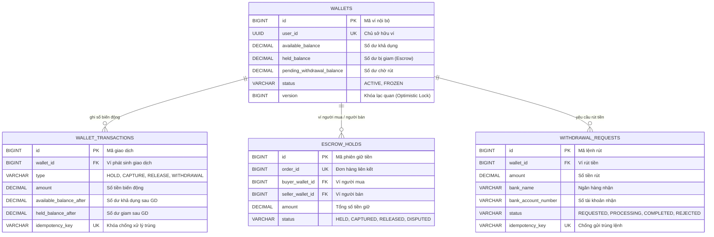
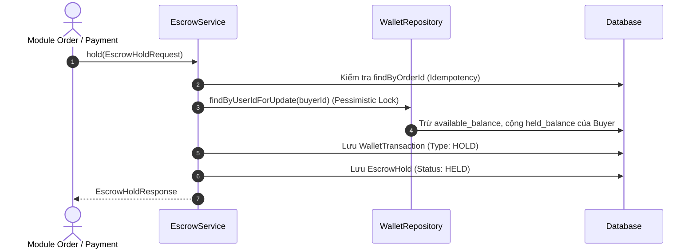
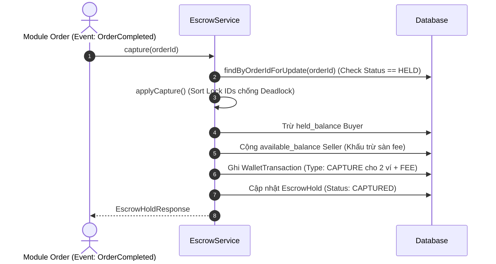
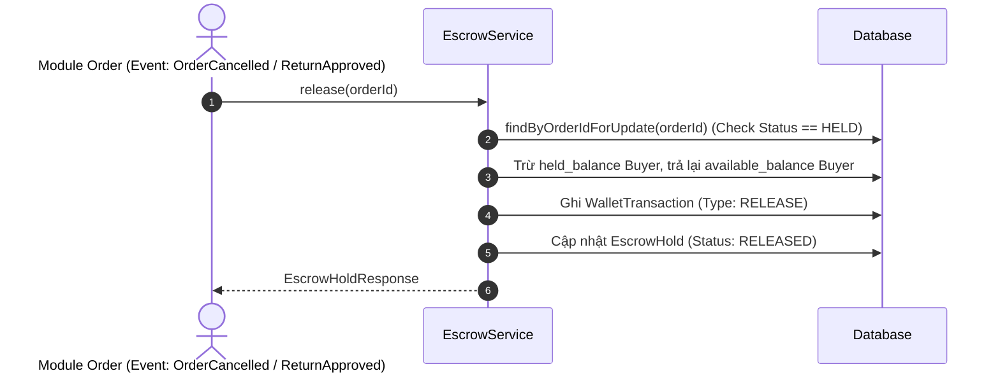
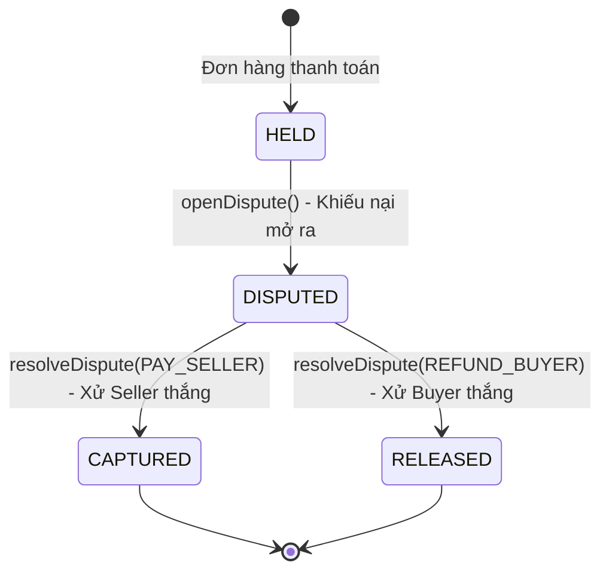
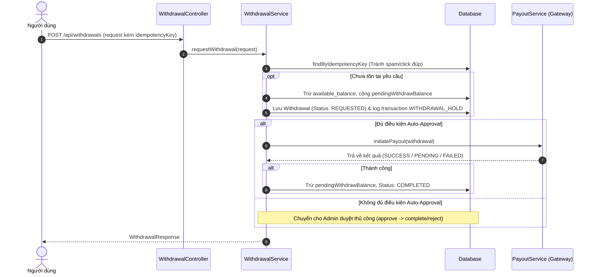

# Tài liệu Kiến trúc & Luồng Code Module Wallet (Ví Nội bộ & Escrow)

---

**Dự án:** Moldy Market — Marketplace C2C Đồ cũ  
**Module:** `com.moldy.moldymarket.wallet`  
**Chức năng:** Quản lý số dư nội bộ (Internal Ledger), Giữ tiền đảm bảo (Escrow) bảo vệ giao dịch mua bán đồ cũ, và Xử lý rút tiền về tài khoản ngân hàng.

---

## 1. Tổng quan & Bản chất Dòng tiền

- **Không phải Ví điện tử (E-Wallet):** Ví trong Moldy Market đóng vai trò là **Sổ cái tài khoản sàn (Internal Ledger)** nhằm gom tiền bán hàng, khấu trừ phí và bảo vệ giao dịch C2C.
- **Cơ chế 3 loại số dư:**
  - `available_balance`: Số dư khả dụng (có thể dùng mua hàng hoặc rút tiền).
  - `held_balance`: Số tiền đang bị đóng băng trong luồng Escrow (chờ giao nhận hàng).
  - `pending_withdrawal_balance`: Số tiền đang chờ ngân hàng thực hiện chuyển khoản thật ra ngoài.

```
Tiền vào hệ thống (Thanh toán đơn hàng) 
       ↓
Khóa tiền đảm bảo (Escrow Hold) 
       ↓ (Sau khi nhận hàng thành công)
Giải ngân vào số dư khả dụng Người bán (Available Balance)
       ↓
Rút tiền về tài khoản ngân hàng cá nhân (Withdrawal)
```

---

## 2. Cấu trúc Cơ sở Dữ liệu (ERD)



---

## 3. Chi tiết Các Luồng Nghiệp vụ & Luồng Code (Workflows & Code Flow)

### Workflow 1: Giam tiền Escrow khi Đặt hàng (Hold Flow)
Khi Người mua thanh toán đơn hàng thành công, tiền được khóa lại trong hệ thống sàn để đảm bảo Người bán sẽ giao hàng.



#### Chi tiết Luồng Code:
1. **Entrypoint:** `EscrowService.java`
   ```java
   @Transactional
   public EscrowHoldResponse hold(EscrowHoldRequest request) {
       if (request.amount().compareTo(BigDecimal.ZERO) <= 0) {
           throw new AppException(ErrorCode.WALLET_INVALID_AMOUNT);
       }
       // Kiểm tra tính Idempotent theo orderId
       return escrowMapper.toEscrowHoldResponse(escrowHoldRepository.findByOrderId(request.orderId())
               .orElseGet(() -> doHold(request)));
   }
   ```
2. **Khóa tiền & Ghi sổ cái:** Phương thức `doHold`
   ```java
   private EscrowHold doHold(EscrowHoldRequest request) {
       // Khóa hàng bi quan (Pessimistic Write Lock) trên ví Buyer
       Wallet buyerWallet = walletRepository.findByUserIdForUpdate(request.buyerId())
               .orElseThrow(() -> new AppException(ErrorCode.WALLET_NOT_EXISTED));
       Wallet sellerWallet = walletRepository.findByUserId(request.sellerId())
               .orElseThrow(() -> new AppException(ErrorCode.WALLET_NOT_EXISTED));

       if (buyerWallet.getAvailableBalance().compareTo(request.amount()) < 0) {
           throw new AppException(ErrorCode.INSUFFICIENT_BALANCE);
       }

       // Trừ khả dụng, cộng tiền giữ
       buyerWallet.setAvailableBalance(buyerWallet.getAvailableBalance().subtract(request.amount()));
       buyerWallet.setHeldBalance(buyerWallet.getHeldBalance().add(request.amount()));
       walletRepository.save(buyerWallet);

       // Ghi sổ cái bất biến (Ledger Transaction)
       transactionRepository.save(WalletTransaction.create(
               buyerWallet, TransactionType.HOLD, request.amount(), "ORDER", request.orderId(),
               "hold:" + request.orderId(), "Holding for order " + request.orderId()
       ));

       // Lưu phiên EscrowHold
       EscrowHold hold = new EscrowHold();
       hold.setOrderId(request.orderId());
       hold.setBuyerWalletId(buyerWallet.getId());
       hold.setSellerWalletId(sellerWallet.getId());
       hold.setAmount(request.amount());
       hold.setFeeAmount(request.fee());
       hold.setStatus(EscrowStatus.HELD);

       return escrowHoldRepository.save(hold);
   }
   ```

---

### Workflow 2: Giải ngân tiền cho Người bán (Capture Flow)
Xảy ra khi Người mua bấm "Đã nhận được hàng" hoặc hết thời hạn bảo đảm (ví dụ: sau 3 ngày kể từ khi giao thành công mà không có khiếu nại).



#### Chi tiết Luồng Code:
1. **Entrypoint:** `EscrowService.capture(orderId)`
   ```java
   @Transactional
   public EscrowHoldResponse capture(String orderId) {
       EscrowHold hold = getHoldForUpdate(orderId);
       requireStatus(hold, EscrowStatus.HELD);

       applyCapture(hold);
       hold.setStatus(EscrowStatus.CAPTURED);
       hold.setResolvedAt(Instant.now());
       return escrowMapper.toEscrowHoldResponse(escrowHoldRepository.save(hold));
   }
   ```
2. **Kỹ thuật chống Deadlock & Điều chuyển tiền:** Phương thức `applyCapture`
   ```java
   private void applyCapture(EscrowHold hold) {
        Long firstId = Math.min(hold.getBuyerWalletId(), hold.getSellerWalletId());
        Long secondId = Math.max(hold.getBuyerWalletId(), hold.getSellerWalletId());

        Wallet firstLocked = walletRepository.findByIdForUpdate(firstId)
                .orElseThrow(() -> new AppException(ErrorCode.WALLET_NOT_EXISTED));
        Wallet secondLocked = walletRepository.findByIdForUpdate(secondId)
                .orElseThrow(() -> new AppException(ErrorCode.WALLET_NOT_EXISTED));

        Wallet buyerWallet = firstId.equals(hold.getBuyerWalletId()) ? firstLocked : secondLocked;
        Wallet sellerWallet = firstId.equals(hold.getSellerWalletId()) ? firstLocked : secondLocked;

        BigDecimal amount = hold.getAmount();
        BigDecimal fee = hold.getFeeAmount();
        BigDecimal netToSeller = amount.subtract(fee);

        buyerWallet.setHeldBalance(buyerWallet.getHeldBalance().subtract(amount));
        sellerWallet.setAvailableBalance(sellerWallet.getAvailableBalance().add(netToSeller));

        walletRepository.save(buyerWallet);
        walletRepository.save(sellerWallet);

        transactionRepository.save(WalletTransaction.create(
                buyerWallet, TransactionType.CAPTURE, amount, "ORDER", hold.getOrderId(),
                "capture-buyer:" + hold.getOrderId(), "Paid for seller"
        ));

        transactionRepository.save(WalletTransaction.create(
                sellerWallet, TransactionType.CAPTURE, netToSeller, "ORDER", hold.getOrderId(),
                "capture-seller:" + hold.getOrderId(), "Received from order " + hold.getOrderId()
        ));

        if (fee.compareTo(BigDecimal.ZERO) > 0) {
            transactionRepository.save(WalletTransaction.create(
                    sellerWallet, TransactionType.FEE, fee, "ORDER", hold.getOrderId(),
                    "fee:" + hold.getOrderId(), "Fee platform"
            ));
        }

        hold.setCapturedAmount(amount);
    }
   ```

---

### Workflow 3: Hoàn tiền cho Người mua (Release Flow)
Xảy ra khi đơn hàng bị hủy trước khi giao hoặc Người bán chấp thuận yêu cầu trả hàng/hoàn tiền.



#### Chi tiết Luồng Code:
1. **Entrypoint:** `EscrowService.release(orderId)`
   ```java
   @Transactional
   public EscrowHoldResponse release(String orderId) {
       EscrowHold hold = getHoldForUpdate(orderId);
       requireStatus(hold, EscrowStatus.HELD);

       applyRelease(hold);
       hold.setStatus(EscrowStatus.RELEASED);
       hold.setResolvedAt(Instant.now());
       return escrowMapper.toEscrowHoldResponse(escrowHoldRepository.save(hold));
   }
   ```
2. **Hoàn tiền về ví khả dụng Buyer:** Phương thức `applyRelease`
   ```java
   private void applyRelease(EscrowHold hold) {
       BigDecimal amount = hold.getAmount();
       Wallet buyerWallet = walletRepository.findByIdForUpdate(hold.getBuyerWalletId())
               .orElseThrow(() -> new AppException(ErrorCode.WALLET_NOT_EXISTED));

       buyerWallet.setHeldBalance(buyerWallet.getHeldBalance().subtract(amount));
       buyerWallet.setAvailableBalance(buyerWallet.getAvailableBalance().add(amount));
       walletRepository.save(buyerWallet);

       transactionRepository.save(WalletTransaction.create(
               buyerWallet, TransactionType.RELEASE, amount, "ORDER", hold.getOrderId(),
               "release:" + hold.getOrderId(), "Return money for order " + hold.getOrderId()
       ));
       hold.setReleasedAmount(amount);
   }
   ```

---

### Workflow 4: Xử lý Khiếu nại & Tranh chấp (Dispute Resolution Flow)
Khi Người mua gửi khiếu nại (hàng giả, hàng lỗi), luồng giải ngân tự động bị dừng lại. Admin/Trọng tài sàn kiểm tra và đưa ra phán quyết.



#### Chi tiết Luồng Code:
```java
// EscrowService.java
public EscrowHold openDispute(String orderId) {
    EscrowHold hold = getHoldForUpdate(orderId);
    requireStatus(hold, EscrowStatus.HELD);
    hold.setStatus(EscrowStatus.DISPUTED);
    return escrowHoldRepository.save(hold);
}

public EscrowHold resolveDispute(String orderId, DisputeOutcome outcome) {
    EscrowHold hold = getHoldForUpdate(orderId);
    requireStatus(hold, EscrowStatus.DISPUTED);
    hold.setStatus(EscrowStatus.HELD);

    if (outcome == DisputeOutcome.PAY_SELLER) {
        applyCapture(hold);
        hold.setStatus(EscrowStatus.CAPTURED);
    } else {
        applyRelease(hold);
        hold.setStatus(EscrowStatus.RELEASED);
    }
    hold.setResolvedAt(Instant.now());
    return escrowHoldRepository.save(hold);
}
```

---

### Workflow 5: Rút tiền về Ngân hàng (Withdrawal Flow + Idempotency & Auto-approval)
Cho phép người dùng rút tiền từ `available_balance` về số tài khoản ngân hàng.



#### Chi tiết Luồng Code:
1. **Tiếp nhận & Kiểm tra Idempotency:** `WithdrawalService.requestWithdrawal`
   ```java
   @Transactional
   public WithdrawalResponse requestWithdrawal(WithdrawalRequest request) {
       if (request.amount().compareTo(BigDecimal.ZERO) <= 0)
           throw new AppException(ErrorCode.WALLET_INVALID_AMOUNT);

       // Chống duplicate request nhờ Idempotency Key
       Withdrawal withdrawal = withdrawalRepository.findByIdempotencyKey(request.idempotencyKey())
               .orElseGet(() -> doRequestWithdrawal(request));

       // Kiểm tra điều kiện duyệt tự động
       if (withdrawal.getStatus() == WithdrawalStatus.REQUESTED && checkForAutoApproval(withdrawal)) {
           withdrawal = autoProcess(withdrawal);
       }
       return withdrawalMapper.toWithdrawalResponse(withdrawal);
   }
   ```
2. **Trừ tiền khả dụng và lưu lệnh:** `doRequestWithdrawal`
   ```java
   private Withdrawal doRequestWithdrawal(WithdrawalRequest request) {
       Wallet wallet = walletRepository.findByUserIdForUpdate(request.userId())
               .orElseThrow(() -> new AppException(ErrorCode.WALLET_NOT_EXISTED));

       if (wallet.getAvailableBalance().compareTo(request.amount()) < 0) {
           throw new AppException(ErrorCode.INSUFFICIENT_BALANCE);
       }

       // Khóa tiền chờ rút
       wallet.setAvailableBalance(wallet.getAvailableBalance().subtract(request.amount()));
       wallet.setPendingWithdrawBalance(wallet.getPendingWithdrawBalance().add(request.amount()));
       walletRepository.save(wallet);

       Withdrawal withdrawal = withdrawalMapper.toWithdrawal(request);
       withdrawal.setWalletId(wallet.getId());
       withdrawal.setStatus(WithdrawalStatus.REQUESTED);
       withdrawalRepository.save(withdrawal);

       walletTransactionRepository.save(WalletTransaction.create(
           wallet, TransactionType.WITHDRAWAL_HOLD, request.amount(), "WITHDRAWAL", 
           String.valueOf(withdrawal.getId()), request.idempotencyKey(), "Withdrawal hold"));

       return withdrawal;
   }
   ```
3. **Các quy tắc Kiểm tra Duyệt tự động (`checkForAutoApproval`):**
   - Không vượt quá hạn mức rút tự động tối đa (`maxAmount`).
   - Tài khoản ngân hàng này đã từng rút thành công trước đó (`knowBankAccount`).
   - Ví không có tranh chấp đang mở (`hasOpenDispute == false`).
   - Tổng tiền rút trong 24 giờ không vượt trần ngày (`recentTotal <= maxDailyTotal`).
4. **Xử lý Hoàn tất hoặc Từ chối (Manual / Callback):**
   - `complete(id)`: Gọi `doComplete()` trừ vĩnh viễn `pendingWithdrawBalance`, chuyển trạng thái `COMPLETED`.
   - `reject(id)` / `fail(id)`: Gọi `reverseHold()` cộng lại tiền từ `pendingWithdrawBalance` về `availableBalance` cho người dùng.

---

## 4. Danh sách API Cốt lõi

| Phương thức | Đường dẫn | Chức năng | Quyền hạn |
|---|---|---|---|
| `GET` | `/api/wallets/{userId}/balance` | Kiểm tra các loại số dư của ví | Chủ ví / Admin |
| `POST` | `/api/withdrawals` | Tạo lệnh rút tiền về ngân hàng (kèm Idempotency-Key) | Chủ ví |
| `GET` | `/api/withdrawals/my` | Xem lịch sử các lần rút tiền của tôi | Chủ ví |
| `PATCH` | `/api/withdrawals/{id}/approve` | Duyệt lệnh rút tiền (chuyển sang PROCESSING) | Admin |
| `PATCH` | `/api/withdrawals/{id}/complete` | Xác nhận chuyển tiền thành công (COMPLETED) | Admin / Webhook |
| `PATCH` | `/api/withdrawals/{id}/reject` | Từ chối rút và hoàn tiền về ví khả dụng | Admin |

---

## 5. Nguyên tắc Toàn vẹn Dữ liệu (Integrity Rules)

1. **Ghi sổ kép (Ledger Rule):** Mọi thao tác tăng/giảm số dư khả dụng, số dư giam hay số dư chờ rút **bắt buộc** phải chèn 1 bản ghi vào bảng `wallet_transactions` trong cùng một `@Transactional`.
2. **Khóa chống tranh chấp (Pessimistic Locking):** Dùng `findByUserIdForUpdate()` / `findByIdForUpdate()` để khóa hàng CSDL, đảm bảo không bị Race Condition khi nhiều giao dịch xảy ra đồng thời.
3. **Thứ tự khóa chống Deadlock:** Khi thao tác đồng thời trên cả ví Buyer và Seller, luôn sắp xếp ID theo `Math.min(idA, idB)` và `Math.max(idA, idB)` trước khi lock.
4. **Chống trùng lặp (Idempotency):** Khóa `idempotency_key` (Unique Index) ngăn chặn triệt để lỗi người dùng nhấn 2 lần nút thanh toán hoặc rút tiền khi mạng chập chờn.

