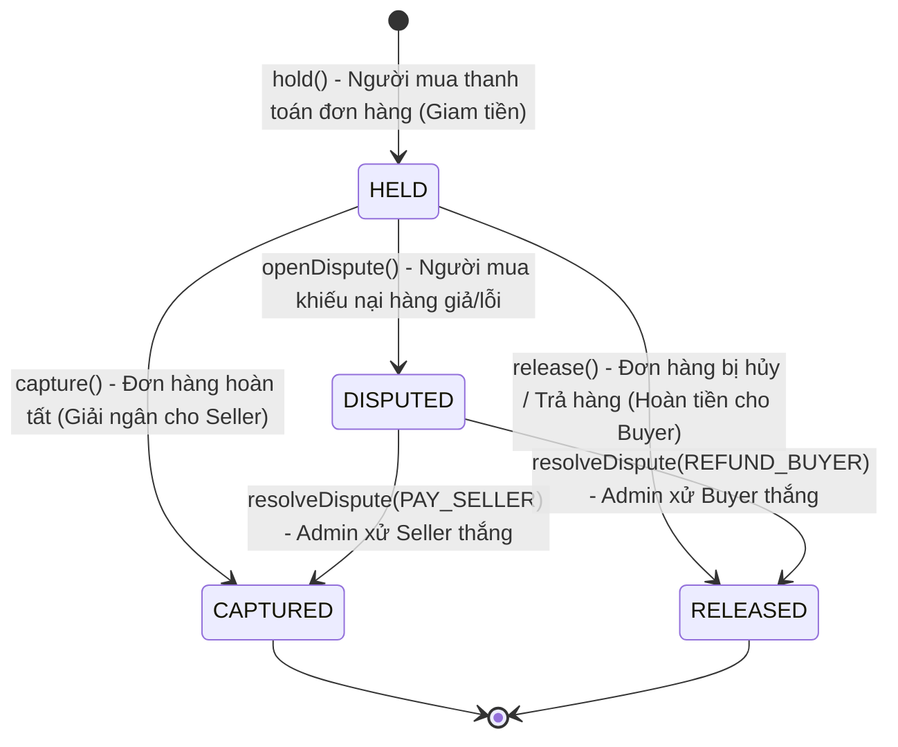
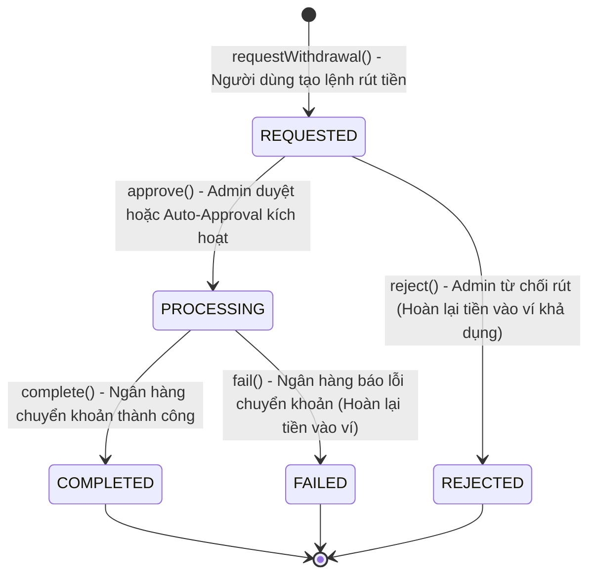
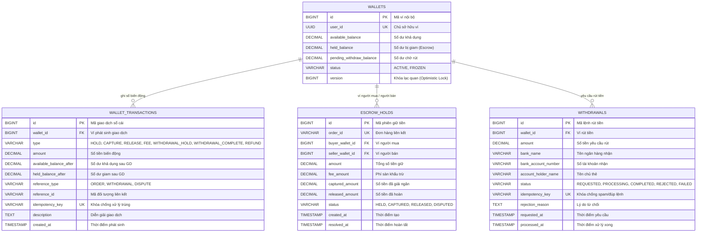
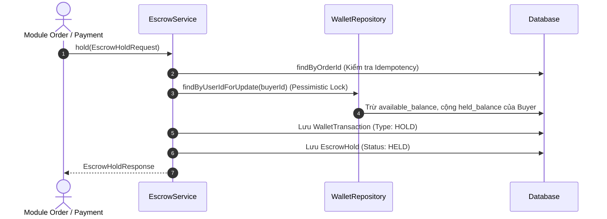
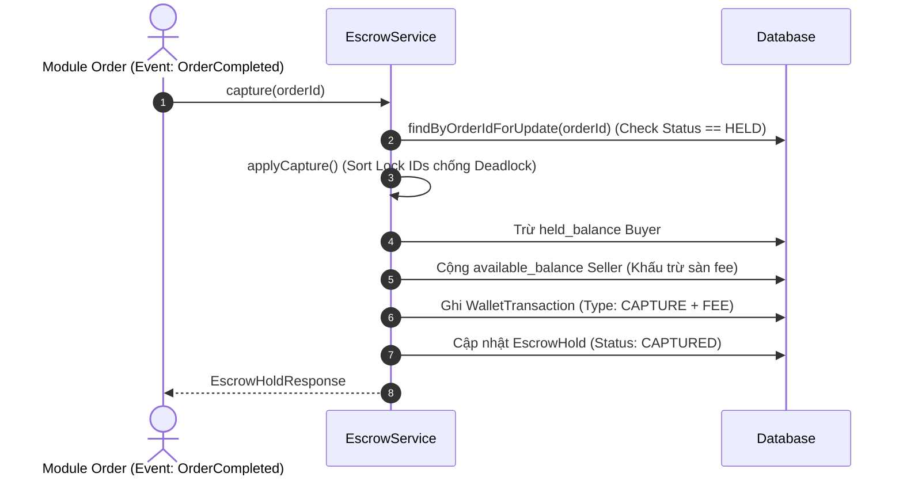
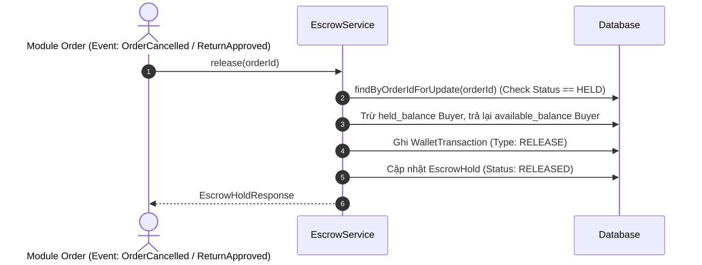
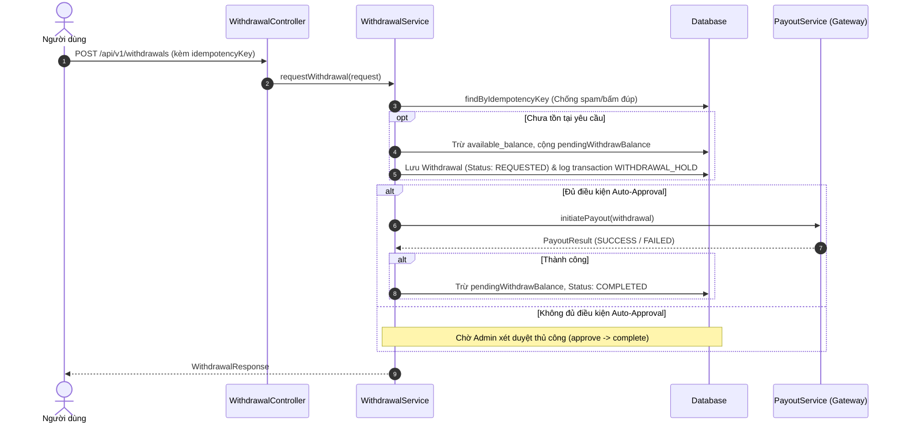

# MoldyMarket — Tài liệu Kiến trúc Module Wallet & Escrow (Ví Nội bộ & Ký quỹ Sàn)

---

## 1. Tổng quan

Module Wallet trong Moldy-Market đóng vai trò là **Sổ cái tài khoản nội bộ (Internal Ledger System)** của sàn thương mại điện tử C2C, chứ **không phải ví điện tử lưu ký ngân hàng**. Mục đích chính là trung chuyển dòng tiền bán hàng, giam giữ tiền ký quỹ (Escrow) để bảo vệ người mua trước khi nhận hàng, và quản lý các yêu cầu rút tiền về tài khoản ngân hàng thật của người bán.

### Bản chất 3 Loại Số dư (3-Balance Model):
Mỗi người dùng trong hệ thống sở hữu một bản ghi `Wallet` với 3 loại số dư hoạt động đồng thời:
1. **`available_balance` (Số dư khả dụng):** Tiền thực tế có thể dùng ngay để thanh toán đơn hàng mới hoặc rút về tài khoản ngân hàng.
2. **`held_balance` (Số dư ký quỹ / Escrow):** Tiền đang bị khóa lại trong quá trình giao nhận đơn hàng. Người mua không thể rút, người bán chưa được nhận.
3. **`pending_withdraw_balance` (Số dư chờ rút):** Tiền đã bị trừ khỏi số dư khả dụng khi người dùng bấm "Rút tiền", đang chờ hệ thống duyệt hoặc chuyển khoản ngân hàng thành công.

```
Tiền vào hệ thống (Người mua thanh toán đơn hàng) 
       ↓
Khóa tiền đảm bảo (Escrow Hold: available_balance -> held_balance) 
       ↓ (Người mua bấm "Đã nhận hàng" hoặc hết hạn khiếu nại)
Giải ngân vào số dư khả dụng Người bán (Capture: held_balance -> available_balance Seller)
       ↓
Rút tiền về tài khoản ngân hàng (Withdrawal: available_balance -> pending -> ngân hàng thật)
```

---

## 2. Phân tích Luồng Hoạt động Tổng quát của Module

Module Wallet hoạt động dựa trên hai trụ cột cốt lõi: **Hệ thống Ký quỹ (Escrow Engine)** và **Hệ thống Rút tiền (Withdrawal Engine)**.

### 2.1. Vòng đời Trạng thái Ký quỹ (`EscrowStatus`)



### 2.2. Vòng đời Lệnh Rút tiền (`WithdrawalStatus`)



### 2.3. Mô hình Sổ cái Bất biến (Append-Only Ledger)
Mọi biến động của bất kỳ loại số dư nào **tuyệt đối không bao giờ được ghi đè âm thầm**. Mỗi lần cộng trừ số dư, hệ thống luôn chèn (INSERT) một dòng lịch sử vào bảng `wallet_transactions` kèm số dư tức thời sau giao dịch (`balance_after`), tạo thành chuỗi kiểm toán tài chính không thể chối cãi.

---

## 3. Cấu trúc Cơ sở Dữ liệu (Database ERD & Schema)



---

## 4. Những Nguyên tắc Biên (Boundary Principles & Guardrails)

Hệ thống tài chính đòi hỏi tính toàn vẹn tuyệt đối, tuân thủ nghiêm ngặt các nguyên tắc biên sau:

1. **Ràng buộc Số tiền Dương (`amount > 0`):**
   - Mọi số tiền truyền vào (`hold`, `capture`, `release`, `withdraw`) bắt buộc phải lớn hơn `0`. Nếu `<= 0`, quăng lỗi `ErrorCode.WALLET_INVALID_AMOUNT`.
2. **Kiểm tra Số dư Khả dụng Đầy đủ (`availableBalance >= amount`):**
   - Nghiêm cấm tạo số dư âm. Nếu người dùng cố gắng đặt hàng hoặc rút tiền vượt quá số tiền họ đang có, quăng lỗi `ErrorCode.INSUFFICIENT_BALANCE`.
3. **Chống Tự Mua Hàng / Tự Giữ Tiền (`buyerId != sellerId`):**
   - Người mua và người bán không được trùng một người.
4. **Cô lập Đơn hàng Tranh chấp (`Dispute Freeze`):**
   - Khi có khiếu nại mở ra (`status = DISPUTED`), mọi luồng giải ngân tự động (`capture`) hay hoàn tiền (`release`) đều bị khóa cứng cho đến khi có phán quyết từ Admin.
   - Ví đang có đơn hàng tranh chấp sẽ **bị vô hiệu hóa tính năng tự động duyệt rút tiền (Auto-Approval)**.
5. **Cơ chế Hoàn trả An toàn (`Reverse Hold`):**
   - Nếu lệnh rút tiền bị Admin từ chối (`reject`) hoặc cổng thanh toán ngân hàng báo lỗi (`fail`), hệ thống lập tức hoàn trả tiền từ `pending_withdraw_balance` ngược về `available_balance` và ghi một giao dịch bồi hoàn vào sổ cái.
6. **Hạn mức Trần Rút tiền (Withdrawal Thresholds):**
   - Áp dụng hạn mức tối đa cho 1 lần rút tự động (`maxAmount`) và trần tổng tiền rút trong vòng 24 giờ gần nhất (`maxDailyTotal`). Bất kỳ lệnh nào vượt ngưỡng đều bị đẩy sang hàng đợi xét duyệt thủ công bởi Admin.

---

## 5. Chi tiết Các Luồng Nghiệp vụ và Code (Workflows)

### Workflow 1: Giam tiền Escrow khi Đặt hàng (Hold Flow)
Chạy khi Người mua thanh toán đơn hàng thành công, tiền được khóa lại trong hệ thống sàn để đảm bảo Người bán yên tâm đóng gói giao hàng.



* **Đoạn code cốt lõi (`EscrowService.java`):**
```java
@Transactional
public EscrowHoldResponse hold(EscrowHoldRequest request) {
    if (request.amount().compareTo(BigDecimal.ZERO) <= 0) {
        throw new AppException(ErrorCode.WALLET_INVALID_AMOUNT);
    }
    // Idempotent: nếu đã tồn tại hold cho orderId này thì trả về luôn
    return escrowMapper.toEscrowHoldResponse(escrowHoldRepository.findByOrderId(request.orderId())
            .orElseGet(() -> doHold(request)));
}

private EscrowHold doHold(EscrowHoldRequest request) {
    // Khóa bi quan hàng của Ví Buyer
    Wallet buyerWallet = walletRepository.findByUserIdForUpdate(request.buyerId())
            .orElseThrow(() -> new AppException(ErrorCode.WALLET_NOT_EXISTED));
    Wallet sellerWallet = walletRepository.findByUserId(request.sellerId())
            .orElseThrow(() -> new AppException(ErrorCode.WALLET_NOT_EXISTED));

    if (buyerWallet.getAvailableBalance().compareTo(request.amount()) < 0) {
        throw new AppException(ErrorCode.INSUFFICIENT_BALANCE);
    }

    // Chuyển tiền từ khả dụng sang giam giữ
    buyerWallet.setAvailableBalance(buyerWallet.getAvailableBalance().subtract(request.amount()));
    buyerWallet.setHeldBalance(buyerWallet.getHeldBalance().add(request.amount()));
    walletRepository.save(buyerWallet);

    // Ghi sổ cái giao dịch
    transactionRepository.save(WalletTransaction.create(
            buyerWallet, TransactionType.HOLD, request.amount(), "ORDER", request.orderId(),
            "hold:" + request.orderId(), "Holding for order " + request.orderId()
    ));

    EscrowHold hold = new EscrowHold();
    hold.setOrderId(request.orderId());
    hold.setBuyerWalletId(buyerWallet.getId());
    hold.setSellerWalletId(sellerWallet.getId());
    hold.setAmount(request.amount());
    hold.setFeeAmount(request.fee());
    hold.setStatus(EscrowStatus.HELD);

    return escrowHoldRepository.save(hold);
}
```

---

### Workflow 2: Giải ngân tiền cho Người bán (Capture Flow)
Xảy ra khi Người mua bấm "Đã nhận được hàng" hoặc hết thời hạn khiếu nại (ví dụ 3 ngày sau khi giao thành công).



* **Đoạn code cốt lõi (`EscrowService.java`):**
```java
@Transactional
public EscrowHoldResponse capture(String orderId) {
    EscrowHold hold = getHoldForUpdate(orderId);
    requireStatus(hold, EscrowStatus.HELD);

    applyCapture(hold);
    hold.setStatus(EscrowStatus.CAPTURED);
    hold.setResolvedAt(Instant.now());
    return escrowMapper.toEscrowHoldResponse(escrowHoldRepository.save(hold));
}

private void applyCapture(EscrowHold hold) {
    // Sắp xếp ID để tránh Deadlock khi khóa 2 ví cùng lúc
    Long firstId = Math.min(hold.getBuyerWalletId(), hold.getSellerWalletId());
    Long secondId = Math.max(hold.getBuyerWalletId(), hold.getSellerWalletId());

    Wallet firstLocked = walletRepository.findByIdForUpdate(firstId)
            .orElseThrow(() -> new AppException(ErrorCode.WALLET_NOT_EXISTED));
    Wallet secondLocked = walletRepository.findByIdForUpdate(secondId)
            .orElseThrow(() -> new AppException(ErrorCode.WALLET_NOT_EXISTED));

    Wallet buyerWallet = firstId.equals(hold.getBuyerWalletId()) ? firstLocked : secondLocked;
    Wallet sellerWallet = firstId.equals(hold.getSellerWalletId()) ? firstLocked : secondLocked;

    BigDecimal amount = hold.getAmount();
    BigDecimal fee = hold.getFeeAmount();
    BigDecimal netToSeller = amount.subtract(fee);

    buyerWallet.setHeldBalance(buyerWallet.getHeldBalance().subtract(amount));
    sellerWallet.setAvailableBalance(sellerWallet.getAvailableBalance().add(netToSeller));

    walletRepository.save(buyerWallet);
    walletRepository.save(sellerWallet);

    // Ghi sổ cái: Giải phóng tiền giam cho Buyer và Tiền về cho Seller
    transactionRepository.save(WalletTransaction.create(
            buyerWallet, TransactionType.CAPTURE, amount, "ORDER", hold.getOrderId(),
            "capture-buyer:" + hold.getOrderId(), "Paid for seller"
    ));
    transactionRepository.save(WalletTransaction.create(
            sellerWallet, TransactionType.CAPTURE, netToSeller, "ORDER", hold.getOrderId(),
            "capture-seller:" + hold.getOrderId(), "Received from order " + hold.getOrderId()
    ));

    if (fee.compareTo(BigDecimal.ZERO) > 0) {
        transactionRepository.save(WalletTransaction.create(
                sellerWallet, TransactionType.FEE, fee, "ORDER", hold.getOrderId(),
                "fee:" + hold.getOrderId(), "Platform fee deducted"
        ));
    }
    hold.setCapturedAmount(amount);
}
```

---

### Workflow 3: Hoàn tiền cho Người mua (Release Flow)
Xảy ra khi đơn hàng bị hủy trước khi giao hoặc Người bán đồng ý trả hàng/hoàn tiền.



* **Đoạn code cốt lõi (`EscrowService.java`):**
```java
@Transactional
public EscrowHoldResponse release(String orderId) {
    EscrowHold hold = getHoldForUpdate(orderId);
    requireStatus(hold, EscrowStatus.HELD);

    applyRelease(hold);
    hold.setStatus(EscrowStatus.RELEASED);
    hold.setResolvedAt(Instant.now());
    return escrowMapper.toEscrowHoldResponse(escrowHoldRepository.save(hold));
}

private void applyRelease(EscrowHold hold) {
    BigDecimal amount = hold.getAmount();
    Wallet buyerWallet = walletRepository.findByIdForUpdate(hold.getBuyerWalletId())
            .orElseThrow(() -> new AppException(ErrorCode.WALLET_NOT_EXISTED));

    buyerWallet.setHeldBalance(buyerWallet.getHeldBalance().subtract(amount));
    buyerWallet.setAvailableBalance(buyerWallet.getAvailableBalance().add(amount));
    walletRepository.save(buyerWallet);

    transactionRepository.save(WalletTransaction.create(
            buyerWallet, TransactionType.RELEASE, amount, "ORDER", hold.getOrderId(),
            "release:" + hold.getOrderId(), "Refund money for order " + hold.getOrderId()
    ));
    hold.setReleasedAmount(amount);
}
```

---

### Workflow 4: Xử lý Khiếu nại & Phán quyết Tranh chấp (Dispute Resolution Flow)
Khi Người mua khiếu nại (ví dụ hàng giả, hàng vỡ), luồng tự động giải ngân bị chặn lại. Admin vào thanh tra bằng chứng và đưa ra quyết định:

```java
// EscrowService.java
public EscrowHold openDispute(String orderId) {
    EscrowHold hold = getHoldForUpdate(orderId);
    requireStatus(hold, EscrowStatus.HELD);
    hold.setStatus(EscrowStatus.DISPUTED);
    return escrowHoldRepository.save(hold);
}

public EscrowHold resolveDispute(String orderId, DisputeOutcome outcome) {
    EscrowHold hold = getHoldForUpdate(orderId);
    requireStatus(hold, EscrowStatus.DISPUTED);
    hold.setStatus(EscrowStatus.HELD);

    if (outcome == DisputeOutcome.PAY_SELLER) {
        applyCapture(hold);
        hold.setStatus(EscrowStatus.CAPTURED);
    } else {
        applyRelease(hold);
        hold.setStatus(EscrowStatus.RELEASED);
    }
    hold.setResolvedAt(Instant.now());
    return escrowHoldRepository.save(hold);
}
```

---

### Workflow 5: Rút tiền về Ngân hàng (Withdrawal Flow + Idempotency & Auto-Approval)
Cho phép người bán rút tiền từ `available_balance` về số tài khoản ngân hàng.



---

## 6. Giải thích Các Chức năng có trong Module (kèm Code)

### 6.1. Danh sách REST API Endpoints

| Phương thức | Đường dẫn | Chức năng | Phân quyền |
|---|---|---|---|
| `GET` | `/api/v1/wallets/{userId}/balance` | Kiểm tra 3 loại số dư ví | Chủ ví / Admin |
| `POST` | `/api/v1/escrows/hold` | Giam tiền đảm bảo đơn hàng | Internal / Order Service |
| `POST` | `/api/v1/escrows/orders/{orderId}/capture` | Giải ngân tiền cho người bán | Internal / Order Service |
| `POST` | `/api/v1/escrows/orders/{orderId}/release` | Hoàn tiền cho người mua | Internal / Order Service |
| `POST` | `/api/v1/withdrawals` | Tạo lệnh rút tiền (kèm `idempotencyKey`) | Chủ ví |
| `PATCH` | `/api/v1/withdrawals/{id}/approve` | Admin duyệt lệnh rút tiền (chuyển sang PROCESSING) | Admin |
| `PATCH` | `/api/v1/withdrawals/{id}/complete` | Xác nhận tiền đã chuyển tới ngân hàng thật | Admin / Webhook |
| `PATCH` | `/api/v1/withdrawals/{id}/reject` | Từ chối lệnh rút tiền và bồi hoàn vào ví | Admin |
| `PATCH` | `/api/v1/withdrawals/{id}/fail` | Báo lỗi chuyển khoản thất bại và bồi hoàn vào ví | Admin / Webhook |

---

### 6.2. Chi tiết các hàm Xử lý Rút tiền (`WithdrawalService.java`)

#### 1. Tạo lệnh rút tiền có Idempotency
```java
@Transactional
public WithdrawalResponse requestWithdrawal(WithdrawalRequest request){
    if (request.amount().compareTo(BigDecimal.ZERO) <= 0)
        throw new AppException(ErrorCode.WALLET_INVALID_AMOUNT);

    // Chống spam request nhờ Idempotency Key
    Withdrawal withdrawal = withdrawalRepository.findByIdempotencyKey(request.idempotencyKey())
            .orElseGet(() -> doRequestWithdrawal(request));

    // Kiểm tra đủ điều kiện duyệt tự động
    if (withdrawal.getStatus() == WithdrawalStatus.REQUESTED && checkForAutoApproval(withdrawal)) {
        withdrawal = autoProcess(withdrawal);
    }
    return withdrawalMapper.toWithdrawalResponse(withdrawal);
}
```

#### 2. Điều kiện Duyệt Rút tiền Tự động (`checkForAutoApproval`)
Hệ thống kiểm tra 4 lớp phòng vệ trước khi tự động giải ngân:
```java
private boolean checkForAutoApproval(Withdrawal withdrawal){
    if (!autoApprovalProperties.isEnabled()) return false;

    // 1. Số tiền không vượt quá hạn mức tối đa cho 1 lần rút
    if (withdrawal.getAmount().compareTo(autoApprovalProperties.getMaxAmount()) > 0) {
        log.info("Withdrawal #{} exceeds max single amount -> manual review", withdrawal.getId());
        return false;
    }

    // 2. Tài khoản ngân hàng này đã từng rút thành công ít nhất 1 lần trong quá khứ
    boolean knownBankAccount = withdrawalRepository.existsByWalletIdAndBankAccountNumberAndStatus(
            withdrawal.getWalletId(), withdrawal.getBankAccountNumber(), WithdrawalStatus.COMPLETED);
    if (!knownBankAccount) {
        log.info("Withdrawal #{} uses a brand-new bank account -> manual review", withdrawal.getId());
        return false;
    }

    // 3. Ví người bán không nằm trong tình trạng có tranh chấp đang mở
    boolean hasOpenDispute = escrowHoldRepository.existsBySellerWalletIdAndStatus(
            withdrawal.getWalletId(), EscrowStatus.DISPUTED);
    if (hasOpenDispute) {
        log.info("Withdrawal #{} wallet has open disputes -> manual review", withdrawal.getId());
        return false;
    }

    // 4. Tổng tiền rút trong 24 giờ qua không vượt quá trần ngày
    Instant since = Instant.now().minus(24, ChronoUnit.HOURS);
    BigDecimal recentTotal = withdrawalRepository.sumRecentWithdrawals(withdrawal.getWalletId(), since);
    if (recentTotal.compareTo(autoApprovalProperties.getMaxDailyTotal()) > 0) {
        log.info("Withdrawal #{} daily total exceeded -> manual review", withdrawal.getId());
        return false;
    }
    return true;
}
```

#### 3. Hoàn tiền khi Rút thất bại hoặc bị Từ chối (`reverseHold`)
```java
private void reverseHold(Withdrawal withdrawal, TransactionType txType, String reason) {
    Wallet wallet = walletRepository.findByIdForUpdate(withdrawal.getWalletId())
            .orElseThrow(() -> new AppException(ErrorCode.WALLET_NOT_EXISTED));

    // Hoàn lại tiền từ chờ rút về khả dụng
    wallet.setPendingWithdrawBalance(wallet.getPendingWithdrawBalance().subtract(withdrawal.getAmount()));
    wallet.setAvailableBalance(wallet.getAvailableBalance().add(withdrawal.getAmount()));
    walletRepository.save(wallet);

    // Ghi sổ cái bồi hoàn
    walletTransactionRepository.save(WalletTransaction.create(
            wallet, txType, withdrawal.getAmount(), "WITHDRAWAL",
            String.valueOf(withdrawal.getId()),
            "reverse:" + withdrawal.getIdempotencyKey(),
            reason
    ));
}
```

---

## 7. Phân tích Chi tiết Các Lưu ý Kĩ thuật Cốt lõi

### Lưu ý 1: Khóa bi quan (`Pessimistic Write Lock`) chống Race Condition
* **Vấn đề kỹ thuật:** Nếu người dùng gửi đồng thời 2 yêu cầu rút 5 triệu trong khi số dư chỉ có 6 triệu (do lag mạng hoặc click đúp), nếu không có cơ chế khóa, 2 transaction có thể cùng đọc ra số dư 6 triệu và cả 2 đều thực hiện thành công, khiến ví bị âm tiền!
* **Giải pháp Code:** Sử dụng query `SELECT ... FOR UPDATE` trong Repository:
  ```java
  // WalletRepository.java
  @Lock(LockModeType.PESSIMISTIC_WRITE)
  @Query("SELECT w FROM Wallet w WHERE w.userId = :userId")
  Optional<Wallet> findByUserIdForUpdate(@Param("userId") UUID userId);
  ```
  Khi Transaction A đang đọc và tính toán số dư, Transaction B bắt buộc phải chờ ở cấp độ CSDL cho đến khi Transaction A commit xong.

---

### Lưu ý 2: Kỹ thuật Sắp xếp ID chống Deadlock (Sorted Lock IDs)
* **Vấn đề kỹ thuật (Deadlock kinh điển):**
  - Transaction 1 (Đơn hàng 1): Buyer A chuyển tiền cho Seller B → Khóa Ví A trước, rồi khóa Ví B.
  - Transaction 2 (Đơn hàng 2): Buyer B chuyển tiền cho Seller A → Khóa Ví B trước, rồi khóa Ví A.
  - Khi 2 giao dịch chạy cùng một mili-giây: T1 giữ A chờ B; T2 giữ B chờ A → **Deadlock, hệ thống sập câu lệnh!**
* **Giải pháp Code:** Luôn sắp xếp ID ví theo thứ tự tăng dần trước khi gọi lệnh lock:
  ```java
  // EscrowService.java - applyCapture
  private void applyCapture(EscrowHold hold) {
        Long firstId = Math.min(hold.getBuyerWalletId(), hold.getSellerWalletId());
        Long secondId = Math.max(hold.getBuyerWalletId(), hold.getSellerWalletId());

        Wallet firstLocked = walletRepository.findByIdForUpdate(firstId)
                .orElseThrow(() -> new AppException(ErrorCode.WALLET_NOT_EXISTED));
        Wallet secondLocked = walletRepository.findByIdForUpdate(secondId)
                .orElseThrow(() -> new AppException(ErrorCode.WALLET_NOT_EXISTED));

        Wallet buyerWallet = firstId.equals(hold.getBuyerWalletId()) ? firstLocked : secondLocked;
        Wallet sellerWallet = firstId.equals(hold.getSellerWalletId()) ? firstLocked : secondLocked;

        BigDecimal amount = hold.getAmount();
        BigDecimal fee = hold.getFeeAmount();
        BigDecimal netToSeller = amount.subtract(fee);

        buyerWallet.setHeldBalance(buyerWallet.getHeldBalance().subtract(amount));
        sellerWallet.setAvailableBalance(sellerWallet.getAvailableBalance().add(netToSeller));

        walletRepository.save(buyerWallet);
        walletRepository.save(sellerWallet);

        transactionRepository.save(WalletTransaction.create(
                buyerWallet, TransactionType.CAPTURE, amount, "ORDER", hold.getOrderId(),
                "capture-buyer:" + hold.getOrderId(), "Paid for seller"
        ));

        transactionRepository.save(WalletTransaction.create(
                sellerWallet, TransactionType.CAPTURE, netToSeller, "ORDER", hold.getOrderId(),
                "capture-seller:" + hold.getOrderId(), "Received from order " + hold.getOrderId()
        ));

        if (fee.compareTo(BigDecimal.ZERO) > 0) {
            transactionRepository.save(WalletTransaction.create(
                    sellerWallet, TransactionType.FEE, fee, "ORDER", hold.getOrderId(),
                    "fee:" + hold.getOrderId(), "Fee platform"
            ));
        }

        hold.setCapturedAmount(amount);
    }
  ```
  Nhờ quy ước này, hiện tượng Deadlock giữa 2 ví được loại bỏ 100%.

---

### Lưu ý 3: Khóa chống trùng lặp (`Idempotency Key Pattern`)
* **Vấn đề kỹ thuật:** Khi mạng chậm, người dùng nhấn nút "Rút tiền" 3 lần liên tiếp.
* **Giải pháp:** Client sinh một mã UUID duy nhất (ví dụ `idem-withdraw-xyz-123`) gửi kèm trong payload.
  ```java
  Withdrawal withdrawal = withdrawalRepository.findByIdempotencyKey(request.idempotencyKey())
          .orElseGet(() -> doRequestWithdrawal(request));
  ```
  Nhờ ràng buộc `UNIQUE` trên cột `idempotency_key`, request thứ 2 và thứ 3 sẽ trả về ngay kết quả của lệnh đầu tiên mà không trừ tiền lần thứ hai.

---

### Lưu ý 4: Nguyên tắc Sổ cái Kép & Bất biến (Double-Entry Ledger)
Mọi phép tính toán số dư đều kèm theo 1 bản ghi `WalletTransaction`. Không cho phép bất kỳ API nào gọi `wallet.setAvailableBalance(...)` mà không gọi `transactionRepository.save(...)`. Điều này cho phép:
$$\text{Available Balance Hiện Tại} = \sum (\text{Các giao dịch cộng}) - \sum (\text{Các giao dịch trừ})$$
Kế toán hoặc Admin có thể kiểm toán, đối chiếu lại toàn bộ lịch sử biến động từ ngày mở tài khoản.

---

## 8. Tính năng Mở rộng (Nâng cấp Hệ thống khi Đủ Thời gian)

1. **Tích hợp Webhook Ngân hàng Tự động (SePay / VietQR Payout API):**
   - Thay vì Admin phải dùng app ngân hàng chuyển tay từng lệnh rút tiền, hệ thống tích hợp Open API của ngân hàng (hoặc SePay Payout) để chuyển khoản liên ngân hàng 24/7 tự động ngay khi lệnh được duyệt `PROCESSING`.
2. **Hệ thống Phí Sàn Đa tầng (Tiered Commission Fees):**
   - Tự động điều chỉnh tỷ lệ phí sàn (`feeAmount`) theo cấp bậc người bán: Người bán thường 5%, Gian hàng Store 3%, Shop VIP 1.5%.
3. **Tích hợp Ví Voucher & Điểm Thưởng (Coin / Loyalty Points):**
   - Mở rộng thêm cột `points_balance` trong ví để quy đổi điểm thưởng thành tiền giảm giá trực tiếp khi thanh toán đơn hàng.
4. **Xuất Báo cáo Sao kê Tài chính (PDF/Excel):**
   - Cung cấp API xuất sao kê lịch sử biến động số dư theo tháng/quý có đóng dấu mộc điện tử để người bán kê khai thuế và đối soát dòng tiền.
