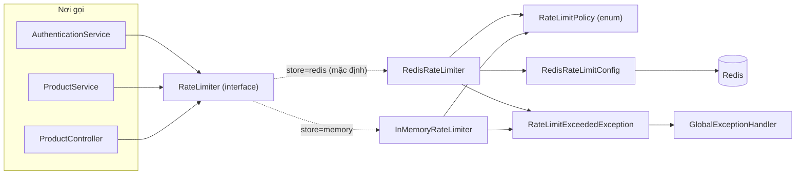
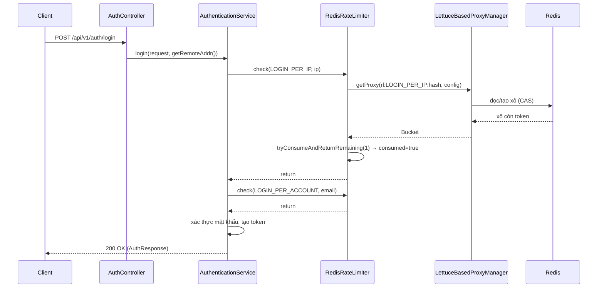
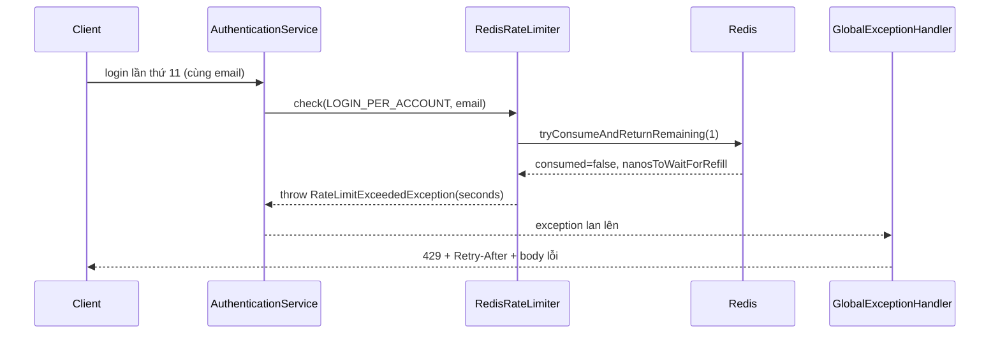
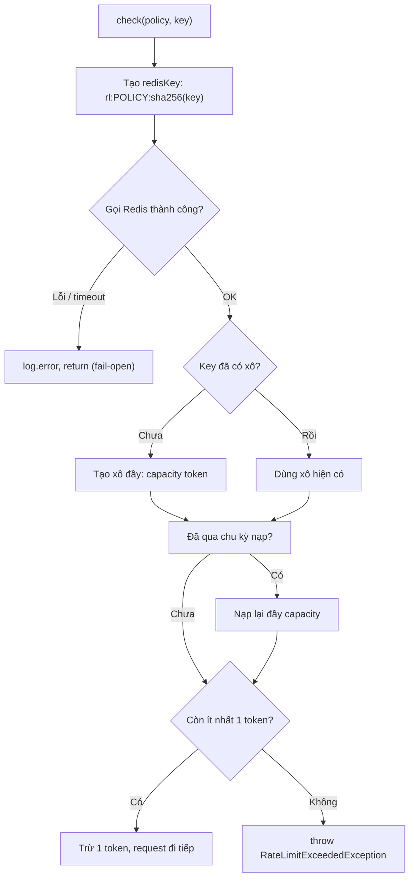
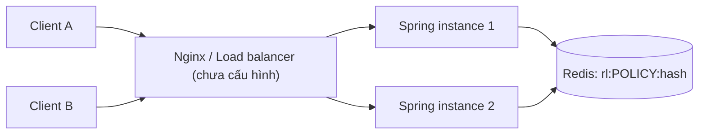
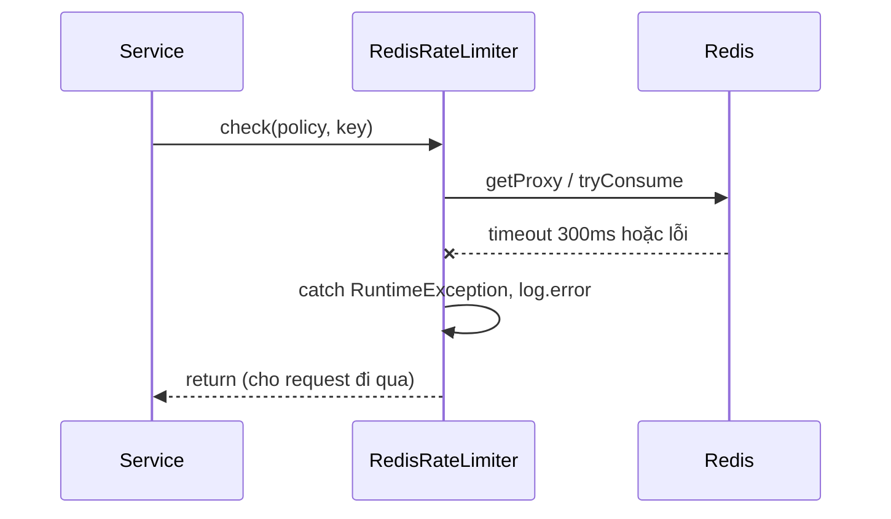

# Rate Limiting & Bucket4j — Technical Documentation

> **Dự án:** Moldy Market (`com.moldy.moldymarket`) · **Phụ trách:** Chu (P2) · **Cập nhật:** 2026-11-01

## 0. Phạm vi và nguồn của tài liệu (đọc trước)

Tài liệu này mô tả phần Rate Limiting đã được implement trên nhánh `feature/product`.

**Nguồn thông tin:** toàn bộ code được dựng lại từ các đoạn code đã viết và chạy thử trong quá trình làm việc, **không phải** từ việc quét trực tiếp repo `Qt159/Moldy-Market` (bản clone chỉ có nhánh `main`, chưa có nhánh `feature/product`). Vì vậy:

- Tên class, method, policy, cấu hình dưới đây là bản cuối cùng sau các lần sửa (đã bao gồm `Bucket4jLettuce.casBasedBuilder`, `getProxy`, `throw` nằm ngoài `try/catch`).
- Những điểm không thể xác minh từ code được ghi rõ **"Chưa xác định được từ source code"**.
- Trước khi dùng làm tài liệu chính thức của team, nên chạy lệnh đối chiếu ở mục 9.5 để chắc tên file/package khớp với repo thật.

**Quy ước đánh dấu:** 🟢 đã implement · 🔴 chưa implement · ⚠️ vấn đề/giới hạn đã ghi nhận.

---

## 1. Overview

### 1.1 Rate Limiting là gì?

**Rate Limiting** (giới hạn tần suất request) là cơ chế quy định *một đối tượng được gọi một hành động tối đa bao nhiêu lần trong một khoảng thời gian*. Đối tượng có thể là một địa chỉ IP, một tài khoản, hoặc một user đã đăng nhập.

### 1.2 Tại sao backend cần nó?

| Nếu không giới hạn | Hậu quả |
|---|---|
| Thử mật khẩu liên tục (brute force / credential stuffing) | Kẻ tấn công dò được mật khẩu |
| Đăng ký tài khoản hàng loạt | Rác dữ liệu, spam |
| Đăng tin liên tục | Spam sản phẩm, tốn DB |
| Gọi `/search`, `/suggest` dồn dập (cào dữ liệu) | Tốn CPU/DB của Postgres, ảnh hưởng người dùng thật |
| Mỗi request đăng nhập tốn BCrypt | Tấn công vào CPU server |

### 1.3 Tại sao dùng Bucket4j?

**Bucket4j** là thư viện Java cài sẵn thuật toán Token Bucket, thread-safe, và có sẵn backend phân tán (Redis, JDBC, Hazelcast...). Project chọn nó vì:

- Không phải tự viết logic đếm/refill (dễ sai khi nhiều thread).
- Cùng một API dùng được cho cả bản in-memory và bản Redis (đổi nơi lưu mà không đổi cách dùng).
- Trả về `ConsumptionProbe` cho biết còn bao nhiêu token và bao lâu nữa được thử lại (dùng để tính `Retry-After`).

### 1.4 Phạm vi bảo vệ hiện tại 🟢

Rate limit **không** phải filter áp cho toàn bộ API. Nó chỉ chạy ở những chỗ code chủ động gọi `rateLimiter.check(...)`:

| Policy | Giới hạn | Key (định danh) | Nơi gọi |
|---|---|---|---|
| `LOGIN_PER_IP` | 30 lượt / 5 phút | IP | `AuthenticationService.login` |
| `LOGIN_PER_ACCOUNT` | 10 lượt / 15 phút | email đã `trim().toLowerCase()` | `AuthenticationService.login` |
| `REGISTER_PER_IP` | 5 lượt / 1 giờ | IP | `AuthenticationService.register` |
| `PRODUCT_CREATE` | 10 lượt / 1 phút | `userId` | `ProductService.create` |
| `SUGGEST_PER_IP` | 60 lượt / 1 phút | IP | `ProductController.suggest` |
| `SEARCH_PER_IP` | 120 lượt / 1 phút | IP | `ProductController.search` |

🔴 **Chưa bảo vệ:** `/auth/refresh`, `GET /products` (danh sách cũ), `GET /products/{id}`, các endpoint store/category, và mọi endpoint chưa có dòng `check(...)`.

---

## 2. Core Concepts — Kiến thức nền tảng

### 2.1 Token Bucket Algorithm

**Khái niệm.** Hình dung một *chiếc xô* chứa các *phiếu* (token). Mỗi request đi qua phải lấy 1 phiếu. Xô hết phiếu thì request bị từ chối. Theo thời gian, xô được *nạp lại* phiếu.

| Thuật ngữ | Nghĩa | Trong project |
|---|---|---|
| **Bucket** (xô) | Nơi chứa token, mỗi key có một xô riêng | Một xô cho mỗi (policy, key) |
| **Token** (phiếu) | Một lượt được phép | `tryConsumeAndReturnRemaining(1)` lấy 1 |
| **Capacity** (sức chứa) | Số token tối đa xô giữ được, cũng là số request tối đa dồn trong một lúc | `policy.capacity()` |
| **Refill** (nạp lại) | Thêm token vào xô theo thời gian | `refillIntervally(capacity, period)` |
| **Refill Tokens / Duration** | Mỗi chu kỳ `Duration` thì nạp bao nhiêu token | Nạp `capacity` token mỗi `period` |
| **Consumption** | Hành động lấy token | `tryConsumeAndReturnRemaining(1)` |
| **Rejected request** | Request đến khi xô trống | Ném `RateLimitExceededException` → HTTP 429 |
| **Bandwidth / Limit** | Một luật (capacity + refill) gắn vào xô | `addLimit(limit -> limit.capacity(..).refillIntervally(..))` |

### 2.2 `refillIntervally` khác `refillGreedy`

- **`refillIntervally(n, period)`** (project dùng): token được nạp **một lần cả cục** mỗi `period`. Ví dụ `LOGIN_PER_ACCOUNT` = 10 token / 15 phút: dùng hết 10 token thì phải đợi hết chu kỳ, lúc đó 10 token về cùng lúc.
- **`refillGreedy(n, period)`** (🔴 project **không** dùng): nạp từng chút liên tục (10 token/15 phút ≈ 1 token mỗi 90 giây).

Lý do chọn Intervally: luật dễ giải thích cho người dùng ("bị khóa tới giờ X") và `Retry-After` chính xác.

### 2.3 Ví dụ bằng số

`LOGIN_PER_ACCOUNT`: capacity 10, nạp 10 token mỗi 15 phút, email `a@gmail.com`.

| Thời điểm | Sự kiện | Token còn | Kết quả |
|---|---|---|---|
| 00:00 | Request 1 (xô mới, đầy 10) | 9 | ✅ |
| 00:01 → 00:02 | Request 2 → 10 | 0 | ✅ |
| 00:03 | Request 11 | 0 | ❌ 429, `Retry-After ≈ 12 phút` |
| 00:15 | Hết chu kỳ, nạp lại | 10 | ✅ lại được |

### 2.4 So sánh với thuật toán khác

| Thuật toán | Cách hoạt động | Nhược điểm |
|---|---|---|
| **Fixed Window** | Đếm request trong từng khung cố định (vd mỗi phút) | Dồn gấp đôi ở ranh giới 2 khung |
| **Sliding Window** | Khung trượt theo thời gian thực | Tốn bộ nhớ/tính toán hơn |
| **Leaky Bucket** | Request vào hàng đợi, "rò" ra với tốc độ cố định | Làm phẳng traffic, không cho phép burst |
| **Token Bucket** (project dùng) | Có phiếu thì đi, hết thì chặn | Cho phép burst tới `capacity` |

Token Bucket hợp API vì cho phép *burst hợp lý* (người dùng thật bấm liên tiếp vài lần vẫn được) nhưng vẫn chặn được kẻ dồn dập kéo dài.

---

## 3. Architecture & Components

Package: `com.moldy.moldymarket.common.ratelimit`

### 3.1 Bảng tổng hợp

| Component | Responsibility | Interaction |
|---|---|---|
| `RateLimiter` (interface) | Hợp đồng duy nhất `check(RateLimitPolicy, String key)` | Mọi service/controller inject interface này |
| `RateLimitPolicy` (enum) | Nơi **duy nhất** khai báo capacity và period của từng policy | Được cả hai implementation đọc |
| `RedisRateLimiter` | Implementation mặc định: Bucket4j + Redis | Dùng `LettuceBasedProxyManager<byte[]>` |
| `InMemoryRateLimiter` | Implementation RAM (Caffeine), chỉ bật khi `store=memory` | Dùng cho máy không có Redis |
| `RedisRateLimitConfig` | Tạo `RedisClient`, kết nối, `ProxyManager` | Bean được `RedisRateLimiter` inject |
| `RateLimitExceededException` | Exception mang `retryAfterSeconds` | Ném từ `check`, bắt ở `GlobalExceptionHandler` |
| `GlobalExceptionHandler.handleRateLimit` | Đổi exception thành HTTP 429 + `Retry-After` | Dùng `ErrorCode.TOO_MANY_REQUESTS` |
| `ErrorCode.TOO_MANY_REQUESTS` | `COMMON_009`, HTTP 429, "Too many requests, please try again later" | Dùng bởi handler |

### 3.2 Chi tiết từng class

**`RateLimiter`** — chỉ có 1 method:

```java
public interface RateLimiter {
    void check(RateLimitPolicy policy, String key); // hết lượt thì ném RateLimitExceededException
}
```

Input: policy + key. Output: `void`; kết quả "bị chặn" thể hiện bằng exception. Tồn tại để code nghiệp vụ không phụ thuộc Redis hay RAM: đổi nơi lưu không phải sửa chỗ gọi.

**`RateLimitPolicy`**:

```java
LOGIN_PER_IP(30, Duration.ofMinutes(5)),
LOGIN_PER_ACCOUNT(10, Duration.ofMinutes(15)),
REGISTER_PER_IP(5, Duration.ofHours(1)),
PRODUCT_CREATE(10, Duration.ofMinutes(1)),
SUGGEST_PER_IP(60, Duration.ofMinutes(1)),
SEARCH_PER_IP(120, Duration.ofMinutes(1));
```

Có hai accessor `capacity()` và `period()`. Thêm giới hạn mới = thêm một dòng vào enum.

**`RedisRateLimiter`** (`@ConditionalOnProperty(name="app.rate-limit.store", havingValue="redis", matchIfMissing=true)`):

- Tạo sẵn `CONFIGS` (một `BucketConfiguration` cho mỗi policy, `EnumMap`) lúc class load.
- `check(...)`: lấy bucket từ Redis, lấy 1 token, nếu hết thì ném exception.
- `redisKey(policy, key)`: băm SHA-256, key Redis có dạng `rl:<POLICY>:<64 ký tự hex>`.

**`InMemoryRateLimiter`** (`havingValue="memory"`): mỗi policy một `Cache<String, Bucket>` của Caffeine (`expireAfterAccess(2h)`, `maximumSize(100_000)`).

**`RedisRateLimitConfig`** (cùng điều kiện với `RedisRateLimiter`), 3 bean:

1. `rateLimitRedisClient` — `RedisClient` Lettuce, timeout 300ms.
2. `rateLimitRedisConnection` — `StatefulRedisConnection<byte[], byte[]>` (codec `ByteArrayCodec`).
3. `rateLimitProxyManager` — `LettuceBasedProxyManager<byte[]>` tạo bằng `Bucket4jLettuce.casBasedBuilder(...)`.

**`RateLimitExceededException`** (`extends RuntimeException`, Lombok `@Getter`): giữ `retryAfterSeconds`. Không dùng `AppException` vì cần mang thêm giá trị này để trả header.

### 3.3 Component Diagram

*Sơ đồ 1 — Các thành phần và quan hệ phụ thuộc.*



---

## 4. Configuration

### 4.1 Dependency (`pom.xml`)

```xml
<dependency>
    <groupId>com.bucket4j</groupId>
    <artifactId>bucket4j_jdk17-core</artifactId>
    <version>8.14.0</version>
</dependency>
<dependency>
    <groupId>com.bucket4j</groupId>
    <artifactId>bucket4j_jdk17-lettuce</artifactId>
    <version>8.14.0</version> <!-- phải cùng version với core -->
</dependency>
<dependency>
    <groupId>org.springframework.boot</groupId>
    <artifactId>spring-boot-starter-data-redis</artifactId>
</dependency>
<dependency>
    <groupId>com.github.ben-manes.caffeine</groupId>
    <artifactId>caffeine</artifactId> <!-- chỉ cần cho InMemoryRateLimiter -->
</dependency>
```

> **Chưa xác định được từ source code:** version Bucket4j chính xác trong `pom.xml` của repo. `8.14.0` là giá trị đề xuất lúc cài; tài liệu Bucket4j `8.18.0` cũng đã được tham chiếu và có API `Bucket4jLettuce.casBasedBuilder`. Quy tắc bắt buộc: hai artifact `core` và `lettuce` **cùng version**.

### 4.2 `application-local.yaml`

```yaml
spring:
  data:
    redis:
      host: localhost
      port: 6379
      password: ${REDIS_PASSWORD:}

app:
  rate-limit:
    store: redis   # hoặc memory khi máy không có Redis
```

- `${REDIS_PASSWORD:}` là placeholder của Spring: dấu `:` sau tên biến nghĩa là *"nếu chưa đặt biến môi trường thì dùng giá trị mặc định, ở đây là chuỗi rỗng"*. Local không đặt mật khẩu thì `password` rỗng.
- `RedisRateLimitConfig` chỉ gọi `withPassword(...)` khi `password` không rỗng.

### 4.3 Redis bằng Docker (`docker-compose.yml`)

```yaml
services:
  redis:
    image: redis:7-alpine
    ports:
      - "127.0.0.1:6379:6379"   # chỉ nghe localhost
```

### 4.4 Chi tiết cấu hình bucket

| Hạng mục | Giá trị thực tế |
|---|---|
| Capacity | `policy.capacity()` |
| Refill | `refillIntervally(policy.capacity(), policy.period())` (nạp đầy lại sau mỗi `period`) |
| Scope | Theo từng cặp `(policy, key)`: IP, email hoặc userId tùy policy |
| Nơi lưu (Redis) | Key `rl:<POLICY>:<sha256-hex>` trong Redis |
| Thời gian tồn tại (Redis) | `ExpirationAfterWriteStrategy.basedOnTimeForRefillingBucketUpToMax(Duration.ofSeconds(30))`: key tự hết hạn khi xô đã đầy lại, cộng 30 giây |
| Nơi lưu (memory) | `Caffeine`, `expireAfterAccess(2h)`, tối đa 100.000 key mỗi policy |
| Timeout Redis | 300 ms (`RedisURI.withTimeout`) |

### 4.5 Cách xác định danh tính client

| Loại | Cách lấy |
|---|---|
| IP | `HttpServletRequest.getRemoteAddr()` (controller truyền xuống service) |
| Account | `request.email().trim().toLowerCase()` |
| User | `userId` từ `CustomUserDetails` (`extractUserId` trong `ProductService`) |

⚠️ Sau Nginx/load balancer, `getRemoteAddr()` luôn là IP proxy → mọi người dùng chung một xô. Cần `server.forward-headers-strategy: native` trong yaml (🔴 chưa cấu hình vì đang chạy local). **Không** tự đọc header `X-Forwarded-For` vì client giả được.

---

## 5. Execution Flow

### 5.1 Flow chung

1. Client gửi HTTP request tới Spring (Security filter chain chạy trước).
2. Controller nhận request, hoặc truyền IP xuống service.
3. Đầu method nghiệp vụ gọi `rateLimiter.check(policy, key)` — **trước** khi làm việc nặng (BCrypt, query DB).
4. `RedisRateLimiter.check`:
   1. Lấy `BucketConfiguration` của policy từ `CONFIGS`.
   2. `proxyManager.getProxy(redisKey(policy, key), () -> config)`: nếu key chưa có trong Redis thì tạo xô đầy theo config; nếu có thì dùng xô hiện tại.
   3. `bucket.tryConsumeAndReturnRemaining(1)` → `ConsumptionProbe`.
5. Còn token → `check` kết thúc bình thường, request đi tiếp.
6. Hết token → ném `RateLimitExceededException(retryAfterSeconds)`.
7. `GlobalExceptionHandler.handleRateLimit` trả HTTP 429 + header `Retry-After`.

### 5.2 Code trọng tâm (`RedisRateLimiter.check`)

```java
@Override
public void check(RateLimitPolicy policy, String key) {
    ConsumptionProbe probe;
    try {
        BucketConfiguration config = CONFIGS.get(policy);
        Bucket bucket = proxyManager.getProxy(redisKey(policy, key), () -> config);
        probe = bucket.tryConsumeAndReturnRemaining(1);
    } catch (RuntimeException e) {
        // Chỉ lỗi từ Redis mới vào đây: fail-open
        log.error("Rate limiter unavailable, request allowed. policy={}, cause={}", policy, e.toString());
        return;
    }

    // Nằm NGOÀI try/catch để không bị nuốt
    if (!probe.isConsumed()) {
        long seconds = Math.max(1, Duration.ofNanos(probe.getNanosToWaitForRefill()).toSeconds());
        throw new RateLimitExceededException(seconds);
    }
}
```

**Giải thích từng bước:**

- `try/catch` **chỉ bao đoạn nói chuyện với Redis**. Nếu Redis lỗi/timeout thì ghi log và cho request đi qua (**fail-open**).
- `throw` bắt buộc nằm **ngoài** `try`. `RateLimitExceededException` là `RuntimeException`, nếu `throw` nằm trong `try` thì `catch (RuntimeException e)` sẽ nuốt nó, log "unavailable" rồi `return` → request bị cho qua dù xô đã hết. (Đây chính là lỗi đã gặp khi debug: bấm login 11 lần vẫn nhận 200.)
- `Math.max(1, ...)` đảm bảo `Retry-After` tối thiểu 1 giây.

### 5.3 Băm key

```java
private static byte[] redisKey(RateLimitPolicy policy, String key) {
    byte[] hash = MessageDigest.getInstance("SHA-256").digest(key.getBytes(StandardCharsets.UTF_8));
    return ("rl:" + policy.name() + ":" + HexFormat.of().formatHex(hash)).getBytes(StandardCharsets.UTF_8);
}
```

Hai lý do băm: (1) key Redis luôn có độ dài cố định, ai đó gửi email dài cả MB cũng không làm đầy Redis; (2) không lưu email dạng rõ trong Redis.

### 5.4 Các flow cụ thể

**Đăng nhập** (`AuthController.login` → `AuthenticationService.login(request, clientIp)`):

```java
rateLimiter.check(RateLimitPolicy.LOGIN_PER_IP, clientIp);
rateLimiter.check(RateLimitPolicy.LOGIN_PER_ACCOUNT, request.email().trim().toLowerCase());
// sau đó mới xác thực mật khẩu
```

Cần cả hai: chỉ theo IP thì kẻ tấn công đổi IP là qua; chỉ theo tài khoản thì không chặn được kẻ thử nhiều email.

**Đăng ký** (`AuthenticationService.register(request, clientIp)`): `REGISTER_PER_IP` ở đầu hàm.

**Đăng tin** (`ProductService.create`): thứ tự là `extractUserId` → `rateLimiter.check(PRODUCT_CREATE, userId.toString())` → các bước kiểm tra nghiệp vụ.

**Search / suggest** (`ProductController`): dòng đầu của hàm:

```java
rateLimiter.check(RateLimitPolicy.SEARCH_PER_IP,  httpRequest.getRemoteAddr()); // /search
rateLimiter.check(RateLimitPolicy.SUGGEST_PER_IP, httpRequest.getRemoteAddr()); // /suggest
```

---

## 6. Architecture Diagrams

### 6.1 Component Diagram

Xem mục 3.3.

### 6.2 Sequence — request hợp lệ (đăng nhập)

*Sơ đồ 2 — Xô còn token.*



### 6.3 Sequence — vượt giới hạn

*Sơ đồ 3 — Xô hết token.*



### 6.4 Flowchart — logic Token Bucket

*Sơ đồ 4 — Logic bên trong một lần `check`.*



### 6.5 Deployment / Storage

*Sơ đồ 5 — Nhiều instance dùng chung một Redis.*



Vì xô nằm trong Redis nên instance 1 và 2 cùng đếm trên **một** xô cho mỗi (policy, key). Với `store=memory`, mỗi instance có xô riêng (xem mục 8).

### 6.6 Sequence — Redis lỗi (fail-open)

*Sơ đồ 6.*



---

## 7. HTTP Response & Error Handling

### 7.1 Response khi vượt giới hạn

- **HTTP status:** `429 Too Many Requests` (`ErrorCode.TOO_MANY_REQUESTS`).
- **Header:** `Retry-After: <giây>` (từ `retryAfterSeconds`).
- **Body:** dùng `ApiResponse.failure(...)` như các lỗi khác; trường `code` là `ErrorCode.name()`:

```json
{
  "code": "TOO_MANY_REQUESTS",
  "message": "Too many requests, please try again later",
  "...": "phần còn lại do ApiResponse/ApiError quyết định, trong đó ApiError.of(request.getRequestURI())"
}
```

> **Chưa xác định được từ source code:** tên chính xác các trường của `ApiResponse` ngoài `code` và `message` (cấu trúc đầy đủ nằm trong class `ApiResponse`/`ApiError` mà tài liệu này không đọc trực tiếp).

### 7.2 Handler

```java
@ExceptionHandler(RateLimitExceededException.class)
public ResponseEntity<ApiResponse<ApiError>> handleRateLimit(
        RateLimitExceededException exception, HttpServletRequest request) {
    ApiResponse<ApiError> response = ApiResponse.failure(
            ErrorCode.TOO_MANY_REQUESTS.name(),
            ErrorCode.TOO_MANY_REQUESTS.getMessage(),
            ApiError.of(request.getRequestURI()));
    return ResponseEntity.status(ErrorCode.TOO_MANY_REQUESTS.getHttpStatus())
            .header(HttpHeaders.RETRY_AFTER, String.valueOf(exception.getRetryAfterSeconds()))
            .body(response);
}
```

Vì `check` được gọi từ controller/service nên exception đi qua `GlobalExceptionHandler` (`@RestControllerAdvice`). Rate limit **không** chạy ở tầng Servlet Filter.

### 7.3 Client nên xử lý thế nào

- Bắt HTTP 429, đọc `Retry-After` và hiển thị "Thử lại sau X giây/phút".
- Với đăng nhập: vô hiệu hóa nút gửi trong thời gian đó, không tự retry liên tục.
- Với `/suggest`: debounce khi gõ để không tự đốt hết 60 lượt/phút.

---

## 8. Important Design Decisions

| Quyết định | Lý do | Đánh đổi |
|---|---|---|
| Interface `RateLimiter` + 2 implementation | Đổi RAM ↔ Redis không sửa chỗ gọi | Thêm một tầng trừu tượng |
| Redis làm mặc định | Nhiều instance dùng chung giới hạn, restart không reset | Cần chạy Redis; mọi thành viên nhóm phải có Redis (hoặc đặt `store=memory`) |
| **Fail-open** khi Redis lỗi | Không để Redis sập kéo theo đăng nhập sập | Lúc đó rate limit tạm thời vô hiệu |
| Băm SHA-256 key | Độ dài cố định, không lưu email rõ | Khó đọc key khi debug (phải tính hash) |
| Policy khai báo trong enum | Một nơi duy nhất để chỉnh | Sửa phải build lại, không cấu hình runtime |
| `LOGIN_PER_ACCOUNT` = 10 (không phải 5) | Đếm cả lần đăng nhập thành công, người dùng thật đổi thiết bị không bị chặn oan | Cho kẻ tấn công nhiều lượt hơn |
| `SEARCH_PER_IP` thêm ngoài yêu cầu | `/search` công khai và tốn tài nguyên | NAT/mạng công ty chung một IP có thể chạm giới hạn |
| Gọi `check` thủ công (không annotation) | Rõ ràng, dễ debug | Quên gọi là endpoint không được bảo vệ |

### 8.1 Câu hỏi thường gặp về an toàn vận hành

- **Memory leak?** Bản Redis: không, key tự hết hạn (`basedOnTimeForRefillingBucketUpToMax` + 30s). Bản memory: `Caffeine` giới hạn 100.000 key/policy và hết hạn sau 2 giờ không dùng.
- **Nhiều instance?** Bản Redis: đúng giới hạn toàn cục. Bản memory: ⚠️ mỗi instance giữ xô riêng nên người dùng được gấp N lần giới hạn, và restart thì reset.
- **Constraint của bản memory:** `expireAfterAccess(2h)` phải lớn hơn `period` dài nhất trong enum (hiện 1 giờ của `REGISTER_PER_IP`). Thêm policy dài hơn 2 giờ thì phải tăng con số này.

### 8.2 Vấn đề kỹ thuật / rủi ro đã ghi nhận ⚠️

1. **Một kết nối Lettuce dùng chung** (`rateLimitRedisConnection`): đủ cho đồ án; chưa đánh giá dưới tải cao. Lettuce thread-safe nhưng không có pool.
2. **Redis chết lúc khởi động → app không chạy** (bean kết nối tạo ngay). Chủ ý: thiếu Redis phải thấy lỗi sớm. Khác với Redis chết *lúc đang chạy* (fail-open).
3. **Khóa tài khoản bị lợi dụng:** `LOGIN_PER_ACCOUNT` theo email nên kẻ xấu cố ý nhập sai liên tục có thể khóa người khác tối đa 15 phút/lần. Mức thiệt hại thấp nên chấp nhận.
4. **`getRemoteAddr()` sau proxy:** chưa cấu hình `server.forward-headers-strategy` (xem 4.5).
5. **Đổi số trong `RateLimitPolicy` có hiệu lực ngay không?** *Chưa xác định được từ source code.* Theo thiết kế của Bucket4j, `() -> config` chỉ được dùng khi key chưa tồn tại, nên xô đã tạo có thể giữ cấu hình cũ cho tới khi hết hạn. Nên thử trên Redis thật; khi cần áp dụng ngay, xóa key `rl:*` (`flushdb` ở môi trường dev).
6. **Chưa giới hạn endpoint khác** (xem mục 1.4).
7. **Chưa có metric/monitoring** cho số lần bị chặn hay số lần fail-open (🔴 chưa implement).

---

## 9. Testing & Debugging

### 9.1 Test hiện có

🔴 **Chưa có test tự động** cho rate limit (mục "automated tests" nằm trong danh sách việc còn lại). Mọi kiểm tra đến nay là thủ công bằng Postman và log.

### 9.2 Các trường hợp cần test

| Trường hợp | Kỳ vọng |
|---|---|
| Gọi đủ `capacity` lần | Tất cả thành công |
| Lần `capacity + 1` | 429 + `Retry-After` ≥ 1 |
| Sau khi hết chu kỳ | Gọi lại được |
| Hai key khác nhau (hai email) | Độc lập |
| Hai policy khác nhau, cùng key | Độc lập |
| Redis tắt giữa chừng | Request vẫn đi qua, có log `Rate limiter unavailable` |
| `store=memory` | Hành vi tương tự trên một instance |

### 9.3 Kiểm tra bằng Postman

1. `POST /api/v1/auth/login` với cùng một email (sai mật khẩu cũng được, vì check chạy trước xác thực), bấm 11 lần. Lần 11 phải trả **429** kèm header `Retry-After`.
2. Muốn thử nhanh không cần gọi 61 lần: tạm đổi `SUGGEST_PER_IP(60, …)` thành `SUGGEST_PER_IP(3, …)`, gọi `GET /api/v1/products/suggest?q=iph` 4 lần.
3. Reset giữa các lần thử: `docker exec <tên-container-redis> redis-cli flushdb`.

### 9.4 Xem key trong Redis

```
docker exec <tên-container-redis> redis-cli keys 'rl:*'
```

Kết quả dạng `rl:LOGIN_PER_ACCOUNT:<64 ký tự hex>`. Tên container xem bằng `docker ps`.

### 9.5 Lỗi thường gặp

| Triệu chứng | Nguyên nhân thường gặp | Hướng debug |
|---|---|---|
| Vượt giới hạn nhưng vẫn 200 | `throw` bị đặt trong `try`, hoặc thiếu đoạn `if (!probe.isConsumed()) throw` | Log `consumed=` và `remaining=` ngay sau `tryConsume...` |
| `required a bean of type InMemoryRateLimiter` | Service inject class cụ thể thay vì interface | Đổi kiểu field thành `RateLimiter` |
| Báo `builderFor` bị gạch ngang | API cũ đã deprecated | Dùng `Bucket4jLettuce.casBasedBuilder(...).expirationAfterWrite(...)` |
| `LOGIN_PER_ACCOUNT` luôn bằng 0 khi log | Xem log `remaining`; thường do đã hết lượt từ lần test trước | `flushdb` rồi thử lại |
| Chạy local không có Redis → app không lên | Bean Redis kết nối ngay lúc khởi động | Bật Redis hoặc `app.rate-limit.store: memory` |
| Mọi user chung một giới hạn khi deploy | `getRemoteAddr()` là IP của proxy | Cấu hình `server.forward-headers-strategy: native` |

**Lệnh đối chiếu tài liệu với repo thật** (chạy trong thư mục project):

```bash
grep -rn "rateLimiter.check\|RateLimitPolicy\." src/main/java
grep -n "bucket4j" pom.xml
```

---

## 10. How to Extend

### 10.1 Thay đổi giới hạn
Sửa số trong `RateLimitPolicy`. Với Redis, xô đã tạo có thể giữ cấu hình cũ (xem 8.2 mục 5), nên xóa key `rl:<POLICY>:*` khi cần áp ngay.

### 10.2 Thêm endpoint được bảo vệ
1. Thêm một dòng vào `RateLimitPolicy`, ví dụ `REFRESH_PER_IP(20, Duration.ofMinutes(5))`.
2. Ở controller nhận `HttpServletRequest httpRequest`, dòng đầu hàm: `rateLimiter.check(RateLimitPolicy.REFRESH_PER_IP, httpRequest.getRemoteAddr());`
3. Inject `private final RateLimiter rateLimiter;` (kiểu **interface**).
4. `RedisRateLimiter.CONFIGS` tự bao gồm policy mới vì nó được dựng từ `RateLimitPolicy.values()`.

### 10.3 Đổi refill strategy
Trong cả `RedisRateLimiter.CONFIGS` và `InMemoryRateLimiter.check`, đổi `refillIntervally(...)` thành `refillGreedy(...)` (nạp dần thay vì nạp cục). Nên đổi đồng bộ cả hai.

### 10.4 Đổi cách định danh client
Chỉ cần đổi tham số `key` truyền vào `check` (ví dụ dùng `userId` thay vì IP cho endpoint đã đăng nhập). Không phải sửa `RateLimiter`.

### 10.5 Mở rộng (đề xuất, 🔴 chưa implement)

- Annotation `@RateLimited(policy = ...)` + interceptor để khỏi quên gọi `check`.
- Fail-closed riêng cho `LOGIN_*` (trả 503 khi Redis lỗi) nếu muốn an toàn hơn tiện.
- Metric (Micrometer) đếm số lần chặn và số lần fail-open.
- Cache thêm tầng local trước Redis cho endpoint rất nóng.

---

## 11. Knowledge Check

<details><summary><b>Câu 1.</b> Tại sao dùng Token Bucket thay vì đếm theo phút (Fixed Window)?</summary>

Fixed Window cho phép dồn gấp đôi quanh ranh giới hai khung (cuối phút này + đầu phút sau). Token Bucket có `capacity` rõ ràng và cho burst hợp lý, `Retry-After` tính được chính xác.
</details>

<details><summary><b>Câu 2.</b> Capacity khác Refill thế nào?</summary>

Capacity là số token tối đa xô giữ (độ lớn của burst). Refill là tốc độ/chu kỳ thêm token. Project đặt hai giá trị bằng nhau (`refillIntervally(capacity, period)`).
</details>

<details><summary><b>Câu 3.</b> Token được tiêu thụ ở thời điểm nào của request đăng nhập?</summary>

Ngay đầu `AuthenticationService.login`, **trước** khi xác thực mật khẩu. Nên request bị chặn không tốn công băm BCrypt, và cả lần đăng nhập thành công cũng tốn token.
</details>

<details><summary><b>Câu 4.</b> Điều gì xảy ra khi bucket hết token?</summary>

`tryConsumeAndReturnRemaining(1)` trả `isConsumed() == false`; code ném `RateLimitExceededException(seconds)`; `GlobalExceptionHandler` trả 429 kèm `Retry-After`.
</details>

<details><summary><b>Câu 5.</b> Vì sao <code>throw</code> phải nằm ngoài <code>try/catch</code> trong <code>check</code>?</summary>

`RateLimitExceededException` là `RuntimeException`. Nếu đặt trong `try`, `catch (RuntimeException)` (dành cho lỗi Redis) bắt luôn nó, ghi log rồi cho request đi qua, khiến rate limit không bao giờ chặn được.
</details>

<details><summary><b>Câu 6.</b> In-memory bucket có hạn chế gì?</summary>

Mất khi restart; mỗi instance giữ xô riêng nên khi chạy N instance người dùng được gấp N lần giới hạn; tốn RAM (nên phải dùng Caffeine để hết hạn + giới hạn kích thước).
</details>

<details><summary><b>Câu 7.</b> Deploy nhiều instance thì sao?</summary>

Với `store=redis` mọi instance dùng chung xô theo key nên giới hạn đúng toàn cục. Với `store=memory` thì không. Ngoài ra cần cấu hình `forward-headers-strategy` nếu đứng sau proxy.
</details>

<details><summary><b>Câu 8.</b> Redis chết giữa chừng thì request đăng nhập có bị chặn không?</summary>

Không, vì thiết kế **fail-open**: lỗi/timeout 300ms được bắt, ghi log rồi cho qua. Đổi lại rate limit tạm thời không hoạt động.
</details>

<details><summary><b>Câu 9.</b> Vì sao key Redis bị băm SHA-256?</summary>

Để độ dài cố định (chặn email dài làm đầy Redis) và không lưu email dạng rõ trong Redis.
</details>

<details><summary><b>Câu 10.</b> Vì sao đăng nhập cần cả LOGIN_PER_IP và LOGIN_PER_ACCOUNT?</summary>

Chỉ theo IP: kẻ tấn công đổi IP là qua. Chỉ theo account: không chặn được kẻ thử nhiều email từ một IP, và dễ bị lợi dụng khóa tài khoản người khác. Dùng cả hai bù cho nhau.
</details>

---

## 12. Summary

- **Đã implement 🟢:** `RateLimiter` (interface), `RedisRateLimiter` (mặc định), `InMemoryRateLimiter`, `RedisRateLimitConfig`, `RateLimitPolicy` (6 policy), 429 + `Retry-After`, fail-open, băm key.
- **Class quan trọng nhất:** `RedisRateLimiter.check`, `RateLimitPolicy`, `GlobalExceptionHandler.handleRateLimit`.
- **Flow:** gọi `check` đầu method → xô trong Redis → hết token thì ném exception → 429.
- **Giới hạn:** chỉ bảo vệ chỗ có gọi `check`; chưa cấu hình forwarded header; chưa có test tự động; chưa có metric; fail-open khi Redis lỗi.
- **Cải thiện sau này:** annotation `@RateLimited`, test tích hợp với Testcontainers Redis, metric, rà soát endpoint chưa được bảo vệ.
