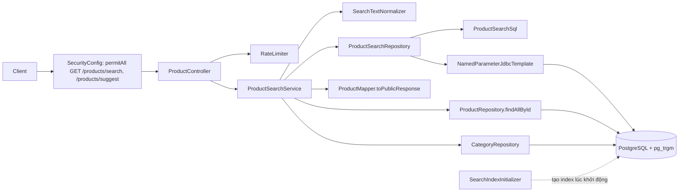
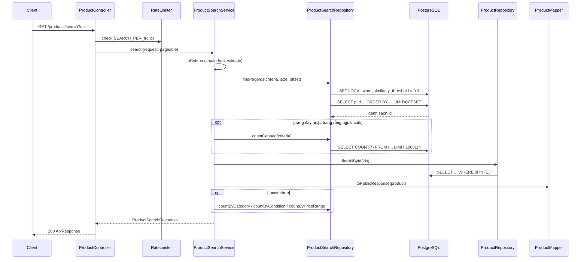
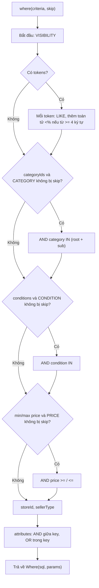
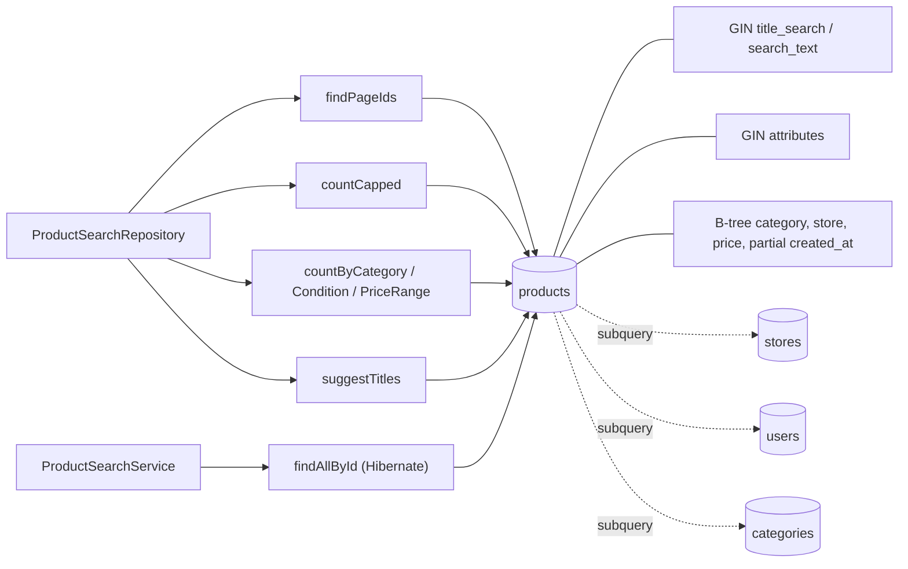
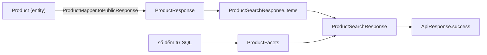

# Search Engine — Technical Documentation

> **Dự án:** Moldy Market (`com.moldy.moldymarket`) · **Phụ trách:** Chu (P2) · **Cập nhật:** 2026-11-01

## 0. Phạm vi và nguồn của tài liệu (đọc trước)

Tài liệu mô tả search engine đã implement trên nhánh `feature/product`: endpoint `GET /api/v1/products/search` (tìm + lọc + facets) và `GET /api/v1/products/suggest` (gợi ý khi gõ).

**Nguồn:** code được dựng lại từ các đoạn code đã viết và chạy thử trong quá trình làm việc, **không phải** quét trực tiếp repo (bản clone chỉ có nhánh `main`). Do đó:

- Tên class/method là bản cuối sau các lần sửa.
- Những điều không thể xác minh từ code được ghi **"Chưa xác định được từ source code"**.
- Các **số đo hiệu năng** trong tài liệu được đo trên một Postgres 16 tạm với **300.000 sản phẩm giả**, trong môi trường phát triển, **không** phải trên database thật của dự án.
- Đối chiếu với repo thật bằng các lệnh ở mục 11.6.

**Quy ước:** 🟢 đã implement · 🔴 chưa implement · ⚠️ vấn đề/giới hạn đã ghi nhận.

**Điều quan trọng cần biết ngay:** search engine này **không phải** Elasticsearch và **không** dùng Full-text Search (`tsvector`) của Postgres. Nó là *tìm kiếm trong PostgreSQL bằng `pg_trgm` (trigram) + `LIKE` + index GIN*, viết bằng SQL thuần qua `NamedParameterJdbcTemplate`, **không** dùng JPA Specification/Criteria API cho endpoint `/search`.

---

## 1. Overview

### 1.1 Search Engine là gì, vì sao marketplace cần?

**Search engine** là thành phần cho phép người dùng tìm sản phẩm bằng từ khóa tự do, kết hợp bộ lọc và sắp xếp. Marketplace có hàng nghìn tin đăng với tiêu đề không chuẩn hóa (không dấu, sai chính tả, viết tắt), nên người mua cần tìm nhanh và chịu lỗi nhập.

### 1.2 Khác gì truy vấn CRUD thông thường?

| CRUD (`findById`, `findAll`) | Search |
|---|---|
| Truy theo khóa chính hoặc điều kiện cố định | Điều kiện **động**, tùy người dùng chọn |
| Kết quả không cần xếp hạng | Cần **độ liên quan** (relevance) |
| Khớp chính xác | Khớp mờ: không dấu, sai chính tả |
| Một truy vấn đơn giản | Nhiều bước: tìm, đếm, facets |

### 1.3 Cơ chế hiện tại

1. **Chuẩn hóa chữ** bằng code Java (`SearchTextNormalizer`): chữ thường, bỏ dấu tiếng Việt, `đ→d`, ký tự đặc biệt thành khoảng trắng.
2. **Lưu sẵn cột đã chuẩn hóa** trong bảng `products`: `title_search` và `search_text` (= tiêu đề + mô tả chuẩn hóa).
3. **Khớp** bằng `LIKE '%từ%'` (chuỗi con) hoặc toán tử `<%` của `pg_trgm` (gần giống, cho từ ≥ 4 ký tự).
4. **Xếp hạng** bằng `word_similarity` của `pg_trgm`.
5. **Index GIN trigram** để các câu `LIKE '%...%'` không phải quét cả bảng khi dữ liệu lớn.

### 1.4 Dữ liệu tìm được và điều kiện hỗ trợ

Dữ liệu: các `Product` đang **hiển thị công khai**, tức `status = 'ACTIVE'` **và** store không `BLOCKED` **và** (nếu là tin cá nhân) user bán còn `ACTIVE`.

| Điều kiện | Tham số | Kết hợp |
|---|---|---|
| Từ khóa | `q` | Mọi từ đều phải khớp (AND) |
| Category | `categoryId` (nhiều giá trị) | OR trong cùng nhóm; chọn root thì gồm cả sub |
| Tình trạng | `condition` (nhiều giá trị) | OR trong cùng nhóm |
| Khoảng giá | `minPrice`, `maxPrice` | AND |
| Shop | `storeId` | AND |
| Loại người bán | `sellerType` = `STORE`/`PERSONAL` | AND |
| Thuộc tính | `attr=key:value` (nhiều) | Khác key: AND; cùng key: OR |
| Sắp xếp | `sort` | `relevance`/`newest`/`price_asc`/`price_desc` |
| Facets | `facets=true` | Bật đếm theo nhóm |

🔴 **Chưa implement:** facet theo thuộc tính (`brand`, `ram`), cache facets bằng Redis, tìm theo tên category/shop, Full-text Search, Elasticsearch, cursor pagination.

---

## 2. Core Concepts — Kiến thức nền tảng

Chỉ giải thích những gì project thực sự dùng.

### 2.1 Chuẩn hóa văn bản (normalization)

**Là gì:** biến mọi chuỗi về một dạng thống nhất để so sánh. **Vì sao:** người dùng gõ "Điện thoại", "dien thoai", "ĐIỆN THOẠI" đều phải ra cùng kết quả.

```java
// SearchTextNormalizer.normalize
String s = input.toLowerCase(Locale.ROOT).replace('đ', 'd');
s = Normalizer.normalize(s, Normalizer.Form.NFD);   // tách dấu khỏi chữ
s = DIACRITICS.matcher(s).replaceAll("");           // \p{M}+ : bỏ dấu
s = NON_ALNUM.matcher(s).replaceAll(" ");           // [^a-z0-9]+ -> khoảng trắng
return s.trim();
```

Ví dụ: `"Điện thoại iPhone 13 (Pro)"` → `"dien thoai iphone 13 pro"`.

**Vì sao làm ở Java chứ không dùng extension `unaccent` của Postgres:** hàm `unaccent` không dùng trực tiếp trong index được và không xử lý rõ chữ `đ`; code Java chạy giống nhau ở mọi môi trường.

### 2.2 `LIKE '%từ%'` và vấn đề tốc độ

`LIKE` với `%` ở đầu **không dùng được B-tree index** nên mặc định phải quét cả bảng. Giải pháp: index GIN trigram.

### 2.3 Trigram (`pg_trgm`)

**Là gì:** cắt chuỗi thành các cụm 3 ký tự. `"iphone"` → `iph, pho, hon, one` (+ đệm). Hai chuỗi càng chung nhiều trigram càng giống.

**`word_similarity(a, b)`**: đo độ giống giữa từ `a` và *phần giống nhất* trong `b` (0 → 1). Một số giá trị đã đo trên Postgres 16:

| Cặp | `word_similarity` |
|---|---|
| `iphon` vs `iphone 13 pro max` | 0,83 |
| `laptp` | 0,67 |
| `samsng` | 0,57 |
| `ipone` | 0,44 |
| `ifone` | 0,33 |

Ngưỡng mặc định của Postgres là 0,6, quá chặt cho tiếng Việt gõ sai, nên code đặt **0,3**.

**Toán tử `<%`:** `'từ' <% cột` đúng khi `word_similarity('từ', cột) >= pg_trgm.word_similarity_threshold`.

**Index GIN `gin_trgm_ops`:** lưu ánh xạ trigram → dòng, nên `LIKE '%…%'` và `<%` tìm nhanh. **Giới hạn:** từ khóa dưới 3 ký tự không tạo được trigram nào để thu hẹp, nên rất chậm (xem 10.3).

### 2.4 JSONB và toán tử `@>`

Cột `attributes` của `Product` lưu thuộc tính tự do (`{"brand":"Apple","ram":8}`). Toán tử `@>` ("chứa") dùng được index `GIN jsonb_path_ops`. JSONB **phân biệt kiểu**: `"8"` (chuỗi) ≠ `8` (số), nên code thử cả hai (xem 6.4).

### 2.5 Dynamic Query

Người dùng chọn tổ hợp bộ lọc bất kỳ, nên câu SQL được **ghép động**: chỉ thêm điều kiện cho tham số có giá trị. Mọi giá trị đi qua **tham số có tên** (`:name`) của JDBC, không nối chuỗi người dùng vào SQL (chống SQL injection).

### 2.6 Pagination, Sort, Facets

- **Pagination:** chia kết quả thành trang. Dùng `LIMIT/OFFSET`, trang do Spring `Pageable` cung cấp.
- **Sort:** thứ tự do `ProductSortOption` quyết định, ghép vào `ORDER BY` từ danh sách cố định (không nhận chuỗi tùy ý).
- **Facets:** số đếm theo nhóm ("iPhone (90), Samsung (30)") cho thanh lọc bên cạnh. Luật: **mỗi nhóm bỏ qua bộ lọc của chính nó** để người dùng vẫn thấy các lựa chọn khác.

---

## 3. Architecture & Components

### 3.1 Bảng tổng hợp

| Component | Vị trí | Responsibility | Input / Output |
|---|---|---|---|
| `ProductController.search` | `product` controller | Nhận request, rate limit, gọi service | `ProductSearchRequest`, `Pageable` → `ApiResponse<ProductSearchResponse>` |
| `ProductController.suggest` | cùng controller | Gợi ý khi gõ, rate limit | `q` → `ApiResponse<List<String>>` |
| `ProductSearchService` | `product/service` | Validate/chuẩn hóa đầu vào, điều phối, đếm, facets, map response | Request → `ProductSearchResponse` |
| `ProductSearchRepository` | `product/search` | Chạy SQL (tìm id, đếm có trần, facets, suggest) | Criteria → `List<UUID>`, số đếm |
| `ProductSearchSql` | `product/search` | Ghép mệnh đề `WHERE` và `ORDER BY` động | Criteria → `Where(sql, params)` |
| `ProductSearchCriteria` (record) | `product/search` | Điều kiện đã chuẩn hóa | — |
| `SearchTextNormalizer` | `product/search` | Chuẩn hóa chữ | `String` → `String` |
| `SellerType`, `ProductSortOption` (enum) | `product/search` | Giá trị hợp lệ cho `sellerType`, `sort` | — |
| `ProductSearchRequest` (record) | `product/dto` | DTO đầu vào + validation | Query params |
| `ProductSearchResponse`, `ProductFacets` (record) | `product/dto` | DTO đầu ra | — |
| `ProductMapper.toPublicResponse` | `product` mapper | Entity → DTO công khai | `Product` → `ProductResponse` |
| `ProductRepository.findAllById` | `product/repository` | Tải entity đầy đủ cho các id trong trang | `List<UUID>` → `List<Product>` |
| `CategoryRepository.findAllById` | `category` | Lấy tên category cho facets | — |
| `SearchIndexInitializer` | `config` (`@Order(4)`) | Tạo extension, index, backfill cột chuẩn hóa | Chạy lúc khởi động |
| `Product` (entity) | `product/entity` | Có `titleSearch`, `searchText`, `refreshSearchFields()` | — |
| `RateLimiter` | `common/ratelimit` | `SEARCH_PER_IP`, `SUGGEST_PER_IP` | Xem tài liệu rate limit |

> **Chưa xác định được từ source code:** package chính xác của DTO (`product.dto` hay `product.dto.request/response`) trong repo thật. Code gốc trong chat dùng `product.dto.request/response`, còn cấu trúc thật của bạn là `product.dto.*` (không có subpackage). Chỉ ảnh hưởng đến câu `import`.

### 3.2 Cột dữ liệu liên quan trong `Product`

```java
@Column(name = "title_search", nullable = false, columnDefinition = "text not null default ''")
private String titleSearch = "";

@Column(name = "search_text", nullable = false, columnDefinition = "text not null default ''")
private String searchText = "";

private void refreshSearchFields() {
    this.titleSearch = SearchTextNormalizer.normalize(title);
    this.searchText = titleSearch + " " + SearchTextNormalizer.normalize(description);
}
```

`refreshSearchFields()` được gọi ở **cuối constructor** và **cuối `Product.update(...)`** để hai cột luôn đồng bộ với `title`/`description`. `default ''` giúp `ddl-auto: update` thêm cột vào bảng đã có dữ liệu.

### 3.3 Component Diagram

*Sơ đồ 1 — Thành phần của search engine.*



---

## 4. Search Request Structure

### 4.1 Endpoint

| | |
|---|---|
| Method | `GET` |
| Path | `/api/v1/products/search` |
| Xác thực | Không cần (public). `SecurityConfig` liệt kê tường minh `GET /api/v1/products/search` trong `permitAll` |
| Rate limit | `SEARCH_PER_IP`: 120 lượt / phút / IP |
| Path variable | Không có |

### 4.2 Query parameters (`ProductSearchRequest`)

| Tham số | Kiểu | Validation | Mặc định | Ghi chú |
|---|---|---|---|---|
| `q` | String | `@Size(max=100)` | rỗng | Tách thành tối đa 8 từ (`MAX_TOKENS`) |
| `categoryId` | `List<UUID>` | `@Size(max=20)` | rỗng | Lặp tham số: `categoryId=a&categoryId=b` |
| `condition` | `List<ProductCondition>` | `@Size(max=10)` | rỗng | Sai enum → 400 |
| `minPrice` | BigDecimal | `@DecimalMin("0")` | — | |
| `maxPrice` | BigDecimal | `@DecimalMin("0")` | — | `minPrice > maxPrice` → 400 |
| `storeId` | UUID | — | — | |
| `sellerType` | `SellerType` | — | — | `STORE` hoặc `PERSONAL` |
| `attr` | `List<String>` | `@Size(max=10)` | rỗng | Dạng `key:value`; key khớp `[A-Za-z0-9_]{1,30}`, value tối đa 50 ký tự |
| `sort` | String | qua `ProductSortOption.fromParam` | xem dưới | Sai giá trị → 400 |
| `facets` | Boolean | — | `null` (tắt) | `facets=true` để bật |
| `page`, `size` | Spring `Pageable` | — | mặc định của Spring | Xem lưu ý 4.4 |

**Quy tắc `sort` mặc định:** không gửi `sort` → có từ khóa thì `RELEVANCE`, không có thì `NEWEST`. Gửi `RELEVANCE` mà không có từ khóa → tự chuyển `NEWEST`.

### 4.3 Ví dụ chạy bằng Postman

```
GET /api/v1/products/search
GET /api/v1/products/search?q=dien thoai
GET /api/v1/products/search?q=ipone
GET /api/v1/products/search?q=iphone&condition=NEW&condition=LIKE_NEW&minPrice=1000000&maxPrice=15000000&sort=price_asc
GET /api/v1/products/search?categoryId=<id-root>
GET /api/v1/products/search?q=iphone&attr=brand:Apple&attr=ram:8&facets=true
GET /api/v1/products/search?sort=abc          -> 400
```

### 4.4 Lưu ý về phân trang ⚠️

- `Pageable` của Spring đánh số trang từ **0** (`page=0` là trang đầu). Response trả `page = pageNumber + 1` (tức **từ 1**). Frontend cần biết sự khác nhau này.
- **Chưa xác định được từ source code:** giá trị mặc định/tối đa của `size` đang áp dụng (phụ thuộc cấu hình `spring.data.web.pageable.*`; Spring mặc định `size=20`, `max-page-size=2000`). Trong thảo luận có đề xuất chặn `size <= 100` nhưng cấu hình này chưa được xác nhận trong code.
- Cửa sổ duyệt tối đa 10.000 kết quả: `offset + size > 10_000` → `400 INVALID_REQUEST`.
- `Pageable` cũng tự đọc tham số `sort` của Spring, nhưng `search` **bỏ qua** `pageable.getSort()` và chỉ dùng `ProductSortOption`. Hai thứ trùng tên tham số `sort` nên dễ nhầm: giá trị hợp lệ chỉ là `relevance|newest|price_asc|price_desc`.

---

## 5. Search Execution Flow

### 5.1 Flow `/search`

1. **Client** gửi `GET /api/v1/products/search?...`.
2. **Security filter chain:** khớp rule `permitAll` của `/api/v1/products/search`, không cần token.
3. **`ProductController.search`**: `@Valid ProductSearchRequest` được bind từ query string và validate; dòng đầu: `rateLimiter.check(SEARCH_PER_IP, httpRequest.getRemoteAddr())`.
4. **`ProductSearchService.search`** (`@Transactional(readOnly = true)`):
   1. `toCriteria(request)`: kiểm tra `minPrice ≤ maxPrice`, chuẩn hóa `q` thành `tokens`, chọn `sort`, chuyển `condition` thành tên enum, parse `attr`.
   2. Kiểm tra cửa sổ: `offset + size > MAX_RESULT_WINDOW` → lỗi 400.
   3. `searchRepository.findPageIds(criteria, size, offset)` → danh sách `UUID` đã sắp xếp.
   4. Tính tổng: nếu trang chưa đầy và là trang hợp lệ thì `total = offset + ids.size()` (khỏi đếm); ngược lại `countCapped`.
   5. `productRepository.findAllById(ids)`, sắp lại theo thứ tự `ids`, map `toPublicResponse`.
   6. Nếu `facets=true` → `buildFacets(criteria)`.
5. **Trả về** `ProductSearchResponse` bọc trong `ApiResponse.success`.

### 5.2 Code trọng tâm (`ProductSearchService.search`)

```java
List<UUID> ids = searchRepository.findPageIds(criteria, size, offset);

long total; boolean capped = false;
if (ids.size() < size && (offset == 0 || !ids.isEmpty())) {
    total = offset + ids.size();              // đã tới cuối danh sách, khỏi đếm
} else {
    long counted = searchRepository.countCapped(criteria);
    if (counted > MAX_RESULT_WINDOW) { total = MAX_RESULT_WINDOW; capped = true; }
    else { total = counted; }
}

Map<UUID, Product> byId = productRepository.findAllById(ids).stream()
        .collect(Collectors.toMap(Product::getId, Function.identity()));
List<ProductResponse> items = ids.stream()
        .map(byId::get).filter(Objects::nonNull)
        .map(productMapper::toPublicResponse).toList();
```

**Vì sao tách "lấy id" và "tải entity":** truy vấn tìm kiếm chỉ `SELECT p.id` (rẻ, không kéo cột mô tả/ảnh/jsonb), sau đó tải đầy đủ đúng 20 sản phẩm của trang. `findAllById` không đảm bảo thứ tự nên code sắp lại theo `ids`.

### 5.3 Flow `/suggest`

1. `ProductController.suggest`: `rateLimiter.check(SUGGEST_PER_IP, ip)`.
2. `ProductSearchService.suggest(q)`: chuẩn hóa; dưới 3 ký tự → `List.of()` (không chạm DB); trên 50 ký tự → cắt bớt.
3. `ProductSearchRepository.suggestTitles(normalized, 8)`.

```java
String sql = "SELECT MIN(p.title) AS title FROM products p WHERE " + ProductSearchSql.VISIBILITY
        + " AND p.title_search LIKE :contains"
        + " GROUP BY p.title_search"
        + " ORDER BY CASE WHEN p.title_search LIKE :prefix THEN 0"
        + "               WHEN p.title_search LIKE :wordStart THEN 1 ELSE 2 END,"
        + "          COUNT(*) DESC, p.title_search"
        + " LIMIT :limit";
```

Ưu tiên: (1) bắt đầu bằng từ khóa, (2) có từ bắt đầu bằng từ khóa, (3) chứa từ khóa; cùng mức thì tiêu đề có nhiều sản phẩm hơn xếp trước; không trùng tiêu đề (`GROUP BY title_search`).

### 5.4 Sequence Diagram

*Sơ đồ 2 — Một request `/search`.*



---

## 6. Query Building Logic

### 6.1 Vì sao Dynamic Query và vì sao không dùng JPA Specification?

Không thể viết một câu SQL cố định vì số điều kiện thay đổi theo từng request. Project có một cách dựng động bằng **JPA Specification** cho endpoint cũ `GET /api/v1/products` (`ProductSpecifications.sellerAndStoreVisible()`), nhưng `/search` chọn **SQL thuần** vì cần các toán tử Postgres mà JPA không biểu diễn gọn: `<%`, `word_similarity`, `@>` trên jsonb, `COUNT(*) FILTER`.

⚠️ **Hệ quả:** quy tắc "hiển thị công khai" tồn tại ở **hai nơi**: `ProductSpecifications.sellerAndStoreVisible()` (JPA) và hằng `ProductSearchSql.VISIBILITY` (SQL). Đổi quy tắc phải sửa cả hai. Chú thích trong code đã nhắc điều này.

### 6.2 Quy tắc hiển thị công khai (luôn áp dụng)

```java
static final String VISIBILITY = """
    p.status = 'ACTIVE'
    AND (p.store_id IS NULL OR NOT EXISTS (
            SELECT 1 FROM stores s WHERE s.id = p.store_id AND s.status = 'BLOCKED'))
    AND (p.store_id IS NOT NULL OR EXISTS (
            SELECT 1 FROM users u WHERE u.id = p.seller_id AND u.status = 'ACTIVE'))
    """;
```

`VISIBILITY` không phải tham số người dùng nên luôn có mặt và dùng chung với `suggestTitles`.

### 6.3 `ProductSearchSql.where(criteria, skip)`

Dựng `StringBuilder` bắt đầu từ `VISIBILITY`, rồi nối `AND ...` cho từng điều kiện **có giá trị**. Field không truyền lên → **không thêm điều kiện nào**. Tham số `skip` (`Set<Facet>`) cho phép bỏ qua bộ lọc của chính nhóm facet đang đếm.

**Từ khóa:**

```java
for (int i = 0; i < tokens.size(); i++) {
    params.addValue("tl" + i, "%" + token + "%");
    if (token.length() >= FUZZY_MIN_LENGTH) {   // 4
        params.addValue("tf" + i, token);
        sql.append(" AND (p.search_text LIKE :tl").append(i)
           .append(" OR CAST(:tf").append(i).append(" AS text) <% p.search_text)");
    } else {
        sql.append(" AND p.search_text LIKE :tl").append(i);
    }
}
```

- Mọi từ phải khớp (AND giữa các từ).
- Mỗi từ khớp nếu là **chuỗi con** (`LIKE`) **hoặc** (từ ≥ 4 ký tự) **gần giống** (`<%`). Từ ngắn (≤ 3 ký tự) chỉ khớp chính xác để tránh khớp bừa.
- Vì token chỉ gồm `a-z0-9` (đã chuẩn hóa) nên **không có ký tự `%` hay `_`** làm hỏng `LIKE`: câu hỏi về wildcard/special characters không phát sinh.
- Chuỗi rỗng/chỉ khoảng trắng/chỉ ký tự đặc biệt → `tokens` rỗng → không thêm điều kiện từ khóa, kết quả là danh sách mới nhất.

**Category** (root gồm cả sub):

```sql
AND p.category_id IN (SELECT cat.id FROM categories cat
                      WHERE cat.id IN (:cats) OR cat.parent_id IN (:cats))
```

**Condition / Price / Store / SellerType:** `p.condition IN (:conds)`, `p.price >= :minPrice`, `p.price <= :maxPrice`, `p.store_id = :storeId`, `p.store_id IS NOT NULL` (STORE) / `IS NULL` (PERSONAL).

### 6.4 Thuộc tính (JSONB)

```java
alternatives.add("p.attributes @> jsonb_build_object(CAST(:" + keyParam + " AS text), CAST(:" + base + " AS text))");
// nếu value trông như số: thêm nhánh CAST(... AS numeric); nếu true/false: thêm nhánh boolean
sql.append(" AND (").append(String.join(" OR ", alternatives)).append(")");
```

- Khác key: `AND`. Cùng key nhiều value: `OR`.
- `jsonb_build_object` dựng JSON ngay trong SQL từ tham số, nên không phải tự escape chuỗi JSON.
- `attr=ram:8` khớp được cả `"ram": 8` lẫn `"ram": "8"`.
- Key bị giới hạn bởi regex trong `ProductSearchService.parseAttributes`, key/value được truyền qua tham số.

### 6.5 `ORDER BY`

| `ProductSortOption` | `ORDER BY` |
|---|---|
| `RELEVANCE` | `(2*word_similarity(:qn, p.title_search) + word_similarity(:qn, p.search_text) + CASE WHEN p.title_search LIKE :qp THEN 1 ELSE 0 END) DESC, p.created_at DESC, p.id` |
| `NEWEST` | `p.created_at DESC, p.id` |
| `PRICE_ASC` | `p.price ASC, p.created_at DESC, p.id` |
| `PRICE_DESC` | `p.price DESC, p.created_at DESC, p.id` |

Tiêu đề được tính nặng gấp đôi mô tả; bắt đầu bằng từ khóa được thưởng 1 điểm. `p.id` ở cuối giúp thứ tự **ổn định** giữa các trang khi điểm bằng nhau. Giá trị `ORDER BY` lấy từ `switch` cố định, không nhận chuỗi người dùng.

### 6.6 Flowchart dựng query

*Sơ đồ 3 — `ProductSearchSql.where`.*



---

## 7. Database Interaction

### 7.1 Ai chạy truy vấn và ở tầng nào

- Câu SQL được dựng ở `ProductSearchSql`, chạy bởi `ProductSearchRepository` qua `NamedParameterJdbcTemplate` (**không qua Hibernate/JPQL**). Vì vậy `spring.jpa.show-sql` **không** in các câu này.
- Chỉ bước `findAllById` (tải entity của trang) và `CategoryRepository.findAllById` (facets) đi qua Hibernate/JPA.

### 7.2 Các truy vấn

| Hàm | Mục đích | Ghi chú |
|---|---|---|
| `findPageIds` | Lấy id một trang, đã sắp xếp | `LIMIT :limit OFFSET :offset`, phân trang **ở database** |
| `countCapped` | Đếm có trần | `SELECT COUNT(*) FROM (SELECT 1 ... LIMIT 10001) t` |
| `countByCategory` | Facet category | `GROUP BY p.category_id`, bỏ qua bộ lọc CATEGORY |
| `countByCondition` | Facet tình trạng | `GROUP BY p.condition`, bỏ qua bộ lọc CONDITION |
| `countByPriceRange` | Facet khoảng giá | Một lần quét, nhiều `COUNT(*) FILTER (WHERE ...)` |
| `suggestTitles` | Gợi ý | Xem 5.3 |

`PRICE_BOUNDS = {500_000, 1_000_000, 3_000_000, 5_000_000, 10_000_000}` → 6 khoảng. Mốc là hằng số trong code nên nối thẳng vào SQL là an toàn.

### 7.3 Ngưỡng "gần giống"

```java
private void applyFuzzyThreshold() {
    jdbc.getJdbcTemplate().execute("SET LOCAL pg_trgm.word_similarity_threshold = 0.3");
}
```

`SET LOCAL` chỉ có hiệu lực **trong transaction hiện tại**, nên `ProductSearchService` bắt buộc có `@Transactional(readOnly = true)`. Nếu bỏ annotation, ngưỡng về mặc định 0,6 và việc sai chính tả hoạt động kém.

### 7.4 Index (do `SearchIndexInitializer` tạo, idempotent bằng `IF NOT EXISTS`)

| Index | Loại | Phục vụ |
|---|---|---|
| `idx_products_title_trgm` | GIN `title_search gin_trgm_ops` | gợi ý, relevance |
| `idx_products_search_trgm` | GIN `search_text gin_trgm_ops` | `LIKE` và `<%` trên từ khóa |
| `idx_products_attributes` | GIN `attributes jsonb_path_ops` | lọc `@>` thuộc tính |
| `idx_products_category` | B-tree `category_id` | lọc category |
| `idx_products_store` | B-tree `store_id` | lọc shop |
| `idx_products_price` | B-tree `price` | lọc/sắp xếp giá |
| `idx_products_active_created` | B-tree `(created_at DESC, id) WHERE status='ACTIVE'` | duyệt "mới nhất" |

Cũng chạy `CREATE EXTENSION IF NOT EXISTS pg_trgm` và **backfill** `title_search`/`search_text` cho các dòng cũ (`WHERE title_search = ''`, batch 500).

> **Lưu ý:** `idx_products_status_created` là index cũ của phiên bản đầu; sau đó được thay bằng `idx_products_active_created`. Index cũ nếu đã tạo vẫn còn trong DB; dọn bằng `DROP INDEX IF EXISTS idx_products_status_created;`. Nếu `attributes` là kiểu `json` (không phải `jsonb`) thì tạo `idx_products_attributes` sẽ lỗi, initializer chỉ ghi `log.warn` và bỏ qua.

**Chưa xác nhận được:** có bao nhiêu index **thực sự được planner chọn** trên DB của dự án. Cần `EXPLAIN (ANALYZE, BUFFERS)` trên dữ liệu thật (xem mục 11).

### 7.5 N+1 và JOIN

- **JOIN:** truy vấn tìm kiếm dùng `EXISTS`/`IN (SELECT ...)` (subquery) cho store, user, category, **không** JOIN dòng sang bảng khác nên không nhân bản dòng.
- **N+1:** việc tải đầy đủ gom thành **một** truy vấn `findAllById`, không tải từng sản phẩm. *Chưa xác định được từ source code:* nếu `ProductMapper.toPublicResponse` hoặc entity `Product` truy cập quan hệ `LAZY` (ví dụ `category`, `store`) thì có thể phát sinh thêm truy vấn mỗi sản phẩm. Cần bật log SQL của Hibernate để kiểm tra trên một request thật.

### 7.6 Hiệu năng đã đo (Postgres 16 tạm, 300.000 sản phẩm giả)

| Truy vấn | Thời gian |
|---|---|
| Duyệt mới nhất, không từ khóa (có partial index) | ~0,2 ms |
| Tìm "iphone 13" | ~60 ms |
| Sai chính tả "macbok", khớp 23.000 dòng, xếp theo relevance (xấu nhất) | ~260 ms |
| Không có kết quả | ~2 ms |
| `COUNT(*) OVER()` khớp 60.000 dòng | ~200 ms (vì vậy dùng đếm có trần) |
| Facet tình trạng, từ khóa "iphone" (11.600 dòng) | ~17 ms |
| Facet category, lọc `condition=NEW` (75.000 dòng) | ~54 ms |
| Facet khoảng giá, không lọc (300.000 dòng) | ~130 ms |
| Gợi ý `ip` (2 ký tự) | ~5 giây ⚠️ |
| Gợi ý `iph` (3 ký tự) / `iphone` | ~28 ms / ~38 ms |

Các số này chỉ có giá trị tương đối, đo trên dữ liệu giả.

### 7.7 Database Interaction Diagram

*Sơ đồ 4 — Truy vấn nào chạm bảng/index nào.*



---

## 8. Entity-to-DTO Mapping

*Sơ đồ 5 — Từ entity tới response.*



`/search` dùng **`toPublicResponse`**, khác `toResponse` (đầy đủ, dành cho chủ sở hữu/admin): `sellerId` bị ẩn (`null`) nếu sản phẩm thuộc shop, và bỏ `version`, `removalReason`. Mục đích: không lộ thông tin cá nhân của người bán trong API công khai.

---

## 9. Response Structure

### 9.1 DTO

```java
public record ProductSearchResponse(
        List<ProductResponse> items,
        int page,            // bắt đầu từ 1
        int size,
        long totalElements,  // tối đa 10.000
        int totalPages,
        boolean totalCapped, // true: có từ 10.000 kết quả trở lên
        ProductFacets facets // null nếu không gửi facets=true
) {}

public record ProductFacets(
        List<CategoryFacet> categories,
        List<ConditionFacet> conditions,
        List<PriceRangeFacet> priceRanges) {
    public record CategoryFacet(UUID id, String name, long count, List<CategoryFacet> children) {}
    public record ConditionFacet(String value, long count) {}
    public record PriceRangeFacet(BigDecimal min, BigDecimal max, long count) {}
}
```

### 9.2 Ví dụ JSON

Phần `items` là `ProductResponse` (bản công khai). *Chưa xác định được từ source code* danh sách đầy đủ trường của `ProductResponse` nên ví dụ dùng `"..."` thay cho các trường đó.

```json
{
  "code": "...",
  "message": "...",
  "data": {
    "items": [ { "id": "...", "title": "iPhone 13 Pro", "...": "các trường khác của ProductResponse" } ],
    "page": 1,
    "size": 20,
    "totalElements": 143,
    "totalPages": 8,
    "totalCapped": false,
    "facets": {
      "categories": [
        { "id": "...", "name": "Điện thoại", "count": 120,
          "children": [ { "id": "...", "name": "iPhone", "count": 90, "children": [] } ] }
      ],
      "conditions": [ { "value": "NEW", "count": 40 }, { "value": "LIKE_NEW", "count": 30 } ],
      "priceRanges": [
        { "min": 0, "max": 500000, "count": 12 },
        { "min": 10000000, "max": null, "count": 8 }
      ]
    }
  }
}
```

> **Chưa xác định được từ source code:** tên và vị trí chính xác của các trường bọc ngoài (`code`, `message`, `data`) trong `ApiResponse`; đối chiếu `ApiResponse.success(...)`.

### 9.3 Chi tiết

- **Empty result:** `items = []`, `totalElements = 0`, `totalPages = 0`, `totalCapped = false`.
- **Facets:** `categories` và `conditions` chỉ trả nhóm có ít nhất 1 sản phẩm; `priceRanges` luôn trả đủ 6 khoảng (kể cả `count = 0`) để giao diện giữ bố cục. Khoảng giá là `[min, max)`, `max = null` là không giới hạn trên.
- **Sorting:** response **không** trả thông tin sort đã áp dụng. 🔴 chưa implement.
- **Lỗi:** `400` cho `sort`/`attr` sai, `minPrice > maxPrice`, vượt cửa sổ 10.000, kiểu tham số sai (qua `GlobalExceptionHandler`); `429` khi vượt rate limit.

---

## 10. Important Design Decisions

### 10.1 Database Search so với Search Engine chuyên dụng

| | Hiện tại (Postgres + pg_trgm) | Elasticsearch/OpenSearch |
|---|---|---|
| Hạ tầng | Không thêm dịch vụ | Thêm cluster, đồng bộ dữ liệu |
| Nhất quán | Luôn khớp DB (cùng transaction) | Trễ đồng bộ |
| Relevance | Đơn giản (trigram + prefix) | BM25, boosting, phân tích ngôn ngữ |
| Sai chính tả | Có (trigram) | Có (fuzzy) |
| Quy mô | Tốt đến hàng trăm nghìn dòng (đã đo) | Hàng chục triệu+ |
| Facets | Mỗi facet là một truy vấn đếm | Aggregation tích hợp, nhanh |

Với đồ án và quy mô hiện tại, Postgres đủ dùng và đơn giản hơn nhiều. 🔴 Không có Full-text Search (`tsvector`) và không có Elasticsearch.

### 10.2 Quyết định chính

| Quyết định | Lý do | Đánh đổi |
|---|---|---|
| Cột chuẩn hóa lưu sẵn (`title_search`, `search_text`) | Tìm không dấu mà vẫn dùng được index | Phải đồng bộ khi sửa (`refreshSearchFields`), tốn thêm dung lượng |
| Chuẩn hóa ở Java | Rõ ràng, xử lý `đ` | Logic nằm ngoài DB |
| SQL thuần thay vì JPA Specification | Cần `<%`, `@>`, `FILTER` | Quy tắc hiển thị bị nhân đôi (⚠️) |
| Truy vấn chỉ lấy id, rồi tải theo lô | Truy vấn tìm rẻ, tránh kéo cột to | Hai bước, phải sắp lại thứ tự |
| Đếm có trần 10.000 | `COUNT` là phần đắt nhất | Không cho biết tổng thật khi quá lớn; chỉ duyệt tối đa 10.000 kết quả |
| Facets mặc định tắt | Đắt khi không có từ khóa (~200 ms+) | Frontend phải xin `facets=true` |
| Fuzzy chỉ cho từ ≥ 4 ký tự | Tránh khớp bừa ở từ ngắn | Từ ngắn sai chính tả không được sửa |
| Gợi ý tối thiểu 3 ký tự | 2 ký tự chậm ~5 giây (trigram cần ≥ 3 ký tự) | Chưa gợi ý được từ rất ngắn |
| Rate limit cho `/search`, `/suggest` | Endpoint công khai và đắt | NAT chung IP có thể bị chặn oan |

### 10.3 Giới hạn và rủi ro ⚠️

1. **Relevance trên từ khóa rất phổ biến** phải tính điểm cho mọi dòng khớp: ~260 ms ở 300.000 dòng (trường hợp xấu nhất khi đo).
2. **`OFFSET` lớn** chậm dần; đã chặn bằng cửa sổ 10.000, nhưng chưa có cursor pagination.
3. **Lệch mốc giá:** sản phẩm đúng bằng mốc (ví dụ 500.000) xuất hiện ở hai khoảng liền kề khi lọc (vì `maxPrice` bao gồm đầu mút). Hiếm gặp, chấp nhận.
4. **Trùng quy tắc hiển thị** ở JPA Specification và `VISIBILITY`.
5. **Chưa có facet theo thuộc tính**, chưa cache facets, chưa tìm theo tên category/shop.
6. **Tham số `sort` trùng tên** giữa request tùy biến và `Pageable` của Spring (xem 4.4).
7. **Không có test tự động** (xem mục 11).
8. **Số đo chỉ trên dữ liệu giả** trong môi trường phát triển.

---

## 11. Testing & Debugging

### 11.1 Test hiện có

🔴 **Chưa có test tự động** cho search. Mọi kiểm tra đến nay là thủ công bằng Postman (các request ở 4.3) và bằng truy vấn SQL kiểm tra ở trên.

### 11.2 Trường hợp cần test

| Trường hợp | Kỳ vọng |
|---|---|
| Không tham số | Sản phẩm mới nhất |
| `q=dien thoai` / `q=Điện Thoại` | Cùng kết quả (không dấu, hoa thường) |
| `q=ipone` | Ra "iphone" (sai chính tả, từ ≥ 4 ký tự) |
| `q=ab` | Chỉ khớp chuỗi con, không fuzzy |
| `q` toàn ký tự đặc biệt (`%%__`) | Coi như không có từ khóa |
| `minPrice > maxPrice` | 400 |
| `sort=abc` | 400 |
| `condition=abc`, `categoryId=xyz` | 400 (lỗi bind) |
| Vượt cửa sổ 10.000 (`page` rất lớn) | 400 |
| `categoryId=<root>` | Có cả sản phẩm của sub |
| Sản phẩm `HIDDEN`/`REMOVED`/store `BLOCKED`/user bị khóa | Không xuất hiện |
| Sản phẩm shop | `sellerId = null` trong kết quả |
| `condition=NEW&facets=true` | `items` chỉ có NEW, nhưng `facets.conditions` **vẫn hiện** các tình trạng khác |
| `/suggest?q=ip` hoặc không có `q` | `[]` |
| `/suggest?q=dien tho` | Ra tiêu đề "Điện thoại ..." |
| Gọi quá hạn mức rate limit | 429 + `Retry-After` |

### 11.3 Kiểm tra SQL

Câu SQL tìm kiếm không đi qua Hibernate nên `show-sql` không thấy. Cách xem:

- Bật log JDBC của Spring (chỉ dùng khi debug):

```yaml
logging:
  level:
    org.springframework.jdbc.core.JdbcTemplate: DEBUG
    org.springframework.jdbc.core.StatementCreatorUtils: TRACE   # in giá trị tham số (cẩn thận dữ liệu nhạy cảm)
```

- Hoặc bật `log_statement = 'all'` ở Postgres (môi trường dev), hoặc dùng `EXPLAIN` bên dưới.

### 11.4 `EXPLAIN` để biết index có được dùng không

```sql
EXPLAIN (ANALYZE, BUFFERS)
SELECT p.id FROM products p
WHERE p.status = 'ACTIVE' AND p.search_text LIKE '%iphone%'
ORDER BY p.created_at DESC, p.id LIMIT 20;
```

| Thấy | Nghĩa |
|---|---|
| `Seq Scan on products` | Quét cả bảng (bình thường khi bảng nhỏ) |
| `Bitmap Index Scan on idx_products_search_trgm` | Đã dùng index trigram |
| `Execution Time` | Số quan trọng nhất |

Bảng vài trăm dòng thường `Seq Scan` vì nhanh hơn; index chỉ có nghĩa từ cỡ chục nghìn dòng. Muốn thử "index có dùng được không": `SET enable_seqscan = off;` rồi `EXPLAIN` lại, xong `RESET enable_seqscan;` (chỉ để thử).

### 11.5 Kiểm tra pagination và sorting

- Gọi `?page=0&size=5`, `?page=1&size=5` và đối chiếu không trùng/không sót sản phẩm (thứ tự ổn định nhờ `p.id` cuối `ORDER BY`).
- `totalCapped=true` khi kết quả ≥ 10.001.
- Test `sort=price_asc` / `price_desc` so với giá.

### 11.6 Lệnh đối chiếu với repo thật

```bash
grep -rn "ProductSearchSql\|ProductSearchRepository\|ProductSearchService" src/main/java
grep -n "title_search\|search_text" -r src/main/java
```

### 11.7 Edge cases đáng chú ý

- `ids.size() < size` ở trang đầu nghĩa là đã hết, khỏi đếm.
- Trang rỗng nhưng `offset > 0` (đi quá cuối) → vẫn gọi `countCapped` để trả `total` đúng.
- `q` dài hơn 100 ký tự → 400; `q` có hơn 8 từ → chỉ dùng 8 từ đầu (sau khi bỏ trùng).

---

## 12. How to Extend

### 12.1 Thêm một bộ lọc mới (ví dụ `location`)

1. `ProductSearchRequest` (record): thêm trường + validation.
2. `ProductSearchCriteria`: thêm trường tương ứng.
3. `ProductSearchService.toCriteria`: chuyển/chuẩn hóa giá trị.
4. `ProductSearchSql.where`: thêm `if (c.location() != null) { params.addValue(...); sql.append(" AND ..."); }`. **Luôn dùng tham số có tên**, không nối chuỗi người dùng.
5. Thêm index nếu cột lọc chưa có: thêm câu `CREATE INDEX IF NOT EXISTS ...` vào `STATEMENTS` trong `SearchIndexInitializer`.
6. Nếu cần facet cho bộ lọc này: thêm giá trị vào `ProductSearchSql.Facet`, thêm hàm đếm ở `ProductSearchRepository`, thêm vào `ProductFacets` và `ProductSearchService.buildFacets`.

### 12.2 Thêm kiểu sắp xếp
Thêm hằng vào `ProductSortOption` và một nhánh `case` trong `ProductSearchSql.orderBy` (switch sẽ báo lỗi biên dịch nếu thiếu nhánh).

### 12.3 Thêm trường vào response
Thêm vào `ProductResponse` (hoặc record response tương ứng) và kiểm tra `ProductMapper` (MapStruct cần **clean rebuild** sau khi đổi DTO). Nhớ xem nó thuộc `toResponse` hay `toPublicResponse` để không lộ dữ liệu cá nhân.

### 12.4 Thêm trường vào phạm vi tìm
Sửa `Product.refreshSearchFields()` (ví dụ thêm tên category vào `searchText`), rồi backfill: xóa nội dung cột hoặc viết lại bước `backfill()` trong `SearchIndexInitializer` (hiện chỉ động vào dòng `title_search = ''`).

### 12.5 Đổi bảng khoảng giá
Sửa `ProductSearchRepository.PRICE_BOUNDS`.

### 12.6 Tối ưu và mở rộng (đề xuất, 🔴 chưa implement)

- **Cache facets trong Redis** cho trường hợp không có từ khóa (cùng kết quả cho mọi người), TTL ngắn.
- **Facet theo thuộc tính** (`brand`, `ram`).
- **Cursor pagination** thay `OFFSET` nếu cần duyệt sâu.
- **Full-text Search (`tsvector`)** nếu cần stemming/ranking tốt hơn `pg_trgm`; hoặc **Elasticsearch/OpenSearch** khi dữ liệu lên hàng triệu hoặc cần relevance phức tạp.
- Gom quy tắc hiển thị về một nguồn duy nhất.

---

## 13. Knowledge Check

<details><summary><b>Câu 1.</b> JPA Specification là gì, và vì sao <code>/search</code> không dùng nó?</summary>

Specification là cách dựng điều kiện truy vấn động bằng Criteria API (mỗi điều kiện là một `Predicate`). `/search` cần `<%`, `word_similarity`, `@>` jsonb và `COUNT(*) FILTER` mà Criteria API không biểu diễn gọn, nên dùng SQL thuần với tham số có tên. Endpoint cũ `GET /products` vẫn dùng Specification.
</details>

<details><summary><b>Câu 2.</b> Khi một field lọc không được truyền lên thì chuyện gì xảy ra?</summary>

`ProductSearchSql.where` chỉ nối `AND ...` cho field có giá trị, nên field vắng mặt không để lại điều kiện nào trong SQL.
</details>

<details><summary><b>Câu 3.</b> Dynamic Query có lợi ích gì, và làm sao tránh SQL injection?</summary>

Một đoạn code phục vụ mọi tổ hợp bộ lọc. Mọi giá trị người dùng đi qua tham số có tên (`:name`) của JDBC; riêng `ORDER BY` lấy từ `switch` cố định trên enum, và mốc giá là hằng số trong code.
</details>

<details><summary><b>Câu 4.</b> Pageable hoạt động thế nào, và Sort được thực hiện ở đâu?</summary>

`Pageable` cung cấp `offset` và `size`, được đưa vào `LIMIT/OFFSET` của SQL, tức phân trang **ở database**. Sắp xếp cũng ở database qua `ORDER BY` do `ProductSortOption` chọn; `Sort` của `Pageable` bị bỏ qua.
</details>

<details><summary><b>Câu 5.</b> Vì sao nên phân trang ở database?</summary>

Chỉ cần đọc/truyền đúng số dòng của trang, không tải cả kết quả lên ứng dụng. Với `ORDER BY` + `LIMIT`, Postgres có thể dừng sớm.
</details>

<details><summary><b>Câu 6.</b> <code>LIKE</code> khác Full-text Search thế nào, và project dùng loại nào?</summary>

`LIKE '%x%'` so khớp chuỗi con thuần túy, không hiểu từ/ngôn ngữ. Full-text (`tsvector`) tách từ, bỏ stop word, xếp hạng. Project **không** dùng Full-text mà dùng `LIKE` + `pg_trgm` (độ giống theo cụm 3 ký tự), phù hợp tiếng Việt không dấu và sai chính tả.
</details>

<details><summary><b>Câu 7.</b> Database Index giúp gì cho search, và vì sao <code>LIKE '%x%'</code> thường không dùng được B-tree?</summary>

B-tree chỉ hữu ích khi biết phần đầu chuỗi. `%` ở đầu làm mất điều đó. Index GIN `gin_trgm_ops` lập chỉ mục theo trigram nên hỗ trợ `%...%` và `<%`.
</details>

<details><summary><b>Câu 8.</b> Vì sao gợi ý yêu cầu tối thiểu 3 ký tự?</summary>

Index trigram làm việc trên cụm 3 ký tự. Từ khóa 2 ký tự không tạo trigram nào để thu hẹp, Postgres đọc gần hết index: đo được ~5 giây ở 300.000 dòng.
</details>

<details><summary><b>Câu 9.</b> Tại sao dùng đếm có trần 10.000?</summary>

`COUNT` trên tập khớp lớn là phần đắt nhất (~200 ms ở 60.000 dòng). Đếm tối đa 10.001 dòng giữ truy vấn rẻ; `totalCapped=true` cho frontend hiển thị "10.000+".
</details>

<details><summary><b>Câu 10.</b> Vì sao <code>ProductSearchService</code> bắt buộc <code>@Transactional(readOnly = true)</code>?</summary>

Vì `SET LOCAL pg_trgm.word_similarity_threshold = 0.3` chỉ có hiệu lực trong transaction hiện tại. Không có transaction thì ngưỡng về mặc định 0,6.
</details>

<details><summary><b>Câu 11.</b> N+1 query là gì, và search tránh nó thế nào?</summary>

Là 1 truy vấn lấy danh sách rồi N truy vấn nữa để lấy từng phần tử. Search lấy id bằng một truy vấn rồi tải cả trang bằng đúng một `findAllById`. Cần kiểm tra thêm việc mapper có chạm quan hệ lazy hay không.
</details>

<details><summary><b>Câu 12.</b> Vì sao mỗi facet phải bỏ qua bộ lọc của chính nó?</summary>

Nếu đang lọc `condition=NEW` mà facet tình trạng cũng bị lọc, nó chỉ hiện `NEW` và người dùng không thấy số lượng của lựa chọn khác để đổi. Do đó `where(criteria, Set.of(Facet.CONDITION))` bỏ điều kiện tình trạng khi đếm.
</details>

<details><summary><b>Câu 13.</b> Khi nào cần Elasticsearch?</summary>

Khi dữ liệu cỡ hàng triệu+, cần relevance phức tạp (BM25, boosting, đồng nghĩa, phân tích ngôn ngữ), facets nặng, hoặc tải tìm kiếm cần tách khỏi database chính. Đổi lại phải vận hành cluster và đồng bộ dữ liệu.
</details>

<details><summary><b>Câu 14.</b> Vì sao tìm kiếm chỉ lấy <code>p.id</code> rồi mới tải entity?</summary>

Để truy vấn tìm/sắp xếp không kéo các cột lớn (mô tả, ảnh, jsonb) cho cả tập kết quả; chỉ tải đầy đủ cho đúng sản phẩm của trang, rồi sắp lại theo thứ tự `ids`.
</details>

---

## 14. Summary

- **Kiến trúc:** Postgres + `pg_trgm`, SQL thuần qua `NamedParameterJdbcTemplate`; không Elasticsearch, không `tsvector`.
- **Class quan trọng:** `ProductController`, `ProductSearchService`, `ProductSearchRepository`, `ProductSearchSql`, `SearchTextNormalizer`, `SearchIndexInitializer`, `Product.refreshSearchFields`, `ProductMapper.toPublicResponse`.
- **Lifecycle:** public GET → rate limit → chuẩn hóa/validate → lấy id (SQL động) → đếm có trần → tải entity theo lô → map DTO công khai → (tùy chọn) facets → response.
- **Query:** `VISIBILITY` + các điều kiện động bằng tham số có tên; từ khóa = `LIKE` hoặc `<%`; relevance bằng `word_similarity`; thuộc tính bằng `@>` trên JSONB.
- **Database:** các index GIN trigram/jsonb và B-tree; đo trên 300.000 dòng giả cho thấy các truy vấn thông thường từ vài ms đến vài trăm ms; gợi ý 3 ký tự trở lên.
- **Hạn chế:** chưa có test tự động; quy tắc hiển thị nhân đôi; chưa facet thuộc tính, chưa cache facets; relevance trên từ phổ biến chậm; OFFSET sâu bị chặn ở 10.000; số liệu chỉ từ dữ liệu giả.
- **Hướng cải thiện:** test tích hợp (Testcontainers Postgres), cache facets Redis, cursor pagination, thống nhất nguồn quy tắc hiển thị, cân nhắc Full-text/Elasticsearch khi quy mô tăng.
