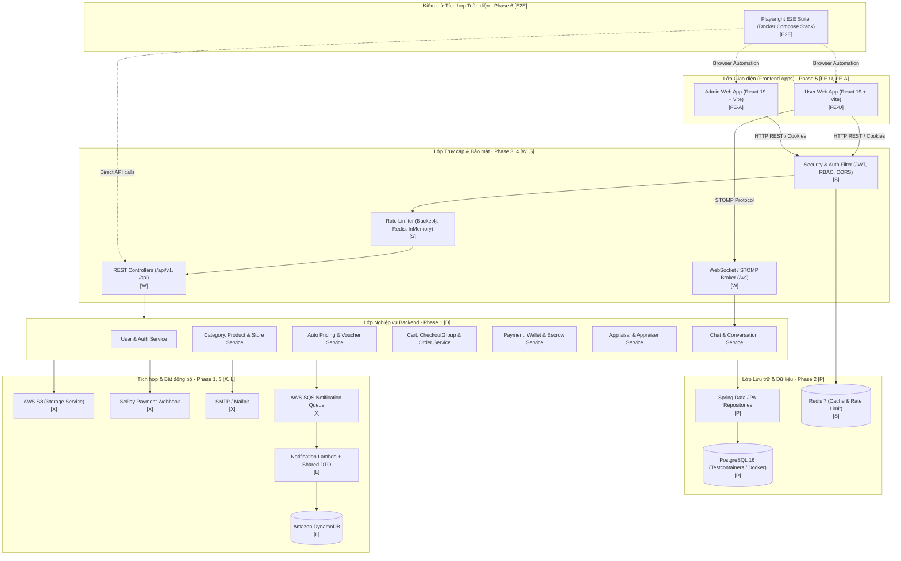

# Kế hoạch kiểm thử toàn diện Moldy-Market

## Sơ đồ cấu trúc hệ thống và bản đồ kiểm thử

### Bản đồ mã hóa nhóm kiểm thử (Test Group Mapping)

| Ký hiệu | Nhóm kiểm thử | Thành phần hệ thống tương ứng | Công cụ chính |
| :--- | :--- | :--- | :--- |
| **D** | Domain / Unit Test | Tầng Service, Helper, Mapper, Validator | JUnit 5, Mockito, AssertJ |
| **S** | Security / Auth Test | JwtAuthenticationFilter, RBAC, RateLimiter, CORS | JUnit 5, MockMvc, Spring Security Test |
| **P** | Persistence Test | Entities, JPA Repositories, Constraints, Schema | @DataJpaTest, Testcontainers PostgreSQL 16 |
| **W** | Web API Test | REST Controllers, ExceptionHandler, Request/Response | @WebMvcTest, MockMvc, @SpringBootTest |
| **X** | External Adapters | S3 File Storage, SePay Webhook, Mailer, SQS Event | Mockito, WireMock, Mock Webhook |
| **L** | Serverless / Lambda | Notification Lambda, DynamoDbService, SES, SNS | JUnit 5, AWS SDK Mock |
| **FE-U** | Frontend User Test | User App: Hooks, Pages, Schemas, Services, Components | Vitest, React Testing Library, MSW |
| **FE-A** | Frontend Admin Test | Admin App: Components, Guards, Services, Dashboard | Vitest, React Testing Library, MSW |
| **E2E** | End-to-End System | Toàn bộ stack: Backend + DB + Frontends | Playwright, Docker Compose |

---

## Phase 0 · Khảo sát & Kế hoạch (Baseline)

- [x] **Khảo sát mã nguồn Backend**: Đọc toàn bộ 373 file Java trong 3 build Maven (`moldyMarket` root, `shared`, `notification-lambda`).
- [x] **Khảo sát mã nguồn Frontend**: Đọc cấu trúc 2 repo ReactJS (`Moldy-Market-User-Frontend` và `Moldy-Market-Admin-Frontend`).
- [x] **Vẽ sơ đồ cấu trúc hệ thống**: Thể hiện đầy đủ các layer, luồng dữ liệu, dependency và liên kết nhóm test.
- [x] **Đánh giá hiện trạng test & đo lường baseline**:
  - Backend Unit: 30 tests pass (`DepreciationFactorHelperTest`: 15, `PricingCalculationHelperTest`: 8, `AuthControllerTest`: 7).
  - Backend Context/Integration: 2 tests fail trong `MoldyMarketApplicationTests` do phụ thuộc DB local mà thiếu Testcontainers harness ([QA-005](FINDINGS.md#qa-005--context-test-phụ-thuộc-cấu-hình-môi-trường-và-database)).
  - Frontend User App: 21 test files, 150 tests pass (`vitest run`).
  - Frontend Admin App: 0 test files (cấu hình `passWithNoTests: true`, [QA-008](FINDINGS.md#qa-008--admin-ci-có-thể-xanh-với-0-test)).
  - Shared / Lambda: 0 test files.
- [x] **Cài đặt công cụ kiểm thử**:
  - Đã thêm `spring-boot-testcontainers`, `testcontainers-junit-jupiter`, `testcontainers-postgresql` vào `pom.xml` (scope `test`).
  - Test compile thành công (`BUILD SUCCESS`).
- [x] **Ghi nhận khiếm khuyết & rủi ro ban đầu**: Ghi đầy đủ các phát hiện vào [FINDINGS.md](FINDINGS.md) (QA-001 -> QA-009).
- [x] **Xây dựng checklist chi tiết cho Phase 1 -> Phase 7**.

---

## Phase 1 · Backend: Unit test (Service / Util / Mapper / Validator)

> **Nguyên tắc**: Sử dụng JUnit 5 + Mockito + AssertJ. Chạy test sau mỗi module. Đặt tên test `should_<kết quả>_when_<điều kiện>`, tuân thủ Arrange-Act-Assert. Không gọi DB thật hay network thật.

### Module 1.1: Auth & User (`com.moldy.moldymarket.user`, `security`)
- [ ] `AuthenticationService`
  - [ ] Happy path: Đăng ký user mới thành công, mã hóa mật khẩu, gán role mặc định `ROLE_USER`.
  - [ ] Happy path: Đăng nhập thành công trả về access token & refresh token.
  - [ ] Input không hợp lệ: Email rỗng, sai định dạng regex, mật khẩu không đủ độ dài.
  - [ ] Không tìm thấy dữ liệu: Đăng nhập với email chưa từng đăng ký (ném `AppException(USER_NOT_FOUND)` hoặc `INVALID_CREDENTIALS`).
  - [ ] Sai mật khẩu: Đăng nhập sai mật khẩu (ném `INVALID_CREDENTIALS`).
  - [ ] Trùng dữ liệu: Đăng ký trùng email đã tồn tại (ném `USER_ALREADY_EXISTS`).
  - [ ] Trạng thái tài khoản: Đăng nhập khi tài khoản bị khóa / `INACTIVE` (ném lỗi không cho phép).
  - [ ] Concurrency/Rate limit: Đăng nhập vượt quá số lần cho phép (ném `RateLimitExceededException`).
- [ ] `UserService`
  - [ ] Happy path: Lấy thông tin profile người dùng hiện tại theo ID.
  - [ ] Happy path: Cập nhật thông tin profile (fullName, avatar, phone).
  - [ ] Happy path: Đổi mật khẩu thành công khi khớp mật khẩu cũ.
  - [ ] Sai dữ liệu: Đổi mật khẩu khi mật khẩu cũ không chính xác.
  - [ ] Phân quyền: Cập nhật trạng thái người dùng (chỉ thực hiện khi có quyền Admin).
- [ ] `RefreshTokenService` & `JwtService`
  - [ ] Happy path: Tạo token, trích xuất claims, kiểm tra token hợp lệ.
  - [ ] Hết hạn: Kiểm tra token hết hạn (ném ngoại lệ tương ứng).
  - [ ] Xoay vòng (Rotation): Refresh token được thu hồi và cấp cặp token mới khi sử dụng.
  - [ ] Tái sử dụng token cũ (Reuse detection): Phát hiện refresh token cũ bị dùng lại -> vô hiệu hóa toàn bộ session của user.
- [ ] `CustomUserDetailsService`
  - [ ] Load user by username thành công và mapping đầy đủ danh sách Authorities / Roles.
  - [ ] Ném ngoại lệ khi không tìm thấy username.

### Module 1.2: Category, Product & Store (`com.moldy.moldymarket.category`, `product`, `store`)
- [ ] `CategoryService`
  - [ ] Happy path: Lấy cây danh mục active dạng phân cấp cha-con.
  - [ ] Happy path: Tạo mới danh mục (gán parent ID hợp lệ, tính toán level).
  - [ ] Ràng buộc: Không cho phép xoá hoặc deactivate danh mục cha nếu còn danh mục con hoặc sản phẩm active.
  - [ ] Duplicate: Không tạo danh mục trùng tên trong cùng cấp.
- [ ] `ProductService` & `ProductSearchService`
  - [ ] Happy path: Tạo sản phẩm listing mới (gán sellerId, storeId nếu có, status `PENDING`/`ACTIVE`).
  - [ ] Validation: Kiểm tra thuộc tính sản phẩm theo danh mục (`ProductAttributesValidator`).
  - [ ] Phân quyền/Sở hữu: Chỉ chủ sở hữu (seller) hoặc Admin mới có quyền sửa/ẩn/xóa sản phẩm.
  - [ ] Chuyển đổi trạng thái: Kiểm tra state machine của Product (`DRAFT` -> `ACTIVE` -> `RESERVED` -> `SOLD` -> `ARCHIVED`).
  - [ ] Search & Filter: Chuẩn hóa từ khóa tìm kiếm (`SearchTextNormalizer`), lọc khoảng giá min/max, category ID.
- [ ] `StoreService` & `StoreStaffService`
  - [ ] Happy path: Đăng ký mở store mới cho người dùng.
  - [ ] Quota & Trùng lặp: Mỗi user chỉ sở hữu tối đa số lượng store quy định; tên store không trùng lặp.
  - [ ] Staff & Phân quyền: Thêm staff vào store, cập nhật quyền hạn của staff (`StoreAccessGuard`).
  - [ ] IDOR: Staff không thể thao tác trên store mà mình không trực thuộc.

### Module 1.3: Pricing & Voucher (`com.moldy.moldymarket.pricing`, `voucher`)
- [ ] `AutoPricingService` & `PricingCalculationHelper`
  - [ ] Happy path: Tính toán khoảng giá đề xuất dựa trên giá mua ban đầu, tuổi thọ sản phẩm và hệ số hao mòn.
  - [ ] Edge cases: Tuổi thọ = 0, tình trạng sản phẩm mới 100%, bảo hành còn hạn / hết hạn.
  - [ ] Biên số: Làm tròn giá trị tiền tệ VND hợp lý, không âm.
- [ ] `ReferencePriceService`
  - [ ] Tra cứu giá tham chiếu theo danh mục và tình trạng.
  - [ ] Fallback khi danh mục con chưa có đủ dữ liệu lịch sử giá.
- [ ] `VoucherService`
  - [ ] Happy path: Áp dụng voucher phần trăm (có giới hạn max discount).
  - [ ] Happy path: Áp dụng voucher số tiền cố định.
  - [ ] Ràng buộc giá trị đơn tối thiểu: Không áp dụng khi tổng tiền đơn hàng nhỏ hơn `minOrderValue`.
  - [ ] Ràng buộc thời gian: Voucher chưa đến ngày bắt đầu hoặc đã quá hạn sử dụng.
  - [ ] Ràng buộc số lượng: Voucher đã hết lượt sử dụng tổng thể hoặc user đã dùng hết quota cá nhân.

### Module 1.4: Cart, Checkout & Order (`com.moldy.moldymarket.cart`, `order`)
- [ ] `CartService`
  - [ ] Happy path: Thêm sản phẩm vào giỏ, tăng số lượng nếu đã có.
  - [ ] Ràng buộc: Không cho phép thêm chính sản phẩm của mình (seller mua đồ của seller).
  - [ ] Không cho phép thêm sản phẩm đã bán (`SOLD`) hoặc không khả dụng.
  - [ ] Xóa item khỏi giỏ và tính toán lại CartSummary.
- [ ] `CheckoutGroupService` & `OrderService`
  - [ ] Nhóm đơn: Tách đơn hàng theo từng Store / Seller riêng biệt (`OrderGroupKey`).
  - [ ] Tính toán tổng tiền: Tổng tiền hàng, phí ship, giảm giá voucher, tổng thanh toán.
  - [ ] Trạng thái đơn: Luồng chuyển trạng thái đơn hàng (`PENDING` -> `CONFIRMED` -> `SHIPPING` -> `DELIVERED` -> `COMPLETED` / `CANCELLED`).
  - [ ] Hủy đơn: Chỉ buyer hoặc seller mới có quyền hủy đơn trong trạng thái hợp lệ.

### Module 1.5: Payment & Wallet (`com.moldy.moldymarket.payment`, `wallet`)
- [ ] `PaymentService` & `PaymentTransactionService`
  - [ ] Happy path: Tạo payment request với phương thức chuyển khoản SePay / Escrow.
  - [ ] Khớp giao dịch (Reconciliation): Khớp giao dịch chuyển khoản vào dựa trên nội dung chuyển khoản và số tiền chính xác.
  - [ ] Xử lý sai lệch: Chuyển khoản thiếu tiền / thừa tiền / sai cú pháp mã giao dịch.
  - [ ] Idempotency: Không xử lý lặp lại webhook cho cùng một transaction ID đã thành công.
- [ ] `WalletService` & `EscrowService`
  - [ ] Giữ tiền bảo chứng (Escrow Hold): Giữ tiền của buyer vào ví escrow khi thanh toán đơn hàng.
  - [ ] Giải phóng tiền (Release Escrow): Chuyển tiền từ escrow sang ví khả dụng của seller khi đơn hoàn tất.
  - [ ] Hoàn tiền (Refund): Hoàn trả tiền escrow về cho buyer khi hủy đơn hoặc phân xử dispute thành công.
  - [ ] Bất biến số dư: `balance = availableBalance + lockedBalance`, không bao giờ được âm.
- [ ] `WithdrawalService`
  - [ ] Tạo yêu cầu rút tiền: Trừ số dư khả dụng, tăng số dư đóng băng.
  - [ ] Duyệt rút tiền: Admin duyệt rút tiền, gọi `PayoutService`, trừ số dư đóng băng.
  - [ ] Từ chối / Thất bại: Hoàn tiền đóng băng về số dư khả dụng, ghi nhận lý do. Fix/kiểm chứng bug [QA-002](FINDINGS.md#qa-002--hoàn-tiền-rút-sai-khóa-ví-và-rủi-ro-trạng-thái-đồng-thời).

### Module 1.6: Appraisal, Chat & Notification (`com.moldy.moldymarket.appraisal`, `chat`, `notification`, `lambda`)
- [ ] `AppraiserService` & `AppraiserApplicationService`
  - [ ] Đăng ký thẩm định viên, Admin duyệt / từ chối hồ sơ kèm lý do.
  - [ ] Phân công thẩm định (`AppraisalAssignmentService`), gửi lời mời và quản lý hạn phản hồi.
  - [ ] Nộp báo cáo thẩm định (`AppraisalReportService`), tính hoa hồng thẩm định viên (`AppraiserCommissionService`).
- [ ] `ConversationService` & `MessageService`
  - [ ] Tạo hội thoại giữa buyer và seller gắn với listing sản phẩm.
  - [ ] Phân quyền IDOR: Chỉ thành viên tham gia hội thoại mới được xem/gửi tin nhắn.
- [ ] Notification Lambda & Storage (`notification-lambda`, `common.storage`)
  - [ ] `S3FileStorageService`: Tạo presigned URL cho upload, validate MIME type và kích thước file.
  - [ ] Lambda `NotificationHandler`: Parse SQS record, lưu vào DynamoDB, gửi email qua SES / SMS qua SNS.

---

## Phase 2 · Backend: Repository / Persistence test

> **Nguyên tắc**: `@DataJpaTest` kết hợp `@ServiceConnection` với **Testcontainers PostgreSQL 16**. Kiểm tra tính toàn vẹn dữ liệu, ràng buộc DB thật, query tự viết, và không dùng H2 thay thế.

- [ ] **Khởi tạo Schema & Idempotency**
  - [ ] Khởi chạy schema sạch từ database rỗng hoàn toàn.
  - [ ] Xác minh toàn bộ các initializers (`CategoryInitializer`, `RoleInitializer`, `PermissionInitializer`, `DatabaseConstraintInitializer`, `SearchIndexInitializer`) chạy thành công không sinh lỗi.
  - [ ] Kiểm tra lỗi DDL index của entity Payment: xác minh cột index `(status, expired_at)` ([QA-003](FINDINGS.md#qa-003--ddl-payment-tham-chiếu-tên-cột-sai)).
- [ ] **Kiểm tra Ràng buộc thực thể (Entity Constraints)**
  - [ ] User: Ràng buộc unique email, not-null các trường bắt buộc.
  - [ ] Product & Store: Khóa ngoại trỏ về Category, Seller, Store; cascading rules khi xóa.
  - [ ] Order & Payment: Ràng buộc số tiền dương, trạng thái hợp lệ.
  - [ ] Wallet: Khóa ngoại 1-1 giữa User và Wallet, không cho phép 1 user có 2 ví chính.
- [ ] **Custom Queries & Pagination**
  - [ ] `ProductSearchRepository`: Truy vấn tìm kiếm sản phẩm với Full-text search / pg_trgm, kết hợp JSON attributes và phân trang.
  - [ ] `CategoryRepository`: Truy vấn đệ quy cây danh mục theo level và status.
  - [ ] `WalletRepository` & `EscrowHoldRepository`: Truy vấn khóa bi quan (`PESSIMISTIC_WRITE` / `findByIdForUpdate`) để tránh race condition.
- [ ] **Giao dịch & Rollback thực tế**
  - [ ] Kiểm tra rollback trong luồng Checkout và Tạo đơn: Nếu bước ghi vào OrderItem hoặc Payment thất bại, toàn bộ đơn hàng phải được rollback sạch sẽ.
- [ ] **Kiểm soát N+1 Queries**
  - [ ] Đo lường số lượng SQL query khi tải danh sách sản phẩm kèm Store và Category (sử dụng Fetch Join / EntityGraph).
  - [ ] Đo lường query khi tải chi tiết đơn hàng kèm danh sách item.

---

## Phase 3 · Backend: Web layer / API test

> **Nguyên tắc**: Sử dụng `@WebMvcTest` + MockMvc cho từng Controller cô lập; tiếp theo sử dụng `@SpringBootTest(webEnvironment = RANDOM_PORT)` + Testcontainers cho Integration E2E xuyên suốt qua HTTP.

- [ ] **Ma trận Phân quyền & Endpoint (Role x Endpoint Matrix)**
  - [ ] Public endpoints: `/api/v1/auth/login`, `/api/v1/categories`, `/api/v1/products/search` truy cập được mà không cần token.
  - [ ] Authenticated endpoints: Bắt buộc Bearer JWT token hợp lệ, trả về 401 Unauthorized khi thiếu hoặc token sai.
  - [ ] Role-based access control:
    - User thường gọi endpoint Admin (`/api/v1/admin/**`) -> nhận 403 Forbidden.
    - User thường gọi endpoint Staff (`/api/v1/stores/{id}/staff/**`) -> nhận 403 Forbidden nếu không thuộc store.
    - Appraiser endpoints -> chỉ tài khoản có role `ROLE_APPRAISER` mới được phép thao tác.
- [ ] **Authentication & Token Lifecycle HTTP Contract**
  - [ ] Đăng nhập thành công trả về `accessToken` trong JSON body và `moldy_refresh` trong HttpOnly cookie.
  - [ ] Cookie mang đầy đủ cờ bảo mật: `HttpOnly`, `Secure`, `SameSite=Strict`, `Path=/api/v1/auth`.
  - [ ] Endpoint `/api/v1/auth/refresh` đọc cookie và sinh cặp token mới (Xoay vòng).
  - [ ] Endpoint `/api/v1/auth/logout` xóa cookie refresh token và thu hồi token trong hệ thống.
- [ ] **Validation & Error Envelope Thống nhất**
  - [ ] Kiểm tra lỗi validate Request Body (DTO `@Valid` / `@NotNull` / `@Size`...) -> trả về HTTP 400 cùng cấu trúc lỗi chuẩn `ApiError` (`code`, `message`, `fieldErrors`).
  - [ ] Kiểm tra xử lý ngoại lệ nghiệp vụ (`AppException`) -> mã lỗi tương ứng (404 Not Found, 409 Conflict...).
- [ ] **Tải file & Webhook tích hợp**
  - [ ] Controller cấp presigned URL tải file: kiểm tra validate metadata và quyền hạn upload.
  - [ ] Webhook SePay: Kiểm tra xác thực chữ ký webhook (`SePayWebhookVerifier`), chấp nhận payload hợp lệ và từ chối payload giả mạo chữ ký.
- [ ] **Luồng tích hợp nghiệp vụ End-to-End qua HTTP**
  - [ ] Luồng 1: Đăng ký -> Đăng nhập -> Lấy profile -> Đổi mật khẩu.
  - [ ] Luồng 2: Mở Store -> Tạo sản phẩm -> Cập nhật sản phẩm -> Tìm kiếm sản phẩm.
  - [ ] Luồng 3: Buyer thêm vào giỏ -> Checkout Group -> Khởi tạo thanh toán -> Giả lập Webhook thanh toán thành công -> Đơn hàng chuyển sang `CONFIRMED`.

---

## Phase 4 · Backend: Security & Non-functional

- [ ] **Kiểm tra truy cập chéo dữ liệu (IDOR - Insecure Direct Object References)**
  - [ ] User A không thể xem / sửa đơn hàng của User B bằng cách thay đổi `orderId`.
  - [ ] User A không thể xem số dư / tạo yêu cầu rút tiền từ ví của User B bằng cách truyền `userId` của B ([QA-001](FINDINGS.md#qa-001--wallet-withdrawal-và-escrow-thiếu-kiểm-soát-quyền)).
  - [ ] User A không thể đọc tin nhắn trong cuộc hội thoại chat giữa User B và User C.
- [ ] **Mass Assignment & Data Injection**
  - [ ] Thử inject các trường nhạy cảm (`role`, `status`, `balance`, `isVerified`) vào DTO cập nhật profile hoặc tạo store -> kiểm tra các trường này bị bỏ qua.
  - [ ] Payload injection vào bộ lọc và tìm kiếm sản phẩm: kiểm tra an toàn trước SQL injection / HQL injection.
  - [ ] Payload XSS trong mô tả sản phẩm và tin nhắn chat: kiểm tra mã hóa và sanitize đầu ra.
- [ ] **Bảo mật Hạ tầng & Transport**
  - [ ] CORS Preflight: Kiểm tra CORS headers với origin đáng tin cậy, hỗ trợ header `X-Moldy-Auth` và `Allow-Credentials=true` ([QA-004](FINDINGS.md#qa-004--auth-cookie-không-qua-được-cors-khi-frontend-gọi-khác-origin)).
  - [ ] Rate Limiting: Kiểm tra `InMemoryRateLimiter` và `RedisRateLimiter` kích hoạt HTTP 429 Too Many Requests khi request vượt ngưỡng.
- [ ] **Đồng thời & Race Conditions (Concurrency Tests)**
  - [ ] Race condition trừ tồn kho / mua hàng: Hai buyer cùng bấm mua sản phẩm số lượng 1 duy nhất cùng 1 thời điểm -> đúng 1 buyer thành công, buyer còn lại nhận thông báo lỗi, không âm tồn kho.
  - [ ] Race condition rút tiền ví: Hai request rút tiền đồng thời từ cùng 1 ví -> tổng tiền rút không vượt quá số dư khả dụng thực tế.
  - [ ] Webhook trùng lặp (Duplicate Webhook): Gửi đồng thời 2 webhook giống hệt nhau cho cùng 1 giao dịch -> chỉ 1 giao dịch được cộng tiền, không nhân đôi số dư.
- [ ] **Baseline Hiệu năng (Smoke Performance)**
  - [ ] Đo lường độ trễ (latency p50/p95/p99) của API `/api/v1/products/search` với dữ liệu mẫu.
  - [ ] Đo lường thời gian đáp ứng API `/api/v1/categories` với cây danh mục nhiều cấp.

---

## Phase 5 · Frontend: Unit & Component test

> **Công cụ**: Vitest + React Testing Library + MSW (Mock Service Worker).

### 5.1: Ứng dụng User (`Moldy-Market-User-Frontend`)
- [ ] **API Services & Interceptors**
  - [x] Axios instance, auth headers, token refresh interceptor khi gặp 401 (`authRefreshInterceptor.test.js`).
  - [ ] Mock API với MSW cho các endpoints chính (auth, product, category, cart, order).
- [ ] **Hooks & State Management**
  - [x] Quản lý state đăng nhập, user profile trong Zustand store.
  - [x] React Query hooks: `useCategories`, `useNewestProducts`, `useProductSearch`.
  - [ ] Hook giỏ hàng: Thêm, sửa, xoá item và đồng bộ trạng thái giỏ.
- [ ] **Components & UI States**
  - [x] `ImageWithFallback`, `ProductPrice`, `CategoryGrid`.
  - [ ] Component hiển thị trạng thái: Loading skeleton, Empty state, Error retry banner.
  - [ ] Header/Navbar: Hiển thị đúng menu theo trạng thái khách (Guest) và người dùng đã đăng nhập.
- [ ] **Forms & Validation (Zod + React Hook Form)**
  - [x] `loginSchema`, `createProductSchema`, `editProfileSchema`, `changePasswordSchema`, `openStoreSchema`.
  - [ ] Form submit: Xử lý submit thành công, hiển thị inline error khi server trả về lỗi 400 / 409.
- [ ] **Route Guards & Navigation**
  - [x] 64 test cases routing trong `routes.test.jsx`: Chuyển hướng guest khi vào trang bảo vệ, lưu redirect URL, kiểm tra điều hướng sau login.

### 5.2: Ứng dụng Admin (`Moldy-Market-Admin-Frontend`)
- [ ] **Cấu hình & Test Foundation**
  - [ ] Xoá cờ `passWithNoTests: true` sau khi viết test; thiết lập môi trường test tiêu chuẩn.
- [ ] **Admin Route Guards**
  - [ ] Chặn truy cập nếu chưa đăng nhập -> điều hướng về `/admin/login`.
  - [ ] Chặn truy cập nếu tài khoản không có quyền Admin -> hiển thị trang 403 Forbidden.
- [ ] **Admin Core Components & Management Views**
  - [ ] Dashboard metrics view: Render thẻ thống kê doanh thu, user, listing.
  - [ ] User management table: Danh sách người dùng, phân trang, hành động khóa/mở khóa tài khoản.
  - [ ] Category management: Thêm mới, chỉnh sửa và thay đổi trạng thái danh mục.
  - [ ] Withdrawal approval modal: Hiển thị thông tin yêu cầu rút tiền, xác nhận duyệt hoặc từ chối kèm lý do.
  - [ ] Dispute resolution view: Xem bằng chứng tranh chấp, ra quyết định hoàn tiền hoặc giải phóng escrow.

---

## Phase 6 · E2E: Toàn hệ sinh thái (Playwright)

> **Công cụ**: Playwright runner chạy trên stack Docker Compose hoàn chỉnh (`backend` + `postgres` + `redis` + `user-frontend` + `admin-frontend`).

- [ ] **Cấu hình Môi trường Kiểm thử E2E**
  - [ ] File `docker-compose.test.yml` dựng đầy đủ các service với database sạch và dữ liệu seed khởi tạo.
  - [ ] Cấu hình Playwright: Chạy headless trên Chrome/Firefox, chụp màn hình và quay video trace khi có bước fail.
- [ ] **Kịch bản E2E 1: Luồng Mua bán & Đơn hàng Khách hàng (User Journey)**
  - [ ] Bước 1: Người dùng A đăng ký tài khoản -> Đăng nhập -> Tạo Store -> Đăng bán sản phẩm (listing).
  - [ ] Bước 2: Người dùng B đăng nhập -> Tìm kiếm sản phẩm vừa đăng -> Thêm vào giỏ hàng.
  - [ ] Bước 3: Người dùng B tiến hành Checkout -> Chọn phương thức thanh toán Escrow.
  - [ ] Bước 4: Giả lập xác nhận thanh toán -> Đơn hàng hiển thị trong mục "Chờ giao hàng" của Người bán A.
  - [ ] Bước 5: Người bán A xác nhận gửi hàng -> Người mua B bấm xác nhận đã nhận hàng -> Tiền được giải phóng vào ví Người bán A.
- [ ] **Kịch bản E2E 2: Luồng Quản trị & Phê duyệt (Admin Journey)**
  - [ ] Bước 1: Admin đăng nhập vào Admin Web Portal.
  - [ ] Bước 2: Xem danh sách các hồ sơ đăng ký thẩm định viên (Appraiser) -> Phê duyệt hồ sơ.
  - [ ] Bước 3: Xem danh sách yêu cầu rút tiền của Seller -> Bấm Duyệt yêu cầu rút tiền -> Kiểm tra trạng thái chuyển thành `COMPLETED`.
  - [ ] Bước 4: Khóa một tài khoản vi phạm -> Kiểm tra tài khoản đó bị văng session ngay lập tức ở User App.

---

## Phase 7 · Chuẩn bị CI/CD (GitHub Actions)

- [ ] **Tách bạch Lệnh chạy kiểm thử**
  - [ ] Backend: Lệnh chạy Unit (`mvn test -Dtest="*Test"`), Integration (`mvn verify -Pintegration`), JaCoCo report (`mvn jacoco:report`).
  - [ ] Frontend: `npm test` cho User App và Admin App, `npm run test:coverage`.
  - [ ] E2E: `npx playwright test`.
- [ ] **Báo cáo Coverage (JaCoCo + v8/istanbul)**
  - [ ] Cấu hình JaCoCo plugin xuất báo cáo XML và HTML cho Backend.
  - [ ] Cấu hình Vitest coverage xuất báo cáo lcov/html cho cả 2 Frontend apps.
- [ ] **Thiết kế Workflow GitHub Actions (`.github/workflows/ci.yml`)**
  - [ ] Job 1: `backend-unit` (Chạy nhanh, cache Maven dependencies, không cần Docker).
  - [ ] Job 2: `frontend-unit` (Matrix chạy song song User App và Admin App, cache npm dependencies).
  - [ ] Job 3: `backend-integration` (Khởi chạy Docker runner, chạy Testcontainers PostgreSQL).
  - [ ] Job 4: `e2e-smoke` (Chạy Playwright kiểm tra luồng chính khi các job trước đều pass).
  - [ ] Job 5: `quality-gate` (Tổng hợp coverage, kiểm tra ngưỡng tối thiểu, chặn merge PR nếu test đỏ).
- [ ] **Artifact Upload**
  - [ ] Upload Surefire reports, Vitest reports, JaCoCo HTML, Playwright traces/screenshots khi fail.
- [ ] **Tài liệu hướng dẫn vận hành (`docs/testing/README.md`)**
  - [ ] Hướng dẫn 1 lệnh chạy toàn bộ test local.
  - [ ] Hướng dẫn chạy riêng từng loại test và xử lý sự cố môi trường.
  - [ ] Điểm móc nối sẵn sàng cho luồng CD deploy.

---

## Phụ lục: Danh mục Thành phần Backend đã Khảo sát

- **31 Controllers**: `AuthController`, `UserController`, `CategoryController`, `ProductController`, `StoreController`, `StoreStaffController`, `CartController`, `CheckoutGroupController`, `OrderController`, `PaymentController`, `PaymentTransactionController`, `WalletController`, `WithdrawalController`, `EscrowController`, `AutoPricingController`, `ReferencePriceController`, `VoucherController`, `FileController`, `ChatController`, `ConversationController`, `AppraiserController`, `AdminAppraiserController`, `AppraiserApplicationController`, `AppraisalAssignmentController`, `AppraisalInvitationController`, `AppraisalReportController`, `AppraisalRequestController`, `AppraisalReviewController`, `AppraiserCommissionController`, `NotificationController`, `TestController`.
- **35 Services**: `AuthenticationService`, `UserService`, `RefreshTokenService`, `CategoryService`, `ProductService`, `ProductSearchService`, `StoreService`, `StoreStaffService`, `CartService`, `CheckoutGroupService`, `OrderService`, `PaymentService`, `PaymentTransactionService`, `WalletService`, `WithdrawalService`, `EscrowService`, `AutoPricingService`, `ReferencePriceService`, `VoucherService`, `FileStorageService`, `ConversationService`, `MessageService`, `AppraiserService`, `AppraiserApplicationService`, `AppraisalAssignmentService`, `AppraisalConversationService`, `AppraisalInvitationService`, `AppraisalReportService`, `AppraisalRequestService`, `AppraisalReviewService`, `AppraiserCommissionService`, `NotificationService`, `MockPayoutService`, `SePayWebhookVerifier`, `SePayWebhookProvider`.
- **38 JPA Entities & Repositories tương ứng**.
- **Lambda & Serverless**: Module `notification-lambda` (`NotificationHandler`, `DynamoDbService`, `SesService`, `SnsService`) và module `shared` (`NotificationEvent`, `NotificationType`).
